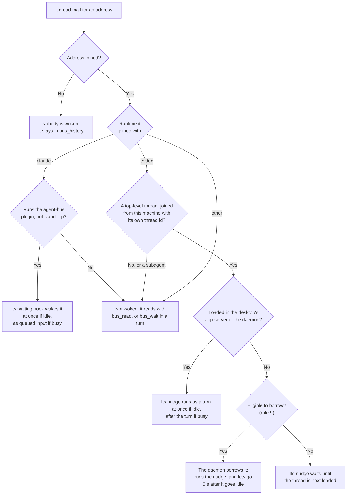
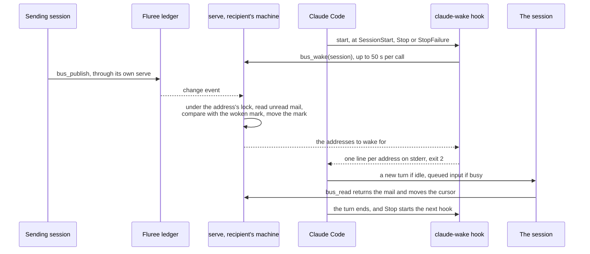
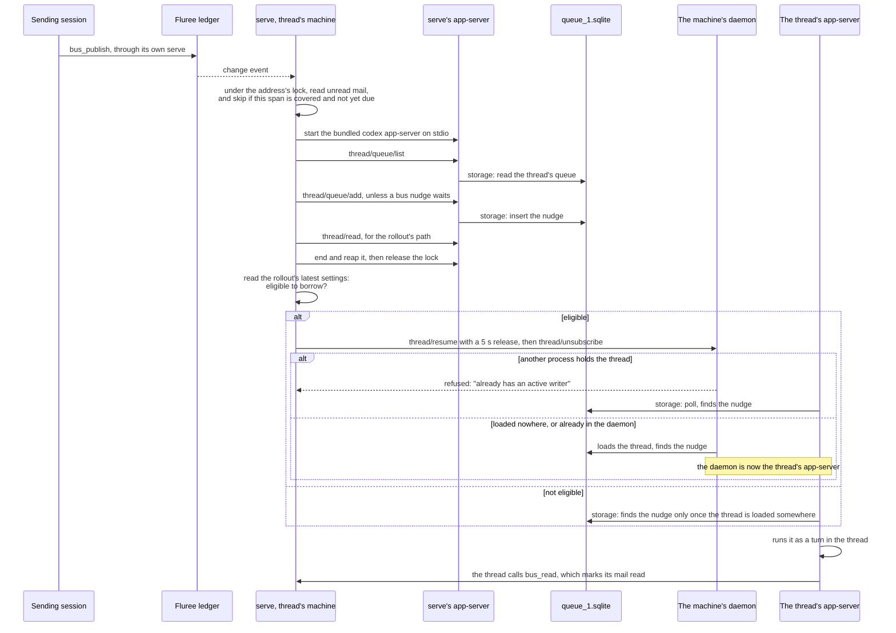
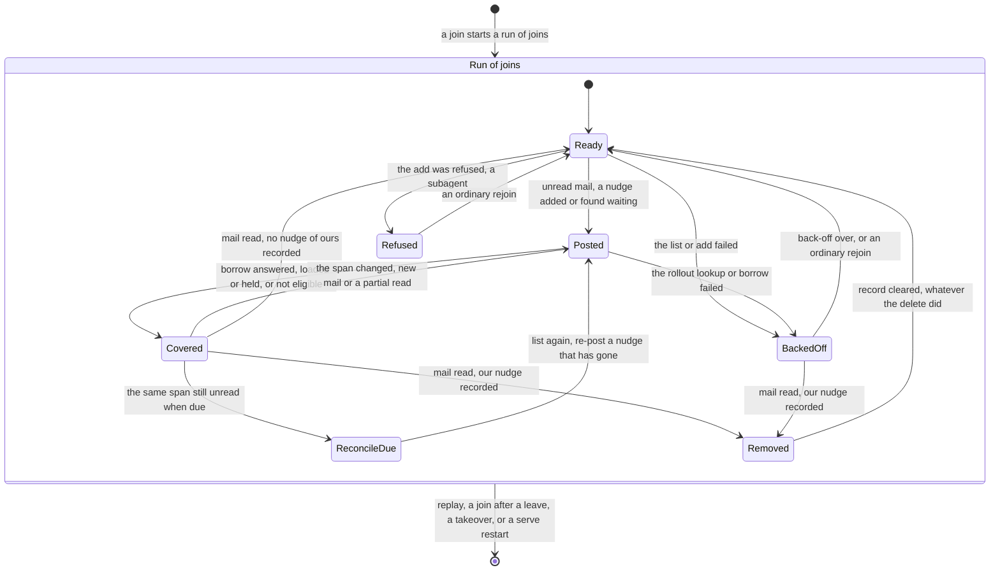

# Delivery: how mail reaches each kind of session

How agent-bus wakes the session that holds an address when the address has unread mail: the Claude Code hook, and the Codex nudge with its borrow, removal, eligibility and reconcile. Addresses, ownership, the ledger and cursors are in [messaging](messaging.md); where each process runs, in [topology](topology.md); what `serve` may touch and what it trusts, in [connections](connections.md); the tools and configuration, in [interfaces](interfaces.md). The Codex and Claude Code behaviour this rests on is in [platforms](../platforms/README.md).

## What it does

### Waking is separate from delivery

A wake is a doorbell. It tells a session that an address it holds has unread mail, with a fixed line that names the address and carries no message text, and the session then reads its mail like any other read. What is delivered is decided by that read, from the address's cursor, under the address's lock ([messaging](messaging.md)). So a wake that is lost, ignored or repeated never loses or duplicates mail (rules 1 to 3).

### Will a session be woken?

Mail is acted on by the `serve` of the machine the address was joined from (rule 4). Addresses and topics decide what is a session's to read; how the session runs decides whether it is woken. The diagram gives the decisions; the table after it, the outcome for each kind of session.

### How each kind of session receives mail

This is the one table of who is woken; other pages link here. "Within seconds" is measured in [platforms: Codex](../platforms/codex.md#the-shared-queue).

| Session | Woken? | How it receives |
| --- | --- | --- |
| Claude Code with the agent-bus plugin, desktop app or terminal | **Yes**, within seconds: at once when idle, as queued input when busy. Not after an interrupted turn whose hook already fired ([limits](#when-a-claude-session-isnt-armed)) | The plugin's hook, armed at session start and at every turn's end, wakes it with a line telling it to call `bus_read`. Its joins return `hooked: true` |
| Claude Code without the plugin | **No** | It calls `bus_read`, or `bus_wait` within a turn |
| `claude -p` | **No**: Claude Code ends async hooks when the run ends | As above |
| Codex desktop Local thread | **Yes**, within seconds while the desktop has it loaded: at once when idle, after the current turn when busy. Once the desktop has let it go, only if it is eligible (rule 9) | A nudge in its queue, run by the desktop; once the desktop has let the thread go, the daemon borrows it to run the nudge, without the desktop app's features |
| Codex `codex` TUI, or a desktop SSH project | **Yes**, within seconds while the daemon has it loaded, with or without a client attached; after the current turn when busy. Once unloaded, or after a daemon stop, only if it is eligible | A nudge in its queue, run by the daemon, which `serve` borrows the thread into again, starting the daemon if it isn't running |
| `codex exec` | **Mail sent after the run exits: yes**, borrowed like any thread loaded nowhere. **Mail sent while it runs: no.** The run may take the nudge and exit mid-turn, which leaves the thread interrupted, so it isn't borrowed until it gets new input ([limits](#for-codex-threads)) | A nudge in its queue. A delegate that is done should `bus_leave`, or reconciles keep waking it |
| A Codex or Claude subagent | **Never directly** | Through its parent. A Codex subagent's queue refuses the nudge (rule 13); a Claude subagent shares its parent's session id, so its mail wakes the parent |
| Any other client | **No** | It calls `bus_read` or `bus_wait` |

### How a message moves

1. A session calls `bus_publish`, directly over MCP or through `agent-bus publish`, and its `serve` appends one entry to the ledger ([messaging](messaging.md)).
2. The ledger's change stream tells every `serve` on every machine: Fluree's event stream, with a 15-second tick merged in and one wake after every reconnect.
3. For each recipient, the `serve` of the machine it joined from acts:
   - **A Claude session:** the hook that its start or its last turn's end started, waiting in `bus_wake`, sees unread mail it hasn't woken the session for. It exits with a wake line, which wakes the session.
   - **A Codex thread:** `serve` adds one nudge to the thread's queue, unless one of its nudges is already waiting. Then it asks the machine's daemon to borrow the thread, if the thread is eligible. Whichever app-server has the thread loaded runs the nudge as a turn.
4. The session reads its mail with `bus_read`, which marks it read and moves the cursor. A refused or failed read moves nothing.

### Claude Code sessions

The agent-bus plugin (`plugin/`) is one manifest with one hook. It runs `agent-bus claude-wake` in the background (`asyncRewake`) at three arming points: `SessionStart` (startup, resume, `/clear` and compaction), `Stop` (every turn's end) and `StopFailure` (a turn ended by an API error).

- **What the hook does.** It calls `bus_wake` with the session id from its input, again and again while each call times out empty. `serve` holds a call until an address the session holds as `claude`, joined from this machine, has unread mail other than what it last woke the session for. The hook then prints one fixed line per address, telling the session to read its mail with `bus_read`, and exits 2. The woken turn's end starts the next hook, so the session runs nothing itself.
- **The woken mark.** For each address, `serve` keeps in memory the join and the span of unread mail, first to newest, that it last woke the session for. New mail or a partial read changes the span and wakes the session again; mail left unread doesn't (rule 5). A rejoin or a takeover changes the join, and a `serve` restart forgets the mark, which costs at most one extra wake per address. A mark moves only with a result that is returned; a call that ends without returning puts its marks back.
- **One hook per session.** A newer `bus_wake` call from the same session ends the older one, and a hook whose session has gone stops (rule 15). A session that holds no address costs one short call at each arming point.
- **`hooked`.** Once `serve` has seen a session's hook, that session's Claude joins return `hooked: true`. `serve` keeps this in memory, so after a restart it returns once the hook calls again.
- **After `/clear`,** the new id holds nothing until it joins again. The hook from before `/clear` keeps waiting under the old id, and fires at most once.
- **The launcher.** The hook runs `~/.local/bin/agent-bus`, the link to the checkout, with `~/.local/bin` and then `~/.bun/bin` put ahead of Claude Code's `PATH`, so it finds `bun` even when Claude Code's `PATH` lacks it. It runs the checkout's code, so a deploy reaches it at once. It reaches `serve` on `AGENT_BUS_PORT`, so it needs the same value as `serve`, or neither set ([interfaces](interfaces.md)).

### Codex threads

Codex threads join with their own thread id (`codexThreadId`, which must equal `session`; [platforms: Codex](../platforms/codex.md#thread-ids-and-codex_thread_id)). When the address has unread mail, `serve` wakes the thread in two acts:
1. **Post.** Under the address's lock, it puts one fixed nudge in the thread's own queue, through a short-lived app-server of its own, and asks where the thread's rollout is.
2. **Borrow.** Outside the lock, it reads the rollout to decide whether the thread is eligible (rule 9), and if it is, asks the machine's daemon to load it. The writer lock decides who runs the nudge: the process already holding the thread, or the daemon.

- **The post.** `serve` lists every page of the thread's queue, and adds the nudge only if no item starts with the nudge's first sentence for that address (rule 6). From its own add it records the ids Codex gave the item (`id` and `clientUserMessageId`) and its exact text, which removal needs (rule 7). The app-server is the desktop app's bundled CLI by default (`serve --codex` names another; [interfaces](interfaces.md)), and is ended, killed if need be, and reaped before the lock is released.
- **Reading eligibility.** No Codex call reports a thread's stored settings without loading it, so `serve` reads them from the thread's rollout, its session file, where a resume reads them: the registered tools and any fork from its first record, the approval policy from the latest settings record, the status from the latest status event, and the permissions and collaboration mode from the latest snapshot the thread wrote itself. It reads the first line, then backwards from the end a chunk at a time. Anything it can't read in time or doesn't recognise is not eligible. An ineligible thread keeps its nudge, and `serve` logs why it isn't borrowed, once per run of joins and again only when the reason changes.
- **The borrow.** `serve` checks that something listens on the daemon's control socket, connects, sends `thread/resume` with `excludeTurns` and `config: {thread_unload_delay_secs: 5}`, then `thread/unsubscribe`, and disconnects (rule 8). The daemon runs whatever waits in the queue, and lets the thread go 5 s after it is idle and unsubscribed; a run of mail keeps it until the run ends. A thread that "is closing" is asked again once, a second later. If nothing listens, `serve` runs `codex app-server daemon start` with the same CLI, then tries once more. A daemon that listens but refuses the connection is left alone, and the attempt backs off. Once a borrow times out, the cycle's other borrows fail at once and back off, so a wedged daemon delays the other peers by one deadline, not one each.
- **Removal.** On a cycle that finds no unread mail and a recorded nudge, `serve` lists the queue through a short-lived app-server, under the address's lock, and deletes the item only if it still has the recorded ids and exactly the recorded text (rule 7). It forgets the record whatever happened, and logs the outcome at debug level.
- **No approval needed.** The bus's tools say they are safe, so Codex lets a thread join, read and answer in any sandbox; only `bus_takeover` asks outside full access ([connections](connections.md#approval-in-codex)).

#### A Codex address's wake state

`serve` keeps what it knows about each Codex address in memory: the unread span the last attempt covered, the nudge it last added, the reason it last logged, and, for the join alone, a subagent refusal and the back-off. It belongs to the current run of joins (rule 11), and a `serve` restart forgets it. A cycle runs on every ledger change and on the 15 s tick.

- **Ready:** nothing covered. The next cycle with unread mail posts.
- **Posted:** a nudge waits for the span. Ours is recorded; one found waiting covers the span but isn't recorded. The borrow follows in the same cycle.
- **Covered:** a nudge waits and the daemon answered the borrow, whether it loaded the thread or another process holds it, or the thread isn't eligible. Nothing more happens for that span until it changes or a reconcile is due (rule 10).
- **Reconcile due:** 5 minutes after the covering attempt, then 15 and 60 minutes after each following one, then hourly. The third logs a warning that says why.
- **Removed:** the mail was read while our recorded nudge waited, so `serve` tried to take it back out (rule 7).
- **Backed off:** an attempt failed. Posting waits 30 s, doubling to 5 minutes; removal doesn't wait (rule 12).
- **Refused:** a subagent's queue refused the add. That join isn't nudged again (rule 13).

### Timing and limits

Every timeout, retry, delay and schedule that the deliverer and the Claude wake use, by its name in code. "Inline" marks a value written in place, with no name of its own.

| Constant | Value | In | What it bounds |
| --- | --- | --- | --- |
| `POLL_INTERVAL` | 15 s | `src/Fluree.ts` | The tick merged into the ledger's change stream. Each tick runs a delivery cycle and a pass of every waiting `bus_wake`. It is what notices a read, which moves a cursor file, not the ledger |
| `RECONNECT_INTERVAL` | 5 s | `src/Fluree.ts` | The pause before reconnecting Fluree's event stream; each reconnection wakes readers once |
| `QUEUE_TIMEOUT` | 2 s | `src/codex.ts` | Each request to `serve`'s own app-server: `initialize`, each list page, `add`, `delete` and `thread/read` |
| `NUDGE_TIMEOUT` | 6 s | `src/codex.ts` | A whole post (start, list, add, `thread/read`) or a whole removal, under the address's lock |
| inline | 500 ms | `src/codex.ts` (`appServer`) | How long `serve`'s app-server has to exit after its input ends, before it is killed |
| `MAX_PAGES` | 20 | `src/codex.ts` | Queue pages listed before the listing fails. Each page asks for 100 items (inline) |
| `READ_TIMEOUT` | 5 s | `src/rollout.ts` | Reading a rollout for eligibility, outside the lock. A slower read is not eligible |
| `MAX_FIRST_LINE` | 8 MiB | `src/rollout.ts` | The longest first record read; a longer one is not eligible. Files are read in 64 KiB chunks (inline, `latestSettings`) |
| `BORROW_TIMEOUT` | 15 s | `src/codex.ts` | Connecting to the daemon, each request on that connection, and the resume with its one retry |
| `START_TIMEOUT` | 10 s | `src/codex.ts` | `codex app-server daemon start`. Added to `BORROW_TIMEOUT`, it is also the whole borrow's deadline: 25 s |
| `CLOSING_RETRY` | 1 s | `src/codex.ts` | The pause before asking again, once, for a thread that "is closing" |
| `UNSUBSCRIBE_TIMEOUT` | 2 s | `src/codex.ts` | `thread/unsubscribe` after the resume. Its failure doesn't fail the borrow |
| `RELEASE_SECONDS` | 5 s | `src/codex.ts` | The borrow's `thread_unload_delay_secs`: how long the daemon keeps the thread once it is idle and unsubscribed |
| `FIRST_RETRY`, `LAST_RETRY` | 30 s, 5 min | `src/codex.ts` | The back-off after a failed attempt: 30 s, doubling with each consecutive failure up to 5 min, counted from the failure |
| `RECONCILE` | 5, 15, 60 min | `src/codex.ts` | The pause after each attempt at the same unread span. The last value repeats, so it is hourly after the third |
| `RECONCILES_BEFORE_WARNING` | 3 | `src/codex.ts` | The reconcile at which the log warns that the thread isn't reading its mail |
| `MAX_WAIT_SECONDS` | 50 s | `src/mcp.ts` | How long one `bus_wake` call waits, and the longest `bus_wait` |
| inline | 55 s | `src/claude.ts` | The hook's deadline for one `bus_wake` call: `MAX_WAIT_SECONDS + 5` |
| `RETRY` | 5 s | `src/claude.ts` | The pause between the hook's failing calls |
| `FAILING_FOR` | 10 min | `src/claude.ts` | How long the hook keeps retrying failing calls before it gives up until the next arming point |
| inline | 65 s | `src/serve.ts` | The HTTP server's `idleTimeout`, `MAX_WAIT_SECONDS + 15`, so a long `bus_wake` or `bus_wait` isn't closed |
| inline | 30 days | `plugin/.claude-plugin/plugin.json` | The hook's `timeout` (2592000 s), after which Claude Code kills it |

## Rules

1. **A wake only signals; the owner's read delivers.** A change in the ledger only wakes readers. Reading from the address's cursor, under its lock, decides what is delivered, and a cursor advances only after a complete read. Only the owning session's read (`bus_read`, or `bus_wait` within a turn) marks its mail read.
2. **A wake carries no text and marks nothing read.** The Claude wake line and the Codex nudge name only the recipient address and tell the session to call `bus_read`. No body, subject or sender from another session enters a session as its owner's input or as the host's own text.
3. **A wake passes over only what isn't mail.** With nothing for a subscriber, a wake moves its cursor past the entries its own read would pass over (presences, its own sends, mail for other addresses), and nothing else.
4. **Each machine wakes only its own joins.** A `serve` wakes only the sessions that joined from its machine (`origin.host`, compared without case or domain), since each machine's queues, threads, daemon and hooks are its own. It doesn't matter which app-server runs a Codex thread: the desktop's or the daemon's, whichever is the writer runs the nudge. It wakes Codex threads that joined as `codex` with their own thread id, by a nudge, and Claude sessions through their hook, for addresses held as `claude`.
5. **Once per change in unread mail.** A session is woken once for each change in an address's unread span, first to newest: new mail or a partial read. Mail left unread doesn't wake it again, except a Codex thread on rule 10's schedule.
6. **One nudge waits per address.** At most one bus nudge waits in a Codex thread's queue for each address, so at most one empty turn follows a read. `serve` lists the whole queue and adds a nudge only when no item starts with that address's nudge sentence. A waiting nudge also covers mail that arrives after it.
7. **`serve` removes only its own nudge.** It records the `id`, `clientUserMessageId` and exact text that Codex answered its own add with; a nudge found waiting isn't recorded, since the owner can queue the same text. Once the address has no unread mail, it lists the queue under the address's lock and deletes the recorded item only if it still has both ids and exactly that text. It never deletes by prefix, adopts a found nudge, or touches any other item, and it forgets the record whatever happened. This is tried once, with failures logged at debug level and not retried. The owner chose this policy, accepting the race in [Limits](#for-codex-threads).
8. **`serve` loads a thread only by a borrow, only to run its nudge.** It starts or steers no turn, waits for none, and passes no permission settings. The only load it asks for is the daemon's borrow: `thread/resume` with `excludeTurns` and a 5 s release, then `thread/unsubscribe`. The writer lock refuses the borrow while another process holds the thread, so a thread never has a second writer.
9. **Only a thread that can't wait on a person, and whose permissions a resume keeps, is borrowed.** Its rollout must show:
   - approval policy `never`, since any other could wait on an approval with nobody to answer, holding the lock;
   - collaboration mode Default, since Plan mode can wait on the user's answer;
   - no tools registered by a client, since a resume restores them and a call to one waits for that client with no deadline;
   - in its own latest snapshot, a built-in permission profile (`:read-only`, `:workspace`, `:danger-full-access`) whose saved form denies no paths, full access, or read-only. A resume compiles a built-in again by name, which drops denials carried over from an earlier profile; it replaces the older `workspace-write` setting with the daemon's default, and a profile from the owner's config too if it no longer compiles;
   - a last turn that wasn't interrupted: a last status event that isn't a `turn_aborted` for `interrupted` or `budget_limited`. A fork by reference with no turn of its own takes its status from its lineage, which its file doesn't hold, so it isn't borrowed.

   Anything unreadable, unrecognised or slower than 5 s to read is not eligible. An ineligible thread still gets its nudge.
10. **Covered mail is reconciled until it is read.** An attempt covers the unread span once a nudge waits and the daemon has answered the borrow, or the thread is ineligible. While that span stays unread, `serve` attempts it again 5 minutes after the attempt that covered it, then 15 and 60 minutes after each following attempt, then hourly: it re-posts a nudge that has gone and borrows again. After the third reconcile it logs a warning that says why. New mail, a partial read, a new run of joins or a `serve` restart starts over.
11. **Wake state belongs to a run of joins.** A run is a join and the ordinary rejoins that renew it, which the ledger records as `rejoinOf`, naming the run's first join ([messaging](messaging.md)). The covered span, the recorded nudge and the logged reason carry over an ordinary rejoin, so a woken thread that calls `bus_join` before reading isn't nudged again for the same mail. A `replay`, a join after a leave, and a takeover start a new run, which is woken afresh. A borrow's result applies only to the run it was for. A subagent refusal and the back-off belong to the join itself, and an ordinary rejoin clears them.
12. **Mail the bus can't wake for is held, never dropped.** A failed Codex attempt (a missing CLI, a thread with no rollout yet, the queue or the daemon not answering) is retried after 30 s, then after a delay that doubles to 5 minutes, with the mail kept unread. The back-off holds off posting, not removal. The Claude hook retries a failing call every 5 s, for up to 10 minutes. A refusal or an unreachable bus ends a CLI command with its message.
13. **A subagent's refused nudge holds that join.** Its mail stays unread for `bus_read`, and it is nudged again only after a rejoin, ordinary or not, or a `serve` restart.
14. **The address's lock bounds the post and the removal.** Joins, leaves, reads, posts and removals for one address run one at a time, so a nudge acts on the subscriber's current state. A post or a removal holds the lock for at most 6 s, and its app-server is ended before the lock is released, so an add that timed out can't land after a takeover. Reading the rollout and the borrow run after the lock is released, so the owner's read never waits on the daemon.
15. **One hook waits per Claude session.** A newer `bus_wake` call from the same session ends the older one, and a hook whose session has gone stops.

## Why

### The Claude wake

- **A hook, not a monitor.** Plugin monitors don't start in stream-json mode, which is how the desktop app runs Claude Code, so a monitor would never wake the sessions the owner works in. An `asyncRewake` hook wakes idle sessions in stream-json mode and in the terminal alike, so the plugin has no monitor: each session has one waiting hook, which the host starts again at each arming point.
- **A wake mark per span, not per message.** Waking again only when the unread span changes means an ignored wake isn't repeated, and a session that read part of its mail is woken for the rest.
- **Rejected: a background `agent-bus wait`.** The model had to restart it after every wake, and a forgotten restart stopped delivery without any sign. `bus_wait` stays as the wait within a turn.
- **Rejected: `serve` posting into the session's inbox socket.** `serve` isn't the session's own child, so a session that bypasses permissions holds the message, and the desktop drops it after five minutes.
- **Rejected: a hook-started watcher posting to that socket.** It would be a long-lived process per session, as the hook is, but would depend on an undocumented frame format and need supervision of its own. `asyncRewake` gives the same wake through a documented exit code.
- **Rejected: channels.** They are terminal only, behind an allowlist or a development flag.

### The Codex wake

- **A nudge in the thread's own queue.** Any app-server can add to a thread's queue without loading it, and whichever app-server has the thread loaded runs the item, so one route reaches idle, busy and unloaded threads alike. A queued item runs as the owner's own input, which is why the nudge carries no sender text (rule 2).
- **A short-lived app-server of `serve`'s own for the post.** The post and the removal need only `thread/queue/list`, `thread/queue/add`, `thread/queue/delete` and `thread/read`, which any app-server serves without loading the thread. So `serve`'s own is never a writer, and posting works even with the daemon down or the thread ineligible; the nudge runs wherever the thread is next loaded. Ending it before the lock is released bounds it (rule 14).
- **The desktop's bundled CLI, with no `PATH` fallback.** The queue methods are experimental, and the bundled CLI is the same build as the desktop that reads the queue ([platforms: Codex](../platforms/codex.md#the-bundled-cli-and-private-app-servers)). `serve` runs under launchd, whose `PATH` has no `codex`, and another CLI's protocol could differ. For daemon threads, the daemon must accept the same protocol.
- **Rejected for the post: the daemon's socket.** Every post would depend on the daemon.
- **Rejected for the post: the desktop's own app-server.** It has no entrance for other processes: its stdio belongs to the app, and driving its windows through the app's coordination socket was dropped untested.
- **Rejected for the post: `thread/queue/start`.** It runs an item only where the thread is already loaded, so `serve`'s app-server would first have to resume the thread and become its writer.
- **Borrowing through the daemon.** Whoever resumes a released thread first becomes its writer for its own unload delay: once, the daemon took a desktop thread that way, and the owner's window was locked out ([platforms: Codex](../platforms/codex.md#the-gap-after-a-thread-is-released)). So agent-bus takes a lock only by a borrow, and a queue add loads nothing. A borrow takes the lock only when no other process holds it, and only for the bus's turns: the daemon lets the thread go 5 s after it is idle and unsubscribed. Without a borrow, a thread loaded nowhere kept its mail until a human opened it.
- **A 5 s release, not 0, and not the global delay.** A release of 0 would race the nudge: Codex fires the unload and the queue dispatch on the same idle event ([platforms: Codex](../platforms/codex.md#the-gap-after-a-thread-is-released)). A longer one would hold the lock against the owner for no gain. Waking doesn't depend on the global `thread_unload_delay_secs`, since each borrow carries its own release.
- **Eligibility read from the rollout.** No Codex call reports a thread's stored settings without loading it, and a borrow of a thread that could wait on a person would hold the lock with nobody to answer. Failing closed leaves an unrecognised thread as it would be without borrowing.
- **Interrupted threads aren't borrowed.** Codex runs no queued input for them, so a borrow would load the thread, run nothing and let it go. `thread/queue/start` would bypass that, but it would have the bus start a turn the owner just stopped (rule 8). An errored turn doesn't stop the queue, so it isn't treated as interrupted.
- **Removal by recorded ids and exact text.** Owner input can quote the nudge's header or be our text word for word, so neither a prefix nor a found nudge proves authorship. Removing from the read path was rejected, since a read would then have to reach Codex; the 15 s tick is soon enough. The owner accepted the one remaining race, an edit in the short window between list and delete ([platforms: Codex](../platforms/codex.md#the-shared-queue)), to save an empty turn after most mid-turn reads.
- **Reconciling on a schedule.** A borrowed turn can end without reading, and a daemon restart can cut one off. Leaving such mail until a human acted was rejected; the schedule costs at most one extra turn an hour, only for a thread whose mail stays unread.
- **Wake state per run of joins, not per join.** Woken threads often call `bus_join` before reading, against the nudge's wording, and per join each rejoin queued a second nudge that ran empty.
- **The owner's threads stay Local.** The first fix for the writer-lock incident was to move the owner's threads onto the daemon, through an SSH project to the same machine or the `CODEX_APP_SERVER_WS_URL` override. An SSH project loses desktop features, and the override loses at least `codex_app` ([platforms: Codex](../platforms/codex.md#what-desktop-capable-means)), so the owner stays in Local threads, and the bus reaches them through their queue instead.

Rejected and retired Codex routes:

| Alternative | Why not |
| --- | --- |
| The Codex `Stop` hook, reading mail inline at turn end | Once reads needed no approval, the nudge alone reached idle, busy and unloaded threads. The hook only added inline delivery, an empty turn after it, and a hidden failed read |
| The daemon deliverer: `serve` classifying threads at join, resuming them and starting turns | A bus-started turn made the daemon a second writer and locked the owner out of a desktop thread, and it marked mail read before the thread read it |
| The desktop's `threads/wake` link | It can't replace the queue add, since it carries no message, only "run what's queued"; nor the writer's poll, since it fails for a thread another app-server holds, whose own poll runs the item. At most it could complement them for threads loaded nowhere, which the borrow covers instead. It holds a woken thread until the app restarts, which shuts out the daemon and SSH projects ([platforms: Codex](../platforms/codex.md#the-threadswake-link)), and it is private |
| Loading in `serve`'s own app-server, or with `codex exec resume` | The bus would become the turn's writer, tied to a process meant to exit |
| Passing `approvalPolicy: "never"` on the borrow | A resume persists the settings it applies, so it would outlive the borrow |
| Supervising borrowed turns, or a hard time limit on them | Both mean interrupting turns, the steering the bus gave up. Eligibility makes the blocking cases ineligible instead, and eligible turns end on their own |

## Limits

### Shared by both

| Limit | Status |
| --- | --- |
| **Unread mail is re-read on every pass.** Each delivery cycle and each pass of a waiting `bus_wake`, at every ledger change and every 15 s tick, reads each address from its oldest unread entry, however long the mail waits. An in-memory scan mark per join would end it if it starts to cost | Known limit |
| **One `serve` per machine.** Locks, the woken marks and the Codex wake state are per process, and a wake can move a cursor past non-mail. A second `serve` on the same ledger and machine could add duplicate nudges or move a cursor back. Checks run extra `serve`s only with a store of their own | Known limit |

### For Codex threads

| Limit | Status |
| --- | --- |
| **The empty-turn bound is per address, not per thread.** A thread that holds two addresses can have two nudges waiting, and so an empty turn if it reads both inboxes in the first one's turn | Known limit |
| **A nudge the writer takes before the next cycle still runs empty,** after a read inside a running turn, whether or not the delete reports success | Known limit |
| **Only a nudge this `serve` added in the current run of joins is removed.** One found waiting (an add whose answer timed out, one from an earlier run, or one from before a `serve` restart) covers the mail but runs once, empty, after a mid-turn read | Known limit |
| **An owner's edit of our nudge** landing in the short window between the list and the delete is deleted with it, since Codex deletes by id with no check on content ([platforms: Codex](../platforms/codex.md#the-shared-queue)). It is the only owner input removal can touch | Accepted risk, chosen by the owner |
| **Removal holds the address's lock** for up to 6 s on the first cycle after a read, so a `bus_read` or `bus_wait` by the same thread can wait that long. The post already does the same | Known limit |
| **A queued item of a shape `serve` doesn't know reads as no text.** If Codex changed the item format, a waiting nudge could go unrecognised and a second be added for the next unread span; the covered span still limits this to one per span. A recorded nudge listed in that shape would read as edited and be left | Known limit |
| **The queue methods (`thread/queue/*`) are experimental.** `serve` uses the desktop's bundled CLI, so protocol and app move together. A change shows as logged errors, and the mail waits unread | Accepted risk |
| **Eligibility depends on Codex's rollout format,** since no Codex call reports the stored settings. A format change makes threads ineligible, with a warning, which leaves them as they were before borrowing. Compressed rollouts (`.jsonl.zst`) aren't found, so they aren't borrowed | Accepted dependency |
| **An administrator's `requirements.toml` can override `never`** with a warning, not an error, so a thread read as `never` could run under another policy ([platforms: Codex](../platforms/codex.md#what-a-resume-restores)) | Accepted risk |
| **Ineligible threads aren't woken while loaded nowhere,** such as sandboxed `on-request` threads and the older `workspace-write`. Their nudge waits until the thread is next loaded | Known limit |
| **An interrupted thread's mail waits** for its next input: Codex runs no queued input after an interrupted turn ([platforms: Codex](../platforms/codex.md#an-interrupted-thread-runs-no-queued-input)), by the owner's Stop, a quit mid-turn, a budget limit, or a `codex exec` run exiting mid-turn. The nudge stays queued and the log says why. After an ordinary rejoin, a nudge consumed and cut off this way is re-posted only at the next reconcile | Known limit of the platform |
| **A borrowed desktop thread shows "open in another app"** in the desktop until 5 s after it goes idle. Opened after that, it opens normally with no Retry | Accepted limit |
| **Borrowed turns run on the daemon,** without the desktop app's tools, and post no desktop notification. A thread that needs desktop tools on an unattended wake has no route that gives both | Known limit (a Codex gap) |
| **Borrowed turns run as the login the daemon started with,** so after a Codex login change they run as the earlier user until the daemon restarts ([platforms: Codex](../platforms/codex.md#the-daemon)) | Known limit: restart the daemon after changing the login ([recover](../runbooks/recover.md)) |
| **A wedged daemon,** whose socket answers but whose requests time out, makes borrows fail and back off with a warning. It needs restarting by hand ([recover](../runbooks/recover.md)) | Known limit |
| **A nudge run on a thread already loaded restarts its holder's idle clock,** so each message can prolong that holder's lock by up to its unload delay ([platforms: Codex](../platforms/codex.md#the-bundled-cli-and-private-app-servers)). A daemon restart or update during a borrow reloads the thread under the global delay, not the borrow's 5 s | Known limit |
| **A borrow can land after a takeover, a rejoin or a leave.** Its result applies only to the run it was for, but it costs one turn in the old thread, whose `bus_read` is refused | Known limit |
| **Whether an edit to the global `thread_unload_delay_secs` applies without restarting the daemon** ([platforms: Codex](../platforms/codex.md#how-long-a-thread-stays-loaded)). Waking doesn't depend on it | Read in code, not tested |
| **Another machine's desktop running a nudge,** and a desktop subagent's add being refused like the daemon's | Unverified |

### When a Claude session isn't armed

| Limit | Status |
| --- | --- |
| **A turn the user interrupts arms nothing.** The previous hook keeps waiting unless it already fired; if it did, no hook waits until the next turn ends or the session restarts | Known limit |
| **A result lost in transit.** If `bus_wake` returns but the hook dies before printing, the mark has moved, so that unread mail doesn't wake the session until it changes. It stays unread and readable | Known limit |
| **Idle longer than 30 days:** the hook's timeout kills it, and nothing wakes the session until its next arming point | Known limit |
| **During an outage** of `serve` or its store, each arming point leaves one hook retrying for up to 10 minutes; after that, nothing waits until the next arming point | Known limit |
| **After `/clear`,** mail to an address the old id held wakes the session once more, through the old hook | Known limit |
| **A `serve` restart forgets the woken marks,** which may wake a session once more per address with unread mail | Known limit |
| **`StopFailure` with `asyncRewake`** is documented by Claude Code but wasn't probed ([platforms: Claude Code](../platforms/claude-code.md#hooks)) | Unverified |

## Rests on

Codex ([platforms: Codex](../platforms/codex.md)):
- [the shared queue](../platforms/codex.md#the-shared-queue): any app-server adds without loading the thread, the writer runs items as turns, queue item ids and `delete`, a subagent's refused add, and the measured times;
- [one writer per thread](../platforms/codex.md#one-writer-per-thread): the writer lock and its refusal;
- [how long a thread stays loaded](../platforms/codex.md#how-long-a-thread-stays-loaded): the unload delay, per request and global;
- [what a resume restores](../platforms/codex.md#what-a-resume-restores) and [a resume with no client](../platforms/codex.md#a-resume-with-no-client): the basis of eligibility and of the borrow;
- [the daemon](../platforms/codex.md#the-daemon): how it starts, outlives its starter and keeps its login;
- [the gap after a thread is released](../platforms/codex.md#the-gap-after-a-thread-is-released): the writer-lock incident, and why the release isn't 0;
- [the bundled CLI and private app-servers](../platforms/codex.md#the-bundled-cli-and-private-app-servers): why a short-lived app-server never meets the writer lock;
- [`codex exec`](../platforms/codex.md#codex-exec), [an interrupted thread runs no queued input](../platforms/codex.md#an-interrupted-thread-runs-no-queued-input) and [persisted status events](../platforms/codex.md#persisted-status-events);
- [approvals for MCP tools](../platforms/codex.md#approvals-for-mcp-tools), [what desktop-capable means](../platforms/codex.md#what-desktop-capable-means) and [the `threads/wake` link](../platforms/codex.md#the-threadswake-link).

Claude Code ([platforms: Claude Code](../platforms/claude-code.md)):
- [how Claude Code runs](../platforms/claude-code.md#how-claude-code-runs): the desktop app's stream-json mode;
- [hooks](../platforms/claude-code.md#hooks): `asyncRewake` waking idle sessions on exit 2, `SessionStart` starting a turn, the `timeout` as a kill deadline, the session id in the input, Claude Code's environment, and `claude -p` ending async hooks;
- [session ids](../platforms/claude-code.md#session-ids): how `/clear`, forks and subagents change or share the id;
- [plugin monitors](../platforms/claude-code.md#plugin-monitors), [the session inbox socket](../platforms/claude-code.md#the-session-inbox-socket) and [channels](../platforms/claude-code.md#channels): the routes rejected in [Why](#the-claude-wake).

Fluree ([platforms: Fluree](../platforms/fluree.md#the-event-stream)): the event stream that signals ledger changes.

## History

The frames that made delivery, indexed with what superseded what in [frames](../frames/README.md):
- **Codex:** [codex-wake](../frames/codex-wake.md) (the writer-lock incident), [queue-wake](../frames/queue-wake.md) (the nudge in the thread's own queue), [one-codex-route](../frames/one-codex-route.md) (one route for every thread), [simplification-pass](../frames/simplification-pass.md) (the `Stop` hook retired), [load-on-mail](../frames/load-on-mail.md) (the borrow, eligibility and reconcile) and [nudge-hygiene](../frames/nudge-hygiene.md) (runs of joins, removal, interrupted threads).
- **Claude Code:** [claude-wake](../frames/claude-wake.md) (the `asyncRewake` hook) and [finish-swap](../frames/finish-swap.md) (the one-manifest plugin, and `wait` removed).
