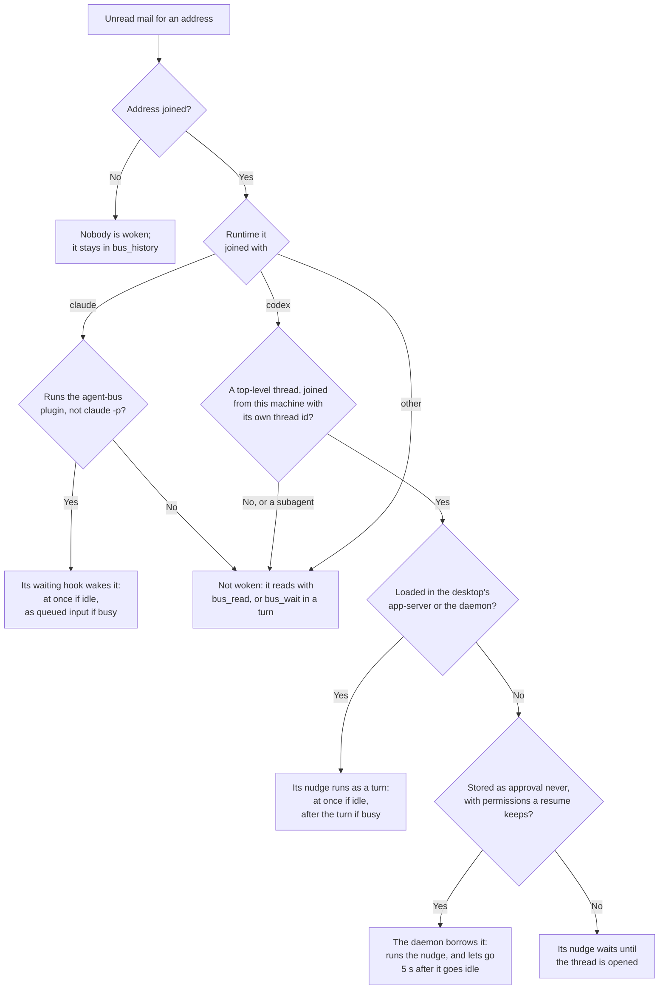
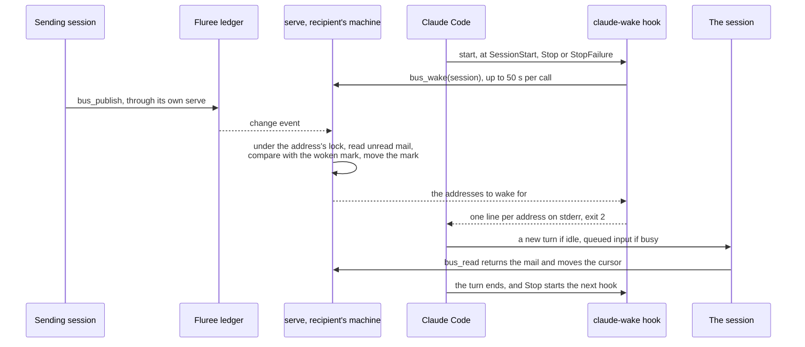
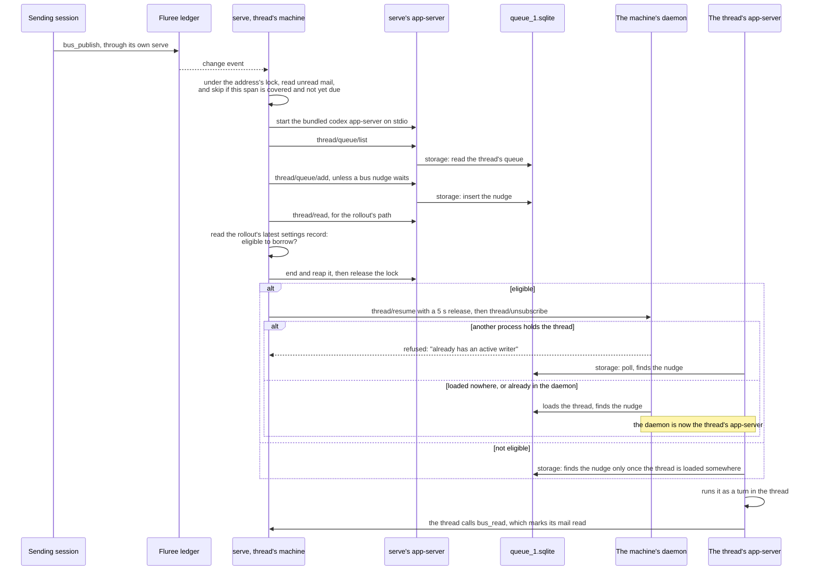

# Delivery: how mail reaches each kind of session

How a message gets from the ledger to the session that owns its address, for each kind of session, and the policies that govern it. Claude Code and Codex each have their own section, with the platform's behaviour first and agent-bus's decisions after it. Platform claims carry their basis and version ([platforms](platforms.md)).

For where the processes run, see [topology](topology.md); for Codex's app-servers and threads, [Codex hosting](codex-hosting.md).

## Waking is separate from delivery

A change in the ledger only signals that something may be waiting. What is delivered is decided by reading from the address's cursor, under that address's lock, and only the owning session's read (`bus_read`, or `bus_wait` within a turn) marks its mail read. A wake may move the cursor past entries that aren't the session's mail, as the session's own read would, and nothing else ([policy 4](#policies-that-govern-delivery)). So a message is delivered once, to whoever owns the address at that moment, within two known limits: a response lost after the read loses that mail for the address, and a takeover from another machine may redeliver ([overview](../overview.md#open-gaps-and-limits)).

Waking is a doorbell on top of that. The bus tells a session that its address has unread mail, with a fixed line that names the address and carries no message text, and the session then reads its mail like any other read. A wake that is lost, ignored or repeated never loses or duplicates mail.

## Will a session be woken?

Mail is acted on by the `serve` of the machine the address was joined from. Addresses and topics decide what is a session's to read; how the session runs decides whether it is woken. The diagram gives the decisions; the table after it, the outcome for each kind of session.

## How each kind of session receives mail

This is the one table of who is woken; the other pages link here. Codex timings are kept in [Codex hosting](codex-hosting.md#the-shared-queue).

| Session | How it receives | Woken? |
| --- | --- | --- |
| Claude Code with the agent-bus plugin, desktop app or terminal | The plugin's hook, which the host starts at session start and at every turn end, wakes it with a line telling it to call `bus_read`. Its joins return `hooked: true` | Yes: in qualification within 1.5–2.6 s when idle, and as queued input when busy ([claude-wake results](../frames/claude-wake.md#results-2026-10-27)). Not after an interrupted turn whose hook had already fired, until the next arming point ([limits](#when-a-claude-session-isnt-armed)) |
| Claude Code without the plugin | Only by calling `bus_read` or `bus_wait` | No |
| `claude -p` | Only by calling `bus_read` or `bus_wait` | No: Claude Code ends async hooks when the run ends |
| Codex desktop Local thread | A nudge in its queue, which the desktop runs as a turn while it has the thread loaded; once it has let go, the daemon borrows the thread to run it | Yes, within seconds while the desktop has the thread loaded: at once when idle, after the current turn when busy ([queue-wake results](../frames/queue-wake.md#qualification-2026-10-27)). Once the desktop has let it go, the daemon borrows it if it is eligible ([load-on-mail](../frames/load-on-mail.md)). The borrowed turn runs without desktop tools, and the desktop shows "open in another app" until 5 s after the thread goes idle |
| Codex `codex` TUI, or a desktop SSH project | A nudge in its queue, which the daemon runs as a turn, with or without the TUI attached | Yes, within seconds while the daemon has the thread loaded, and after the current turn when busy ([one-codex-route](../frames/one-codex-route.md)). After the unload delay with no client, or a daemon stop, the daemon borrows it again if it is eligible, and `serve` starts the daemon if it isn't running |
| `codex exec` | A nudge in its queue. A running `exec` holds the thread's lock but has no queue service, so the nudge waits until the run exits | Yes, once the run has exited, at the next reconcile (5, 15 or 60 minutes, then hourly), if it is eligible. A delegate that is done should `bus_leave`, or it keeps being woken while mail waits |
| A Codex or Claude subagent | Through its parent | Never directly: a Codex subagent's queue refuses the nudge, and a Claude subagent shares its parent's id, so its mail wakes the parent |

## How a message moves

1. A session calls `bus_publish`, directly over MCP or through `agent-bus publish`. Its `serve` checks that the caller owns the sending address, records where it was sent from (machine, directory, Git repo and branch), and appends one entry to the ledger.
2. The ledger's change stream tells every `serve` on every machine. Fluree's event stream does this, with a 15-second poll behind it and a catch-up read after every reconnect.
3. For each recipient, the `serve` of the machine it joined from acts:
   - **A Claude session:** the hook that its start or last turn's end started, waiting in `bus_wake`, sees unread mail it hasn't woken the session for. It exits with a nudge, which wakes the session.
   - **A Codex thread:** `serve` adds one nudge to the thread's queue, unless one of its nudges is already waiting. Then it asks the machine's daemon to load the thread, if the thread is eligible. Whichever app-server has the thread loaded runs the nudge as a turn.
4. The session reads its mail with `bus_read`, which marks it read and moves the cursor. A refused or failed read moves nothing.

## Claude Code sessions

### What Claude Code provides

Verified live on 2026-10-27, on throwaway sessions running Claude Code 2.1.310, in the terminal and in stream-json mode, the way the desktop app runs it ([claude-wake](../frames/claude-wake.md#what-it-rests-on)). The desktop app's installed build is 2.1.308; that it behaves as 2.1.310 did in stream-json mode is extrapolated.
- **The desktop app runs Claude Code in stream-json mode,** as `claude --input-format stream-json --output-format stream-json`, with no terminal (verified live, from the process list).
- **Plugin monitors start in the terminal but not in stream-json mode.** A monitor is a long-running command a plugin declares, and a line it prints wakes an idle session. In the terminal it started about 1 s after the folder was trusted and woke idle sessions; in stream-json mode the plugin loaded but its monitor never ran, in two runs of more than 5 minutes (verified live).
- **`asyncRewake` hooks work in both.** A hook marked `asyncRewake` runs in the background, and when it exits 2, its stderr wakes the session, even an idle one. `Stop` and `SessionStart` hooks, from settings or from a plugin, woke idle stream-json sessions (verified live). A `timeout` of 30 days is accepted (verified live). `StopFailure` with `asyncRewake` is documented but wasn't probed.
- **The hook's input** carries the session's id, equal to its `CLAUDE_CODE_SESSION_ID` (verified live). `/clear` and forks change the id; `--resume` keeps it; subagents share their parent's (verified live).
- **Hooks inherit Claude Code's environment,** not a shell's, so `PATH` may lack `bun` (documented; the hook was checked with the desktop app's `PATH` and with launchd's).
- **`claude -p` ends async hooks** when the run ends (documented).
- **A plugin installed from a marketplace is copied** into Claude Code's cache, not loaded in place (verified live at deploy, [finish-swap](../frames/finish-swap.md)).

### Monitor or hook?

A hook. Plugin monitors don't start in stream-json mode, which is how the desktop app runs Claude Code, so a monitor would never wake the sessions the owner works in. An `asyncRewake` hook wakes idle sessions in stream-json mode and in the terminal alike. So the plugin has no monitor: each session has one waiting hook process, which the host starts again at each arming point.

### What agent-bus does

The agent-bus plugin (`plugin/`) is one manifest. Its hook runs `agent-bus claude-wake` through the `~/.local/bin/agent-bus` link to the checkout, in the background (`asyncRewake`), at three points: `SessionStart` (startup, resume, `/clear` and compaction), `Stop` (every turn's end) and `StopFailure` (a turn ended by an API error).

- **What the hook does.** It calls `bus_wake` with the session id from its input. `serve` holds the call until an address the session holds as `claude`, joined from this machine, has unread mail other than what it last woke the session for. The hook then prints one fixed line per address, telling the session to read its mail with `bus_read`, and exits 2.
- **When the session wakes.** At once when idle, and as queued input when busy. The woken turn's end starts the next hook, so the session runs nothing itself; the limits below are the exceptions.
- **What it marks.** The wake carries no message text and marks nothing read: the session's own read moves its cursor. Like the Codex deliverer, it passes the cursor over entries that aren't the session's mail (presences, its own sends, mail for other addresses), as its read would.
- **Which mail wakes it again.** Each address has an in-memory mark of the unread mail, first to newest, it last woke the session for. New mail or a partial read changes that span and wakes the session again; mail left unread doesn't, so an ignored wake isn't repeated. A rejoin, a takeover or a `serve` restart clears the mark, which costs at most one extra wake per address.
- **One hook waits per session.** A newer `bus_wake` call from the same session ends the older one. A hook whose session has gone stops.
- **Cost and outages.** A session that owns no address costs one short call at each arming point. The hook retries a failing call every 5 s, for up to ten minutes, which covers a `serve` restart or its store being down. A `serve` restart while a hook waits was checked live on 2026-10-27: the next mail woke the session.
- **`hooked`.** Once `serve` has seen a session's hook, that session's Claude joins return `hooked: true`. `serve` keeps this in memory, so after a restart it returns once the hook calls again.
- **After `/clear`,** the new id owns nothing until it joins again. The hook from before `/clear` keeps waiting under the old id, and fires at most once.
- **The launcher.** The hook names `~/.local/bin/agent-bus` and looks for `bun` in `~/.local/bin`, then `~/.bun/bin`, then on Claude Code's `PATH`. It runs the checkout's code with its own dependencies, so a deploy reaches it at once. It needs the same `AGENT_BUS_PORT` as `serve`, or neither set.

#### When a Claude session isn't armed

From the [claude-wake](../frames/claude-wake.md#known-limits) limits:
- **A turn the user interrupts arms nothing.** The previous hook keeps waiting unless it already fired; if it did, no hook waits until the next turn ends or the session restarts.
- **A result lost in transit.** If `bus_wake` returns but the hook dies before printing, the mark has moved, so that unread mail doesn't wake the session until it changes. It stays unread and readable.
- **Idle longer than 30 days:** the hook's timeout kills it, and nothing wakes the session until its next arming point.
- **During an outage** of `serve` or its store, each arming point leaves one hook retrying for up to ten minutes; after that, nothing waits until the next arming point.

Rejected, with reasons in [claude-wake](../frames/claude-wake.md#rejected): a plugin monitor, `serve` posting into each session's inbox socket, and a hook-started watcher posting to that socket.

## Codex threads

### What Codex provides

A thread's queue is shared through `~/.codex`. Any app-server can add to it without loading the thread, and the app-server that has the thread loaded, its only writer, runs a queued item as a turn: at once when idle, after the current turn when busy, and as soon as an app-server loads it if nothing has it loaded. A subagent's queue refuses the add. A load asked of the daemon is refused while another process holds the thread's writer lock. The daemon lets a thread go a set time after it is both idle and unsubscribed, and a load can set that time for itself. [Codex hosting](codex-hosting.md#the-shared-queue) gives the details, with their basis (Codex 0.164).

### What agent-bus does

Codex threads join with their thread id (`codexThreadId`, which must equal `session`). When the address has unread mail, `serve` wakes the thread in two acts ([load-on-mail](../frames/load-on-mail.md)):
1. **Post.** Under the address's lock, it puts one fixed nudge in the thread's own queue, through a short-lived app-server of its own ([why](codex-hosting.md#why-serve-uses-a-short-lived-app-server-of-its-own)), and reads whether the thread may be borrowed.
2. **Load.** Outside the lock, it asks the machine's daemon to load an eligible thread. The writer lock decides who runs the nudge: the process already holding the thread, or the daemon.

- **One nudge waits per address.** `serve` lists the queue first, and adds nothing if one of its nudges for that address is already waiting, since a waiting nudge also covers mail that arrives after it. So when a thread gets its mail some other way first (a read mid-turn, say), it costs at most one empty turn.
- **The borrow.** `serve` connects to the daemon's control socket and sends `thread/resume` with `excludeTurns` and `config: {thread_unload_delay_secs: 5}`, then `thread/unsubscribe`, and disconnects. It starts or steers no turn, and waits for none. The daemon runs whatever waits in the queue, and lets the thread go 5 s after it is idle and unsubscribed; a run of mail keeps it until the run ends. A borrow is refused while another process holds the thread, and that process runs the nudge. A thread "is closing" is asked again once, a second later. The whole borrow has 15 s, plus 10 s when `serve` must first start the daemon (`codex app-server daemon start`, with the CLI it uses for queues).
- **Which threads are borrowed.** Only a thread that can't wait on a person and whose permissions a resume keeps:
  - approval policy `never`, since any other could wait on an approval with nobody to answer, holding the lock;
  - collaboration mode Default, since Plan mode can wait on the user's answer;
  - a built-in permission profile (such as the owner's `:danger-full-access`), full access, or read-only. A resume replaces the older `workspace-write` setting with the daemon's default, and a profile from the owner's config too if it no longer compiles.

  No Codex call reports these settings without loading the thread. So `serve` reads them from the thread's rollout, its session file, where a resume reads them: the approval policy from the latest settings record, and the rest from the latest snapshot the thread wrote itself. Anything it can't read or doesn't recognise is not eligible. An ineligible thread still gets its nudge, and `serve` logs once per join why it isn't borrowed.
- **The unread-span mark, and reconciling.** `serve` remembers in memory the unread mail its last attempt covered. An attempt covers it once a nudge waits and the daemon has answered the borrow, or the thread is ineligible. While that mail stays unread, `serve` attempts it again 5, 15 and 60 minutes later, then hourly, re-posting a nudge that has gone. This covers a borrowed turn that ends without reading, an `exec` that held the lock, and a daemon restart mid-turn. After the third reconcile, it logs a warning. New mail, a partial read, a rejoin or a `serve` restart starts over. A failed borrow leaves the mail uncovered, under the failure back-off. The mail stays unread and readable throughout.
- **No text, nothing marked read.** The nudge names only the recipient address and tells the thread to call `bus_read`, and to end the turn quietly if there is nothing or the address isn't its own. Sender text never enters the thread as its owner's input. Only the thread's own read marks its mail read.
- **No approval needed for the read.** The bus's tools say they are safe, so Codex lets a nudged thread read and answer in any sandbox; only `bus_join` asks outside full access ([connections](../connections.md#approval-in-codex)).
- **Failures** (a missing CLI, no rollout yet, the queue not answering) are retried after 30 s, then after a delay that doubles to five minutes, with the mail kept unread.
- **Subagents.** A subagent's refused add holds that join: its messages stay unread for `bus_read`, and it is tried again only after a rejoin or a `serve` restart.
- **Which machine.** Each machine's `serve` wakes only the Codex peers whose join came from that machine (`origin.host`, compared without case or domain), since each machine's queues, threads and daemon are its own. That machine needs the CLI and a managed daemon package, which `serve` starts if it isn't running.

Within `serve`, joins, leaves, reads and nudges for one address run one at a time, so a nudge acts on the subscriber's current state. The borrow runs after the lock is released, so the owner's read never waits on the daemon. Its result applies only to the join it was for: after a takeover or rejoin, the new join is woken afresh. `serve` starts or steers no turn itself, and the only load it asks for is the daemon's borrow, which the writer lock refuses while another process holds the thread. So a thread never has a second writer ([Codex hosting](codex-hosting.md#one-writer-per-thread)).

## Policies that govern delivery

1. A change notification only wakes readers; reading from the cursor decides delivery. A cursor advances only after a complete read.
2. Each machine's `serve` wakes only the sessions that joined from its machine: Codex threads by a nudge, Claude sessions through their hook, for addresses held as `claude`.
3. A wake carries no text from other sessions and marks nothing read. A session is woken once per change in an address's unread mail, and a Codex thread also on policy 8's schedule. At most one bus nudge waits in a Codex thread's queue per address, so at most one empty turn follows any read.
4. With nothing for a subscriber, a wake moves its cursor past the entries its own read would pass over, and nothing else.
5. A message the bus can't deliver is held, never dropped. The Codex deliverer retries with back-off up to five minutes; the Claude hook retries every 5 s for up to ten minutes. A refusal or an unreachable bus ends a CLI command with its message.
6. A subagent's refused Codex nudge holds that join until a rejoin or a `serve` restart.
7. `serve` loads a Codex thread only to run its own queued nudge, through the machine's daemon, and only a thread stored with approval `never` and permissions a resume keeps. It starts or steers no turn, and the writer lock rules out a second writer.
8. Unread mail that an attempt covered is attempted again 5, 15 and 60 minutes later, then hourly, until it is read or changes.

Identity and ownership, which decide whose read counts, are in the [overview](../overview.md#identity-and-ownership); trust is in [connections](../connections.md).
