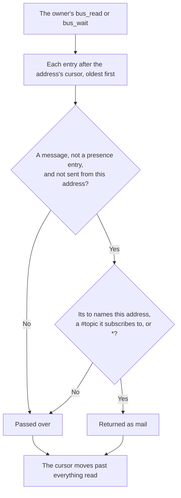

# Messaging: addresses, ownership and the ledger

Who may use an address, how messages are addressed, replied to and read, and how the ledger and cursors record them. Where the processes and stores run is in [topology](topology.md); how a session learns it has mail is in [delivery](delivery.md); each tool and its parameters are in [interfaces](interfaces.md); what the bus trusts is in [connections](connections.md).

## What it does

agent-bus is an append-only ledger with one read cursor per address. It is not a broker that pushes messages over open connections. A session reads its mail when it chooses, and a wake ([delivery](delivery.md)) only tells it that there may be some.

### One ledger, in one order

Everything is an entry in one ledger: messages, and presence entries for joins and leaves. Nothing is changed or deleted. Each entry is one commit on the Fluree transaction server on the bus host, so every machine sees the same order, and a position in the ledger is a commit number.

### Addressing and replies

A message's `to` lists its recipients, each one of:
- **an address,** for that address's owner (point to point);
- **`#topic`,** for every address subscribed to the topic;
- **`*`,** for every joined address.

So topics and `*` fan out, as in pub/sub, but underneath each recipient reads its own inbox on its own cursor. An address never receives a message sent from itself, even through a topic or `*`. Topic membership is checked when the mail is read, against the address's topics at that moment: an address reads a topic's mail only while it subscribes to the topic.

Recipients aren't checked. Mail to an address nobody has joined is written, and stays in `bus_history`. A session that later joins that address starts at the present, so it gets that mail only if it joins with `replay`.

A reply sets `replyTo` to the id of the message it answers. `replyTo` doesn't route: the reply goes to whatever its `to` names, usually the original sender. The ledger links the reply to the answered message, so history and queries can follow a conversation. The bus doesn't check that the id exists.

### Presence: joins and leaves

A join or a leave writes a presence entry. It is addressed to `*`, but it is never delivered as mail. It records the runtime, the status (joined or left), the topics and the owning session, and, when they apply:
- `takeover`, the join it replaced;
- `rejoinOf`, the first join of the run of joins it continues (see the table below);
- `codexThreadId`, the Codex thread to wake;
- `note`, what the session is working on.

For each address, the latest presence with an owner is its state. The addresses whose latest presence is a join are the peers that `bus_peers` lists. A leave clears the address's topics, takes it off the peer list, and stops the bus waking it.

Each machine's `serve` also keeps, in memory, the last call it has seen for each address and how many waits are open on it. A refused join reports them, so the caller can tell a live holder from a dead one.

### Who owns an address

An address belongs to one session, identified by its runtime and the runtime's own id for it. The join fixes both, and every later call presents the id as `session`. One session may hold several addresses. Ownership is recorded in the presence entry, so it survives a `serve` restart. A client whose tool list predates `session` can still pass it as an extra argument, without reconnecting.

An address is in one of five states: free (never joined, or joined only by presences without an owner), held, left, taken over, or replayed. Taken over and replayed are kinds of held: an owner holds the address, and a new run of joins has started. Delivery keeps a Codex thread's wake state for a run of joins, so an ordinary rejoin doesn't wake it again ([delivery](delivery.md)).

| From | Event, and who may cause it | To | The cursor | Run of joins |
| --- | --- | --- | --- | --- |
| Free, or left by another session | `bus_join`, by any session | Held, by the caller | Starts at the present: earlier mail isn't delivered | Starts |
| Left, by the same session | `bus_join`, by that session | Held | Kept on this machine: mail since its last read is still unread. From another machine, it starts at the present ([limits](#limits)) | Starts |
| Held | `bus_join`, by the holder (same runtime and id) | Held | Kept on this machine. From another machine, it starts at the present ([limits](#limits)) | Continues: the presence records `rejoinOf` |
| Held | `bus_join`, by any other session | Held, unchanged: the join is refused | Unchanged | — |
| Held | `bus_takeover` naming the holder's current join id, by another session, only when the human says the holder has ended | Taken over: held by the caller, and the previous holder is refused from then on | Kept, so unread mail carries over ([limits](#limits)) | Starts |
| Any state a join may claim | Any of the joins above, with `replay` | Replayed: held | Moved to the ledger's start, so every message ever for the address is unread | Starts |
| Held | `bus_leave`, by the holder | Left | Kept | Ends |

`bus_takeover` on a free address, or on the caller's own, joins as `bus_join` does: the holder id is checked only while another session holds the address.

### Reading and cursors

Each address has a cursor: how far its owner has read. Only the owner's read consumes mail.
- **`bus_read`** returns the unread mail, oldest first, and moves the cursor past everything it looked at. With a limit, it stops at the last message it returns, and the cursor moves only that far.
- **`bus_wait`** reads the same way. If nothing is waiting, it reads again at each change in the ledger, until mail arrives or its timeout ends.
- **A failed or refused read** moves nothing: the cursor advances only after a complete read.

The wake paths look at unread mail without consuming it. With nothing unread for the address, they move its cursor past entries that aren't its mail, as the owner's read would, and nothing else ([delivery](delivery.md)).

A change in the ledger only wakes readers; reading from the cursor decides what is delivered. Each `serve` has one change stream, shared by every waiter: Fluree's event stream, with a 15-second poll behind it, and one extra wake each time the stream reconnects, since commits may have landed meanwhile.

On Fluree, a cursor is the last commit `t` read. A read is a history query over the entries from the cursor to the head, in windows of 500 commits. Cursors are kept by the `serve` of the machine the address joined from, one file per address, and belong to one incarnation of the ledger (rule 11; [topology](topology.md) gives the path).

Each `serve` has two locks per address. One serializes reads, deliveries and anything else that moves the cursor. The other serializes changes of ownership with sends. A join or a leave takes both, the ownership lock first.

### How an entry is stored

Every entry (`src/domain.ts`) has:
- a time-ordered UUIDv7 `id` and an ISO `ts`;
- `from`, `to` and `kind` (message or presence);
- an optional `subject`, and a `body`;
- an optional `replyTo`;
- an `origin`: the machine, and the session's joined directory with its Git repo and branch, worked out when the entry is written;
- for a presence entry, the presence described above.

Repo and branch are optional metadata for queries. Each `git` call gets 2 seconds, and a field it misses is left out.

In Fluree, each entry is a node `urn:agent-bus:message:<id>`, typed `bus:Message` or `bus:Presence` (`bus:` is `https://rawr.ai/ns/agent-bus#`). Its properties are:
- `bus:id`, `bus:ts` (`xsd:dateTime`), `bus:from`, `bus:to` (one value per recipient), `bus:subject` and `bus:body`;
- `bus:replyTo`, a link to the answered message's node;
- `bus:host`, `bus:cwd`, `bus:repo` and `bus:branch`;
- for presence, `bus:runtime` and `bus:status`;
- `bus:json`, the exact encoded entry, which is what the bus reads back. The rest of a presence (its owning session, topics, `takeover`, `rejoinOf`, `codexThreadId` and note) is only there.

The ledger's config graph enables inline full-text scoring on `bus:body` and `bus:subject`. So `bus_history` ranks stemmed matches (`deploy adapters` finds "Deploying the adapter"), and `bus_query` can rank with `f:fulltext`. A new ledger's text search finds nothing at first ([platforms: Fluree](../platforms/fluree.md#full-text-search)).

## Rules

1. **An address belongs to the session that joined it,** identified by its runtime and that runtime's id: `$CODEX_THREAD_ID` for Codex, `$CLAUDE_CODE_SESSION_ID` for Claude Code, or a stable id of its own for other clients. Every call that acts for the address passes it as `session`. A missing or blank id, or a placeholder that was never expanded (`${…}`, or a value starting with `$`), is refused. A join compares runtime and id, so the same id under another runtime can't join a held address; the later calls compare the id alone, so they accept it under any runtime.
2. **Only the owner may read, wait on, leave or send from the address.** Every refusal changes nothing: not the cursor, the presence or the ledger.
3. **A different session's join is refused** with what the bus knows of the holder: its runtime, machine, join time, note, last call, whether it has a wait open on this machine, and its join id. The policy is to pick another address, not to take the held one.
4. **A takeover (`bus_takeover`, or `agent-bus join --takeover`) must name the holder's current join id,** and is only for replacing a session that has ended, when the human says so. Unread mail carries over to the new owner, and the previous owner is refused from then on.
5. **Rejoining with the same id keeps unread mail,** after a leave too. A new owner of an address that was left starts at the present, so a left address's mail isn't handed to another session. A join with `replay` starts at the ledger's beginning instead, whoever makes it.
6. **The CLI never takes another runtime's id variable.** It presents `--session`, or else the variable of `--runtime` (`$AGENT_BUS_SESSION` for runtimes other than Codex and Claude). Outside `join`, `--runtime` defaults to the runtime the address joined with.
7. **Joins and leaves written without an owner,** by a `serve` from before owners, are ignored.
8. **Ownership is checked under the address's lock at the moment of effect,** so a wait or send that started before a takeover can't act after it.
9. **Topics change only when the caller names them.** A rejoin that names no topics keeps the address's topics; one that names topics replaces them. A leave clears them.
10. **A Codex join's `codexThreadId` must be its own thread id,** the same as `session`, or the join is refused. It is what lets this machine's `serve` wake the thread.
11. **A cursor belongs to one incarnation of the ledger.** Cursors are kept per ledger instance, named by its first commit, so a replacement store starts every subscriber over instead of skipping messages. A cursor ahead of the ledger fails the read rather than skipping.

## Why

### One session per address

Two Claude sessions on one machine once used the same address. One of them sent a request, and the other's background `agent-bus wait` (since retired) consumed the reply, so the session that had asked never saw it. Because reading consumes, two sessions on one address are competing consumers, each getting whatever it reads first. And before owners, any session could send as another's address, so replies went back to the wrong place. Groups have their own mechanism: a `#topic`, where each subscriber has its own address and cursor and gets every message.

### The id as an explicit `session` argument

Identity travels in each call, not in an HTTP header. Claude Code documents its session id only for shells, hooks and stdio MCP subprocesses; `/clear` changes the id while a connection's headers stay fixed; and one Codex daemon serves many threads over one connection. An agent reads its id from its shell, which still works after compaction.
- **Rejected: a lease token issued by `bus_join`.** It would have to survive compaction and be handed to the wake hook, and it protects nothing more between cooperating sessions.
- **`session` is optional in the tool schemas on purpose.** A call without it gets the bus's refusal, which says what to pass, rather than a protocol error, which a client would retry. It is optional in a presence entry too, so presences from before owners still decode.
- **The CLI picks the variable by runtime** (rule 6), never whichever is set, because a Codex process started from a Claude shell inherits the Claude id.

### Takeover as its own tool, naming the holder's join id

Naming the holder's current join id means a takeover can't race a newer join, and can't happen by reflex: the caller must have read the refusal. It is a tool of its own so that `bus_join`, which only claims a free address or reconnects the caller's own, can say it is neither destructive nor open-world. A read-only Codex thread under approval policy `never` can then join itself, while `bus_takeover` stays destructive and still needs approval ([connections](connections.md#approval-in-codex)).
- **Rejected: `takeover` as a parameter of `bus_join`,** which made every join destructive, so such a thread couldn't join at all.

### Fluree as the one store

One shared, ordered log across machines, with history, full-text search and SPARQL. Each message is one commit, so a cursor is a commit number and every machine sees the same order. `bus_query` is kept because the ledger's properties are to grow (topic, task, workstream, decisions, tags, reference docs), so history can be queried by meaning, not only by text.
- **JSONL is test support only.** The unit tests' ledger (`test/jsonl-ledger.ts`) has byte-offset cursors, file watching, substring search and no `bus_query`.
- **Rejected: JSONL as a second production store.** Both machines already ran on Fluree, so a second path had no use ([retired mechanisms](../frames/README.md#retired-mechanisms)).

### Smaller choices

- **Owner-less presences are ignored,** rather than adopted under legacy rules. The cost: an address whose history was only owner-less left the peer list, and a plain join of it starts at the present, without its earlier mail.
- **A new owner starts at the present,** so mail left on an address isn't handed to whoever claims it next. A takeover is the one way to inherit unread mail, and it needs the human's word.
- **Topics are kept on a rejoin that names none.** Models rejoin with few arguments, and a rejoin without topics used to drop every subscription, so a later read passed over pending topic mail.
- **Two locks per address,** so a send doesn't wait behind a slow delivery (a Codex nudge holds the read lock for up to 6 s), while a session that loses an address still can't send after it.
- **Origin repo and branch on every entry.** A branch can't be recovered once its worktree or branch is gone, and a session can switch branches. Recording them once at join, which misses switches, and dropping them, which loses workstream context, were both rejected. `git` gets 2 seconds because it runs under the address's lock.

## Limits

| Limit | Status |
| --- | --- |
| **A lost response loses mail.** `bus_read` and `bus_wait` mark messages read before the response is sent. If the response is lost (the caller dies mid-call), those messages are skipped for that address; they stay in `bus_history` | Known gap |
| **Claims are atomic only within one machine.** Locks are per process, and each machine runs one `serve`. Joins from two machines are ordered by the ledger, and the losing claim is refused only from its next call | Known limit |
| **Cursors are per machine.** A join, rejoin or takeover from another machine uses that machine's cursor for the address. If it has one from an earlier join there, mail after that position is delivered again. If it has none, the session starts at the present, and the unread mail isn't carried over | Known limit; the second case read in code |
| **An inherited id acts for its session.** A process started from a session's shell inherits that session's id and acts for it, as subagents do, so a `codex exec` delegate can consume its Claude parent's mail | Known limit: give a delegate that needs its own inbox its own address |
| **A new Claude Code id needs a new address.** After `/clear` or a fork, Claude Code has a new id, and the old address is still held by the old one | Known limit |
| **`codexThreadId` is only a "wake me" flag.** It must equal `session` (rule 10), so deriving it from the runtime would drop a join field, a CLI flag and a check | Open |
| **A replay reaches the address's whole history.** It delivers every message ever addressed to the address, its current topics or `*`, including mail an earlier owner read | Accepted, read in code: `bus_history` shows every message to every session anyway |
| **Collision protection, not security.** Every process of the user can reach `serve` and the store, and can present any id ([connections](connections.md)) | Accepted |

## Rests on

- **Claude Code's session id:** `CLAUDE_CODE_SESSION_ID` is set in the desktop app, the terminal and `claude -p`, each with its own value, and a child process inherits it; `/clear` and forks change it, `--resume` keeps it, and subagents share their parent's ([platforms: Claude Code](../platforms/claude-code.md#session-ids)).
- **Codex's thread id:** `CODEX_THREAD_ID` is set in a thread's shells and differs for a subagent; a `codex exec` started from a Claude shell has its own and also inherits the Claude id; and a thread whose tool list predates `session` can pass it as an extra argument ([platforms: Codex](../platforms/codex.md#thread-ids-and-codex_thread_id)).
- **Fluree's ordering and catch-up:** one transaction server orders the commits, and a reader holding a `t` from before a restart reads every commit after it ([platforms: Fluree](../platforms/fluree.md#the-transaction-server)). The event stream carries only change notices ([the event stream](../platforms/fluree.md#the-event-stream)), and full-text scoring starts at the ledger's first index ([full-text search](../platforms/fluree.md#full-text-search)).

## History

Indexed in [frames](../frames/README.md).
- [address-ownership](../frames/address-ownership.md): one session per address, the `session` argument, takeover by join id, and the misrouting that started it.
- [simplification-pass](../frames/simplification-pass.md): Fluree as the only production store, owner-less presences ignored, origin repo and branch kept, and `bus_query` and two locks per address kept.
- [nudge-hygiene](../frames/nudge-hygiene.md): runs of joins (`rejoinOf`), topics kept on a rejoin, and takeover as `bus_takeover`.
