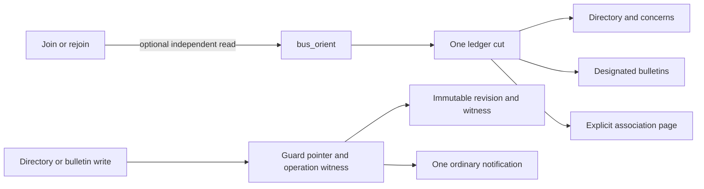

# Orientation: explicit context and designated guidance

How a participant discovers a repository, its concerns, explicitly associated addresses and designated bulletins. [Messaging](messaging.md) owns addresses and delivery, [interfaces](interfaces.md) owns tool contracts, and the [orientation runbook](../runbooks/orientation.md) gives the procedure.

## What it does

`bus_orient` reads one ledger cut without joining, subscribing, waking or moving an address's cursor. It shows programme guidance even without a selected directory. A directory supplies its explicit checkout aliases, concern definitions and authoritative references. Checkout aliases are normalized and matched lexically: a path matches itself and descendants on a path boundary, without inspecting the filesystem or resolving symlinks. A unique match from an exhausted first discovery page may select the directory; ambiguity and incomplete discovery remain explicit. A caller can select a directory and one concern by id instead. A concern requested without a uniquely selected directory remains unresolved rather than hiding the programme or inferring a scope.

For the selected directory the result includes its definition once, the full programme bulletin, the full selected concern bulletin if requested, summaries of other concerns, and a page of explicit address associations. The association query labels directory and concern resolution at the same cut. Unresolved references are diagnostics, not members of a missing directory or concern. Presence, association and subscription are separate: the result points to the `peers` query for subscriptions. A membership projection avoids optional presence detail; a fuller association projection is available through the same saved query, and it alone carries each member's `activity`, `activeSince` and `mutes` at the cut ([messaging](messaging.md#activity-and-mutes)).

The displayed cut names a ledger incarnation and commit, while evaluation time says when expiry was assessed. The catalogue version names the query code, not ledger time. A withdrawn bulletin retains a tombstone revision; an expired bulletin remains designated but is labelled expired.

## Rules

1. **Relationships are declared, not inferred.** Aliases discover candidates and association identifies an address's declared context; neither creates a subscription, assigns authority or proves availability. Each directory id and concern id is explicit. [Messaging rule 12](messaging.md#rules) defines association lifecycle.
2. **Orientation is read-only.** It does not join or alter unread position. A requested orientation after a join is a separate read after the join commits and releases its locks. If the read is unavailable, the result still says the join committed and offers a read-only retry; it never rejoins automatically.
3. **One result uses one cut.** Its directory, bulletins, association rows and continuation name the same incarnation and commit. A historical cut, evaluation time and catalogue version are labelled separately. An exhausted result is complete only when its declared projection was read without unchecked or encountered damage.
4. **Writes designate complete revisions.** `bus_directory` registers or replaces one complete directory; it has no withdrawal action. `bus_bulletin` publishes programme guidance or a registered concern, and can withdraw an existing designation even after its concern was removed. Initial publication expects absence; replacement names the exact current revision. Expiry does not change that expectation. Concern publication fences the directory revision that registered it; withdrawal uses the original validated scope and audience, without requiring current registration. Re-registering the same concern id retains its prior designation and provenance, not a new publication; a new meaning needs a new id.
5. **A guarded write and its notification are one commit.** The server checks the expected designation and absence of the global operation witness, then writes the immutable revision, pointer, witness and exactly one ordinary message. Metadata is not typed or encoded as mail. An address's existing ownership lock covers the check and action; its current joined owner must make every call.
6. **Retry identity is semantic and address-based.** A caller supplies one globally unique UUIDv7 operation id, reusing it only for an identical action, scope, expectation, validated payload and declared audience by the same publisher address. Set-valued input and accepted UTC expiry instants are canonicalized; object key order and generated time or origin do not alter identity. An identical replay returns the original revision and notification receipt without another entry, including after a later revision or an authorized takeover of the same address. A changed intent or different publisher is an identity mismatch.
7. **Outcomes say what is known.** `APPLIED` means a matching witness and original receipt, not that its revision is still current or that a record later damaged is usable. Current and historical reads validate the record, scope and notification at their own cut, and require the witness at that cut to agree on the fields shared by its intent and record. Concern-topic and withdrawal audiences are not reconstructed from the current directory. Agreement is a coherence check against the same provider, not independent proof of authenticity or completeness. `CONFLICT` requires a completed successful attempt, no witness and a different target designation observed at or after its response cut. A transport loss, unqualified server failure, damaged witness or unexplained no-op is `UNKNOWN` unless one fresh witness read proves the operation. Retry the same intent with the same id; never automatically rebase, change id or loop.
8. **Audiences are deliberate.** Programme publication notifies `*`. A concern publication notifies its registered topic and only the direct addresses explicitly named; a directory write names a nonempty audience. Withdrawal notifies the prior revision's audience. A committed notification is neither delivery nor a read receipt, and later arrivals get guidance from orientation rather than old mail.
9. **Limits preserve whole units.** A directory document is at most 16,384 UTF-8 JSON bytes, with at most eight aliases and twenty concerns; its publication metadata is at most 4,096 bytes. A bulletin body is at most 4,096 UTF-8 bytes and its complete projected unit at most 16,384. Nonempty effective associations require an address of at most 512 UTF-8 bytes and associations of at most 16,384 UTF-8 JSON bytes; older unassociated addresses are unchanged. An orientation request is at most 16,384 UTF-8 JSON bytes; its structured logical result is at most 65,536. Candidate and association pages emit at most twenty and fifty rows respectively.
10. **Incomplete is not unavailable.** Ordinary page or byte capacity returns `INCOMPLETE` with the query-owned continuation, never a trimmed row or a complete claim. A fault, damage or required unit that cannot be admitted is aggregate `UNAVAILABLE` with a safe section, message and recovery; already-read programme and other valid facts remain labelled at the same cut when the ledger incarnation is still established. Omitted sections are not empty results. A full association row that cannot fit is not consumed; start the same saved relation's membership-only projection at the original cut as a new traversal. Projection changes do not reuse the old cursor.
11. **A capability-dependent CLI join checks fresh capability first.** Association input requires both discovered input and effective-association output schemas; requested join orientation also requires the advertised output and read-only retry tool. An absent or ambiguous descriptor refuses before mutation. An absent or mismatched echo reports the committed join and uncertainty without rejoining; a failed transport may also have committed, including for an ordinary join. Cached native clients must reconnect before relying on the new fields.

## Why

Explicit current designation lets a participant find the handoff without ranking old conversation as authority. Directory definitions, associations and bulletins compose around the existing ledger and presence rather than creating another membership registry. The operation witness guards replay independently of a pointer, so an old operation cannot reinstall an earlier revision or create a second notification. A single saved association relation owns ordering and continuation; neither orientation nor a changed projection invents another membership pager.

## Limits

- **No ACL or membership lifecycle.** A joined address can publish; the tool does not establish project authorization. Association is not activity, availability or topic delivery.
- **Currentness is designation, not truth.** A published link or body can be wrong; the bus does not inspect a repository or approve the guidance.
- **Logical bytes are not wire or host bytes.** Text and structured MCP outputs may duplicate content and escaping adds bytes. Host-visible completeness requires its own qualification.
- **Oversized legacy presence can obstruct a full association page.** The membership projection is a separate traversal at the original cut; it does not advance the failed full cursor.
- **Reads are bounded in time and scan work.** Candidate discovery inspects at most 200 directory scopes per page with a ten-second deadline; the whole orientation read has a twenty-second deadline. A deadline is unavailable, not a complete empty result. No provider latency guarantee follows from those bounds.
- **Expiry has millisecond precision.** Bulletin expiry accepts UTC instants with zero to three fractional digits. It rejects unsupported precision instead of rounding; query timestamp semantics are separate.
- **The association address bound is not a filesystem acceptance guarantee.** Existing cursor files use the encoded address as a filename, so a filesystem may reject a shorter address when its encoded name exceeds the component limit. This change does not migrate cursor paths.

## Rests on

- [Fluree: conditional updates](../platforms/fluree.md#conditional-updates): the installed provider's transaction and query behavior.
- [Connections](connections.md#rules): pinned queries, bounded output and damage handling.

## History

- [Composed orientation](../frames/composed-orientation.md): the first orientation story and its acceptance boundaries.
