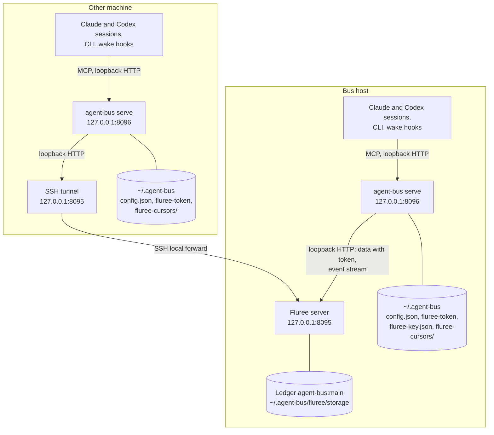
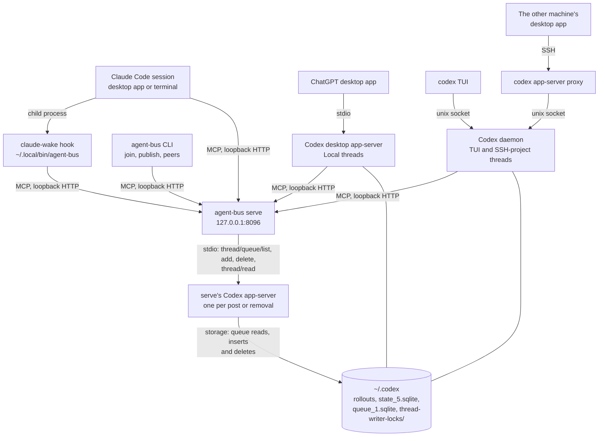

# Topology: machines, processes and stores

Where agent-bus runs: which processes run on which machine, how they reach each other, and where every piece of state lives. What protects each connection is in [connections and trust boundaries](connections.md); how mail reaches a session is in [delivery](delivery.md); what the ledger holds and how cursors read it is in [messaging](messaging.md); installing, restarting and reading the logs of these processes is in the [runbooks](../runbooks/operate.md).

## What it does

### Two machine roles

The bus has one ledger and one `serve` per machine.
- **The bus host** runs the Fluree transaction server that holds the ledger, and its own `serve`.
- **Every other machine** runs its own `serve` and an SSH tunnel to the bus host's Fluree server, on the same local port. It runs no Fluree of its own.

Sessions and the CLI never touch the store; they are MCP clients of their own machine's `serve` (rule 1).

A message sent on one machine is one ledger commit. Fluree's event stream, through the tunnel for the other machine, tells every `serve` that something changed, and each `serve` wakes its own machine's recipients: only the peers whose join came from that machine (the presence entry's `origin.host`).

### Inside one machine

Both machines run the same set of session processes. The desktop app on either machine can also open an SSH project on the other, which reaches that machine's Codex daemon; that is Codex's own connection, not the bus's.

The transports, in short:
- **Loopback HTTP:** every MCP call to `serve` (`/mcp`), and `serve`'s calls to Fluree (directly on the bus host, through the tunnel elsewhere).
- **stdio:** the desktop app to its own app-server, and `serve` to the short-lived app-server it starts each time it posts a Codex nudge or removes one.
- **Unix socket:** the `codex` TUI and `codex app-server proxy` to the Codex daemon's control socket, `~/.codex/app-server-control/app-server-control.sock`. `serve` also connects to it, briefly, to borrow a thread ([delivery](delivery.md#codex-threads)).
- **SSH tunnel:** another machine's `serve` to the bus host's Fluree (`ssh -N -L 127.0.0.1:8095:127.0.0.1:8095`).
- **SSH proxy:** the desktop app's SSH project, which runs `codex app-server proxy` on the SSH host and so reaches that host's daemon. It is Codex's own connection, not the bus's; the bus only sees the thread as a daemon thread on the SSH host.

### Processes

| Process | Runs on | Started by | Reached over | Log |
| --- | --- | --- | --- | --- |
| Fluree server | Bus host | LaunchAgent `ai.rawr.agent-bus.fluree` | HTTP, `127.0.0.1:8095` | `~/.agent-bus/fluree.log` |
| SSH tunnel | Other machines | LaunchAgent `ai.rawr.agent-bus.tunnel` | Listens on `127.0.0.1:8095` | `~/.agent-bus/tunnel.log` |
| `agent-bus serve` | Every machine | LaunchAgent `ai.rawr.agent-bus`, running the checkout's `src/bin.ts` with Bun | HTTP, `127.0.0.1:8096` (`/mcp`, `/health`) | `~/.agent-bus/agent-bus.log` |
| `serve`'s Codex app-server | Every machine with the desktop app (the bundled CLI by default; `serve --codex` replaces it) | `serve`, on every attempt that reaches the post (whether or not it adds a nudge) and on every removal; ended before the address's lock is released | stdio | Into `serve`'s log, on failure |
| `claude-wake` hook | Every machine | Claude Code, in the background at `SessionStart`, `Stop` and `StopFailure` | Calls `serve` over HTTP | Its nudge goes to the session; nothing is logged |
| `agent-bus join`, `publish`, `peers` | Any machine | A shell | Calls `serve` over HTTP | — |
| Codex desktop app-server | Every machine with the desktop app | The ChatGPT desktop app | stdio, from the app | The app's logs |
| Codex daemon | Any machine with Codex | Codex itself ([how](../platforms/codex.md#the-daemon)), or `serve` when it borrows a thread and finds none; nothing starts it at boot | The control socket | Codex's own log ([platforms: Codex](../platforms/codex.md#the-daemon)) |

Each LaunchAgent keeps its process alive (`KeepAlive`, restarted at most every 10 s) and sets `AGENT_BUS_DIR` and `AGENT_BUS_PORT`. `scripts/install-launch-agents.sh` writes them ([install](../runbooks/install.md)). `serve` runs the code of the checkout the installer was run from, and so does the hook, through the `~/.local/bin/agent-bus` link; a deploy is a fast-forward of that checkout and a restart of `serve` ([deploy](../runbooks/deploy.md)). How to restart a process and read its log is in [operate](../runbooks/operate.md).

### Where state lives

| State | Where | Written by | What it is |
| --- | --- | --- | --- |
| The ledger | Bus host: `~/.agent-bus/fluree/storage`, with the Fluree project in `~/.agent-bus/fluree/.fluree` | The Fluree server, for every machine's `serve` | Every message and presence entry, append-only, in ledger `agent-bus:main`. [Messaging](messaging.md) gives its model |
| Cursors | Each machine: `~/.agent-bus/fluree-cursors/<URI-encoded ledger>/<first commit id>/` | That machine's `serve` | One per address joined from that machine: the last commit `t` read. A replaced ledger has a new first commit, so its subscribers start over |
| `config.json` | Each machine: `~/.agent-bus/config.json` | The installer, only when absent | The Fluree URL and ledger. `serve` won't start without it |
| `fluree-token` | Each machine: `~/.agent-bus/fluree-token`, mode 0600 | The installer; copied over `scp` to other machines | The bearer token for Fluree's data and admin APIs |
| `fluree-key.json` | Bus host: `~/.agent-bus/fluree-key.json`, mode 0600 | The installer | The key the Fluree server trusts tokens from |
| The launcher | Each machine: `~/.local/bin/agent-bus`, a link to the checkout's `src/bin.ts` | The installer | What the Claude Code plugin's hook runs |
| The plugin | Each machine: Claude Code's plugin cache | `claude plugin install` | The manifest, `plugin/.claude-plugin/plugin.json`, and the `agent-bus` skill, `plugin/skills/agent-bus/` |
| `serve`'s memory | Each machine | `serve` | Two locks per address (one for reads and deliveries, one for ownership and sends); which sessions' hooks have called (`hooked`); each address's last call and open waits; the marks of what each session was last woken for, and each session's current wake wait; and, for Codex peers, the back-off, refused joins, covered mail, logged reason and recorded nudge. Lost on restart, which costs at most one extra wake per address |
| Codex state | Each machine: `~/.codex` | The Codex app-servers; `serve`'s app-server only lists, adds to and deletes its own nudges from the queue, and reads a thread's record | Rollouts, the thread index, the queue and the writer locks. [Platforms: Codex](../platforms/codex.md#what-codex-keeps-where) describes them |

`~/.agent-bus` is `AGENT_BUS_DIR` when that is set, and `serve`'s port is `AGENT_BUS_PORT` (8096 by default).

## Rules

1. **One `serve` per machine.** It is the only process that reads or writes the store for that machine's sessions, and it keeps their cursors and locks. Sessions, the CLI and the Claude hook are MCP clients of it and never open the store.
2. **One ledger, on one Fluree transaction server on the bus host.** Every machine's `serve` writes to it over HTTP. Other machines run no Fluree.
3. **Servers listen on loopback only.** Fluree is on `127.0.0.1:8095` and `serve` on `127.0.0.1:8096`. Nothing listens on a network address.
4. **Another machine reaches Fluree only through an SSH tunnel,** on the same local port, so its `config.json` names the same URL as the bus host's.
5. **A `serve` wakes only the peers that joined from its own machine.** Each machine's Codex queues and Claude sessions are its own; no wake crosses machines.
6. **Message text lives only in the ledger.** Cursors, `serve`'s memory and wakes hold addresses and positions, never mail.
7. **`serve` and the hook run the installing checkout's code,** the first through its LaunchAgent and the second through the `~/.local/bin/agent-bus` link. That checkout changes only by a fast-forward at a deploy ([deploy](../runbooks/deploy.md)).
8. **Each ledger instance has its own cursor directory.** The path names the ledger and its first commit ([messaging rule 11](messaging.md#rules) says what follows).
9. **`serve` won't start without a `config.json` that names a Fluree ledger.** There is no fallback store.

## Why

- **One ledger on one transaction server.** The server orders every commit, so all machines share one log and a cursor is the last commit `t` read. The ledger is queryable (SPARQL and full-text through `bus_query` and `bus_history`) and readable as of any `t`. The other machine needs only a tunnel.
- **One `serve` per machine.** Locks and the marks of what was last woken live in the process, and the deliverer can move a cursor past mail that isn't the subscriber's. A second `serve` on the same machine and ledger could add duplicate nudges or move a cursor back, so the design has one.
- **Loopback and a tunnel.** Nothing needs to listen beyond its own machine, so nothing does. SSH authenticates the other machine, and the Fluree token still applies on top ([connections](connections.md)).
- **The checkout is the install.** The launcher link makes the hook run the checkout's code and dependencies, so one fast-forward and a restart of `serve` deploy both.
- **Rejected: JSONL, or SQLite, as a second production store.** Once every machine ran on Fluree, a fallback store doubled what had to stay correct, for a fallback nothing used. JSONL stays only as test support (see Limits).

## Limits

| Gap | Status |
| --- | --- |
| Unit tests run on a JSONL ledger, plus the Fluree suites when the `fluree` CLI is installed. Fluree is also covered by `bun run qualify:fluree` and live use | **Accepted** |
| Nothing but the port a `serve` binds keeps a second one off a machine: another `serve` on a different `AGENT_BUS_PORT` against the same ledger would have its own locks and marks | **Known limit** (inferred from the code) |
| `serve`'s memory is lost on restart, which costs at most one extra wake per address | **Accepted** |
| A deploy changes the code the hook runs at once, and `serve`'s only at its restart | **Known limit** |

## Rests on

- [Fluree: the transaction server](../platforms/fluree.md#the-transaction-server) (one server orders the commits; restart and catch-up) and [the event stream](../platforms/fluree.md#the-event-stream) (what wakes each `serve`).
- [Codex: the app-servers on a machine](../platforms/codex.md#the-app-servers-on-a-machine), [what Codex keeps where](../platforms/codex.md#what-codex-keeps-where), [the daemon](../platforms/codex.md#the-daemon) and [SSH projects](../platforms/codex.md#across-machines-ssh-projects).
- [Claude Code: hooks](../platforms/claude-code.md#hooks) and [plugins](../platforms/claude-code.md#plugins) (where the hook runs and what a plugin copies).

## History

The frames that made these choices are indexed in [frames](../frames/README.md):
- [simplification-pass](../frames/simplification-pass.md): Fluree as the only production store, JSONL as test support.
- [one-codex-route](../frames/one-codex-route.md): one `serve` per machine, and `serve` no longer connecting to the daemon to deliver.
- [claude-wake](../frames/claude-wake.md) and [finish-swap](../frames/finish-swap.md): the hook, the launcher link and the one-file plugin.
- [codex-wake](../frames/codex-wake.md): the two Codex app-servers on a machine, and SSH projects.
