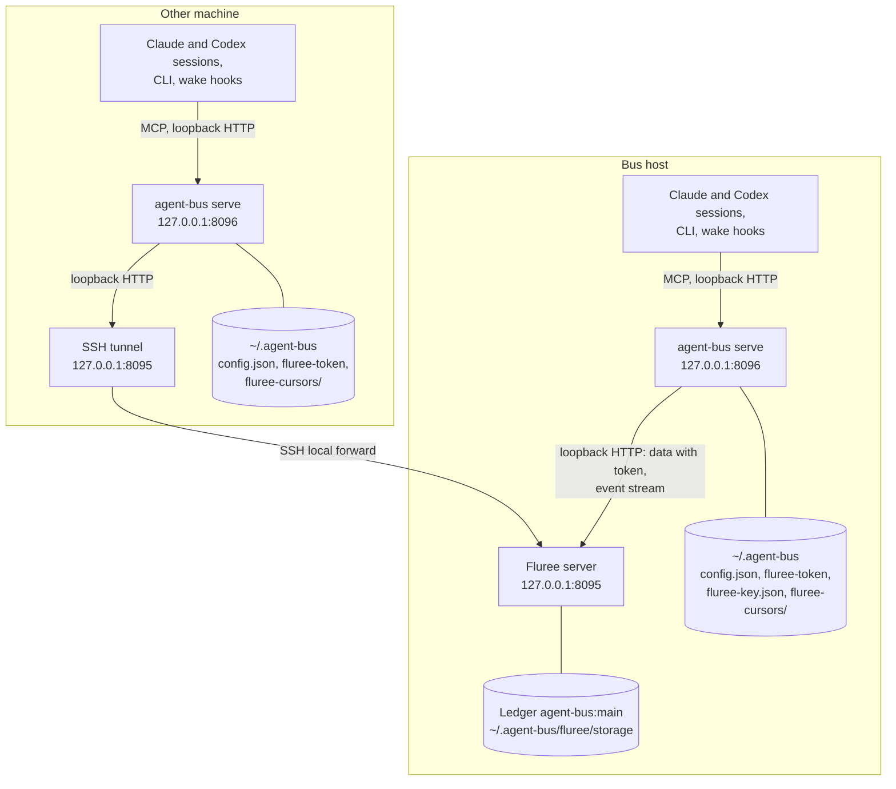
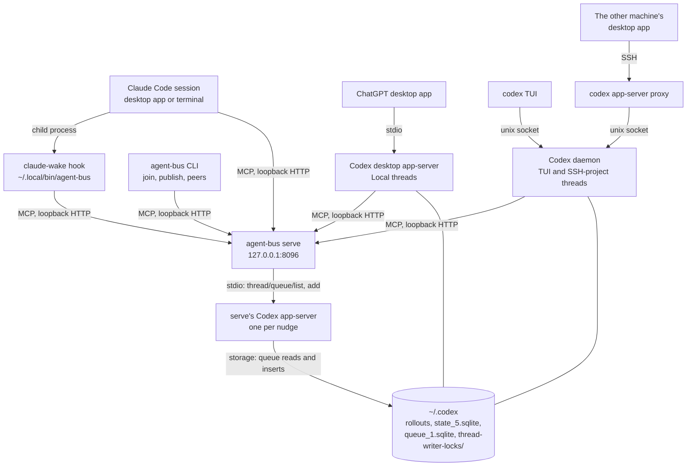

# Topology: machines, processes and stores

Where agent-bus runs: which processes run on which machine, how they reach each other, and where every piece of state lives. For what protects each connection, see [connections and trust boundaries](connections.md). For the Codex app-servers in detail, see [Codex hosting](codex-hosting.md); for how mail reaches a session, [delivery](delivery.md).

## Two machine roles

The bus has one ledger and one `serve` per machine.
- **The bus host** runs the Fluree transaction server that holds the ledger, and its own `serve`.
- **Every other machine** runs its own `serve` and an SSH tunnel to the bus host's Fluree server, on the same local port. It runs no Fluree of its own.

Each `serve` is the only process that reads or writes the store for its machine's sessions, and it keeps their cursors. Sessions and the CLI never touch the store; they are MCP clients of their own machine's `serve`.

A message sent on one machine is one ledger commit. Fluree's event stream, through the tunnel for the other machine, tells every `serve` that something changed, and each `serve` wakes its own machine's recipients. Each machine's `serve` wakes only the peers whose join came from that machine (the presence entry's `origin.host`).

## Inside one machine

Both machines run the same set of session processes. The desktop app on either machine can also open an SSH project on the other, which reaches that machine's Codex daemon; that is Codex's own connection, not the bus's.

The transports, in short:
- **Loopback HTTP:** every MCP call to `serve` (`/mcp`), and `serve`'s calls to Fluree (directly on the bus host, through the tunnel elsewhere).
- **stdio:** the desktop app to its own app-server, and `serve` to the short-lived app-server it starts for each Codex nudge.
- **Unix socket:** the `codex` TUI and `codex app-server proxy` to the Codex daemon's control socket, `~/.codex/app-server-control/app-server-control.sock`.
- **SSH tunnel:** another machine's `serve` to the bus host's Fluree (`ssh -N -L 127.0.0.1:8095:127.0.0.1:8095`).
- **SSH proxy:** the desktop app's SSH project, which runs `codex app-server proxy` on the SSH host and so reaches that host's daemon. It is Codex's own connection, not the bus's; the bus only sees the thread as a daemon thread on the SSH host.

## Processes

| Process | Runs on | Started by | Reached over | Log |
| --- | --- | --- | --- | --- |
| Fluree server | Bus host | LaunchAgent `ai.rawr.agent-bus.fluree` | HTTP, `127.0.0.1:8095` | `~/.agent-bus/fluree.log` |
| SSH tunnel | Other machines | LaunchAgent `ai.rawr.agent-bus.tunnel` | Listens on `127.0.0.1:8095` | `~/.agent-bus/tunnel.log` |
| `agent-bus serve` | Every machine | LaunchAgent `ai.rawr.agent-bus`, running the checkout's `src/bin.ts` with Bun | HTTP, `127.0.0.1:8096` (`/mcp`, `/health`) | `~/.agent-bus/agent-bus.log` |
| `serve`'s Codex app-server | Every machine with the desktop app | `serve`, once per nudge; ended before the address's lock is released | stdio | Into `serve`'s log, on failure |
| `claude-wake` hook | Every machine | Claude Code, in the background at `SessionStart`, `Stop` and `StopFailure` | Calls `serve` over HTTP | Its nudge goes to the session; nothing is logged |
| `agent-bus join`, `publish`, `peers` | Any machine | A shell | Calls `serve` over HTTP | — |
| Codex desktop app-server | Every machine with the desktop app | The ChatGPT desktop app | stdio, from the app | The app's logs |
| Codex daemon | Any machine with Codex | The first `codex` TUI to need it, a desktop SSH project's connection (unmanaged), or `serve` when it borrows a thread and finds none; nothing starts it at boot | The control socket | `~/.codex/app-server-control/app-server.log` |

Each LaunchAgent keeps its process alive (`KeepAlive`, restarted at most every 10 s) and set `AGENT_BUS_DIR` and `AGENT_BUS_PORT`. `scripts/install-launch-agents.sh` writes them; the [README](../../README.md#setup-and-other-machines) has the commands. `serve` runs the code of the checkout the installer was run from, and so does the hook, through the `~/.local/bin/agent-bus` link; a deploy is a fast-forward of that checkout and a restart of `serve`.

## Where state lives

| State | Where | Written by | What it is |
| --- | --- | --- | --- |
| The ledger | Bus host: `~/.agent-bus/fluree/storage`, with the Fluree project in `~/.agent-bus/fluree/.fluree` | The Fluree server, for every machine's `serve` | Every message and presence entry, append-only, in ledger `agent-bus:main`. The [README](../../README.md#ledger-model) gives its model |
| Cursors | Each machine: `~/.agent-bus/fluree-cursors/<ledger>/<first commit id>/` | That machine's `serve` | One per address joined from that machine: the last commit `t` read. A replaced ledger has a new first commit, so its subscribers start over |
| `config.json` | Each machine: `~/.agent-bus/config.json` | The installer, only when absent | The Fluree URL and ledger. `serve` won't start without it |
| `fluree-token` | Each machine: `~/.agent-bus/fluree-token`, mode 0600 | The installer; copied over `scp` to other machines | The bearer token for Fluree's data and admin APIs |
| `fluree-key.json` | Bus host: `~/.agent-bus/fluree-key.json`, mode 0600 | The installer | The key the Fluree server trusts tokens from |
| The launcher | Each machine: `~/.local/bin/agent-bus`, a link to the checkout's `src/bin.ts` | The installer | What the Claude Code plugin's hook runs |
| The plugin | Each machine: Claude Code's plugin cache | `claude plugin install` | Only the manifest, `plugin/.claude-plugin/plugin.json` |
| `serve`'s memory | Each machine | `serve` | Per-address locks, the marks of what each session or thread was last woken for, held subagent joins, and which sessions' hooks have called (`hooked`). Lost on restart, which costs at most one extra wake per address |
| Codex state | Each machine: `~/.codex` | The Codex app-servers; `serve`'s app-server only adds to the queue | Rollouts, the thread index, the queue and the writer locks. [Platforms: Codex](../platforms/codex.md#what-codex-keeps-where) describes them |

Nothing else holds bus state. Message text lives only in the ledger: wakes carry an address, never the mail.
