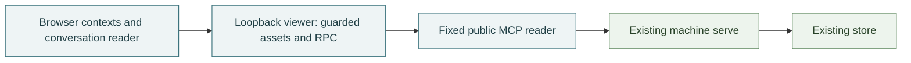

# Viewer: local public observations

The optional browser viewer's reading model, implementation boundary and limits. The public bus tools are owned by [interfaces](interfaces.md), audience and reply meaning by [messaging](messaging.md), and core connection policy by [connections](connections.md). Starting and recovering the viewer belongs in its [runbook](../runbooks/viewer.md).

## What it does

The viewer is a separate loopback process, not another `serve`. It serves built React assets and three fixed oRPC procedures (history, peers and a conversation's reply tree), which use a narrowly scoped Effect MCP reader of the existing machine's `serve`. The reader calls one tool, `bus_run_query`, with fixed operations and arguments. It discovers that server once and shares one reference-counted client and its tool list, so each page is a single tool call; an observation follows a traversal's pages at the first page's commit, under one permit and one deadline that covers every page, so pages each within it can still fail together. Cancelling an observation aborts the page in flight and starts no other. A failed discovery or a missing tool is discovered again on the next read. A client superseded by a missing tool closes when the last read still using it finishes. It imports no core bus, ledger, cursor or wake implementation. The core executable and its deployment are unchanged.

History and current peers are independent observations. Each has its own receipt time, loading/error state, omitted-record count and last-good content, and the ledger commit it was read at, shown beside the receipt time as "commit N" with the raw `t` in its tooltip and data attribute. Receipt time belongs to the viewer clock; the commit belongs to the bus. The bus's own incompleteness, unreadable entries and a head that moved during the read, is shown apart from the viewer's omissions. A history window is labelled from the bus's answer, never from how many rows came back: all entries at `t`, all readable entries with the unreadable ones counted when the bus reached every entry but could not read some, the latest entries with older ones existing, or ranked best matches that are never complete. A reply tree is whole only when the bus exhausted it with nothing unreadable and no missing reply target. The primary reading units are literal topic/address contexts and observed reply groups, not a global message list. The composition location is inert and has no send path.

Submitted text search and exact participant criteria request a replacement bounded server observation, preserving its returned order. Empty form fields mean absent; other text is not trimmed or casefolded. Apply and Clear open all result groups rather than accidentally intersecting them with a previously selected local topic. Current-peer investigation uses an exactly representable address, not inferred delivery. The reader keeps the actual criteria of displayed last-good or retained data while a different request is pending or failed.

Automatic refresh is enabled for the current page session and uses one timer. History and peers skip their own already-pending automatic read independently; manual refresh may replace pending work. Explicit pause and hidden-page state suppress scheduled work, while resume or visibility restoration requests one observation without a catch-up queue. Refresh does not navigate, steal focus or force scroll. Criteria, results and pause state are not persisted across reloads.

The conversation list projects one active bounded history observation. A visible message is a node; an explicit `replyTo` is an edge to its loaded target or a reference-only missing anchor. Weakly connected components include siblings sharing a missing parent, cycles and isolated messages. A context matches any literal member but retains its whole observed component, including replies addressed elsewhere. Current peers never expand those audiences. Messages keep source order; group summaries use latest source position, not a new interpretation of timestamps. A topic context can be read as a full context flow without clicking every singleton group; that flow is not one invented conversation. Chronology remains an alternate view. Reading a conversation asks the bus for the reply tree containing the selected message, at the history observation's own ledger and commit: the tree runs from the nearest top its reply links reach, so it can hold entries the window no longer shows, and a reply to an entry missing at `t` cuts it there and is marked as such. The tree's pages are followed until 200 entries; when the selected message lies beyond them, the reading says the conversation is larger than what was read and offers the message as the history observation holds it, never an endless loading state.

The selected message ID anchors conversation navigation, not a fabricated stable thread ID. Reply targets resolve only inside the displayed reading unit. Each reading unit is frozen at the commit it was read at. A conversation follows new history commits by reading its tree again; a flow follows the new window. Before a refresh renders, the reader checks the candidate: one from another ledger incarnation or an earlier commit, a failed or missing one, or one in which any displayed message would disappear leaves exactly one prior bounded reading unit, either that conversation or that literal context flow, retained with its commit, actual criteria, receipt time and the bus's caveats (unreadable entries, a moved head, viewer omissions). A conversation keeps the criteria its tree was read under: newer criteria whose history succeeds never relabel a tree they did not read. A persistent fixed-header indicator remains visible when its fuller caveat scrolls away. Old and new units are never merged. Explicit context/conversation selection or Read context accepts the current unit; automatic and ordinary manual refresh do not discard it. Hash navigation supports local links and Back without changing the HTTP trust boundary.

Message bodies have a safe GFM Markdown view and a Source view. HTML is not interpreted, image nodes do not create image elements, and only explicit absolute HTTP(S) links can be activated by the reader. Metadata remains isolated text. Directional/control characters use visible notation. A large body's full source remains readable when its Markdown preview exceeds the client rendering limit. Light/dark appearance defaults to the system until a reader chooses; only that appearance preference is persisted, never messages.

The implementation lives under `viewer/`; `scripts/build-viewer.ts` emits the browser assets, exact asset manifest and server artifact. App composition owns shared navigation/selection, feature code owns reading surfaces, and the shared public contract owns projection. The production bootstrap creates the real typed client; Storybook injects synthetic state into the same App and production components. Browser imports of the server client surface are type-only; the production build checks the browser module graph for core/server and test-workbench imports.

## Rules

1. The existing `serve` remains the only store owner. Viewer business calls are exactly `bus_run_query`'s `history`, `search`, `peers` and `thread` operations, with server-fixed arguments; a thread is read at the commit the browser names, which must be one the bus already reported. Protocol discovery and cancellation are transport machinery, not permission to forward another business operation. No viewer join, inbox read, wait, wake, send, public SPARQL, store fallback or browser-selected upstream exists.
2. Viewer and upstream destinations are server-owned loopback addresses. The viewer binds `127.0.0.1`, requires its exact Host and same Origin when Origin is present, rejects foreign and `null` origins, and serves no permissive CORS response. Origin-less local clients remain allowed; this is not user authentication. It refuses to start on a port another process holds on `127.0.0.1`, `0.0.0.0` or `[::]`, rather than taking that owner's loopback traffic.
3. One guarded handler serves only the generated asset allowlist and the exact RPC leaves. RPC is POST-only JSON. Method, body, input and concurrency checks precede business work. Unknown fields cannot select tools, headers, paths or a destination. Environment files are not part of the supported launch path.
4. Runtime validation and explicit nested projection establish the browser DTO. Unknown extra fields are discarded. Invalid records and all raw rows sharing a duplicate valid identity are omitted with a count, never silently replaced by an arbitrary winner. Invalid envelopes, excess counts or response-byte limits make the resource unavailable rather than truncating it. No raw upstream response, diagnostic, private cause or parse value enters browser errors or logs.
5. History is a bounded newest or best-match selection at one commit, shown in commit order (`t`, then id). Preserve literal audience. Completeness and exhaustion are the bus's claims, carried as `window`, `damaged` and `complete`, never inferred from a full or short result; ranked search is never complete, and a window cut to its limit is the latest, not all. Context grouping is a projection of explicit reply references, not topic co-occurrence, subject similarity or body mentions. Select whole observed components before filtering their messages away. Missing anchors are not fabricated messages or proof of deletion. Exact participant matching is not a recipient inbox or a subscription expansion. Current peer subscriptions never rewrite historical audiences.
6. Reading, routing, reply linkage, acceptance and completion are different facts. Do not infer read/delivery/completion, verified identity, online state, historical membership or deletion from these observations. Origin describes recorded message provenance, not the sender's current working state.
7. Failed refreshes preserve independently labeled last-good data with its actual criteria and receipt time, never relabeled as matching a new request. A failed lookup is not an empty success; an all-omitted observation is not an ordinary empty result. Request generations, cancellation and per-resource deadlines prevent stale results and endless loading. Preserve reading position, focus and explicit selection rather than replacing them with new data. No messages are persisted in browser storage or accumulated into an unbounded archive. Visible observation status is not a live region. One polite announcement per resource reports only the first observation, applied criteria, arrived records (and current peers no longer listed), omitted records on the first observation and whenever their count changes, each new kind of failure and a recovery, so periodic refresh is not repeated to assistive technology. The selected context, conversation and chronology row carry `aria-current`.
8. The application owns the native async/Effect boundary, safe error classification, interruption and shutdown. A rejected read with HTTP 504 is labelled as timed out; any other rejection is unavailable. A render defect replaces the viewer with a visible stop and reload action, without retrying or showing its cause. Stop intake, cancel active requests, await dependency cleanup and runtime disposal. Do not hide defects inside an expected upstream error or rely on TypeScript as output validation.
9. Markdown changes presentation, not trust. No raw HTML/MDX, executable playground, automatic image/media request, prefetch or message-controlled local/custom-protocol navigation exists. Unsupported destinations are inert rather than empty/self links. Checked Markdown task items are read-only sender-authored content, never inferred bus task state. Source with controls exposed is not claimed as byte-identical clipboard data.

## Why

Topic/address context and explicit reply groups let a reader follow actual coordination without reconstructing it from isolated global rows. Context flow also works when senders supplied no reply links. A directory of current peers cannot explain historical recipients from present subscriptions. A complete pinned historical audit product would require a different public capability and its own decision.

A separate viewer process avoids expanding the deployed bus server's browser surface or granting its store capability to a UI. Fixed public procedures are smaller and more auditable than generic MCP forwarding. Native oRPC plus an explicit application-owned Effect edge preserves the existing runtime without adopting an unqualified bridge package, alternate Effect major, ambient context bridge or prototype extension.

The existing Bun build tool handles this bounded browser application. A generated asset manifest avoids a filesystem catch-all and keeps static assets behind the same guard as data. No framework migration, database, auth subsystem, global client store, telemetry service or persistent installation is required.

## Limits

- This is a local observer for any client that can reach its loopback boundary, not a per-address confidentiality or authenticated multi-user product. Public message text, notes and allowed provenance can themselves contain sensitive content; projection is not a secret detector.
- There is no complete-history pagination past one window (200 entries, eight pages), exact-ID lookup, total, historical membership or delivery/read evidence. Observations are pinned to a commit, but the browser cannot pick an arbitrary past commit. Search has the upstream [full-text limits](../platforms/fluree.md#full-text-search), including index-startup and historical-gap uncertainty. Empty results do not establish that a historical match does not exist.
- Observed reply groups in the list are not complete threads, even when every visible parent resolves. A latest window can omit a quiet topic's older exchange or later replies. The conversation reading is the bus's reply tree at `t`, which follows `replyTo` links only: related mail without a reply link is outside it, and only its first 200 entries are read, labelled as such. Context flow includes matching groups' differently addressed replies without claiming that they were sent to the selected topic.
- Automatic refresh is periodic observation, not a push stream or proof that every intermediate message was seen. A hidden, paused or retained reading may be stale; its own receipt time and persistent retained-state label remain the evidence. Applying criteria is a new server selection, not pagination or a merged archive. Reload does not restore search or a retained reading unit.
- Markdown previews have a bounded parsing workload; long full source is not discarded. HTTP(S)-only links are a scheme policy, not a guarantee that a destination is reputable. Remote images remain omitted even when the same image could be fetched manually elsewhere.
- Limits and launch settings belong to the [viewer interface catalogue](interfaces.md#viewer); the [runbook](../runbooks/viewer.md#if-it-fails) covers failures. Oversized responses fail visibly, not partially truncated text.
- Bun binds `127.0.0.1` even when another process holds the port on `0.0.0.0` or `[::]`, so the viewer checks those addresses first by binding and releasing each at once; nothing is served there. The check and the real bind are not atomic, so a process that takes the port between them is not detected.
- The shipped browser and server artifacts share one local release. Runtime dependencies increase this private package's install footprint even though the core executable does not import the viewer. Public hosting, merging, deployment of the core bus or persistent service installation are separate decisions.

## Rests on

The current [saved-query contract](interfaces.md#bus_run_query) and [public tool contracts](interfaces.md#bus_history), [messaging model](messaging.md) and [core trust boundary](connections.md#rules); the [Fluree search findings](../platforms/fluree.md#full-text-search); exact dependencies pinned in `package.json` and `bun.lock`; and the viewer's projection, host, wire, lifecycle, build and browser verification. Installed external platform behavior is distinguished from agent-bus policy in [platforms](../platforms/README.md).

## History

The [preparation frame](../frames/agent-bus-viewer.md) records the accepted product/team boundary. The [implementation and qualification frame](../frames/agent-bus-viewer-release.md) records discovery, alternatives, exact compatibility experiments and release evidence.
The [workbench frame](../frames/viewer-workbench.md) records the owner-directed Storybook, Stagehand and local caching qualification.
