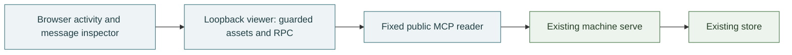

# Viewer: local public observations

The optional browser viewer's reading model, implementation boundary and limits. The public bus tools are owned by [interfaces](interfaces.md), audience and reply meaning by [messaging](messaging.md), and core connection policy by [connections](connections.md). Starting and recovering the viewer belongs in its [runbook](../runbooks/viewer.md).

## What it does

The viewer is a separate loopback process, not another `serve`. It serves built React assets and two fixed oRPC procedures, which use a narrowly scoped Effect MCP reader of the existing machine's `serve`. It imports no core bus, ledger, cursor or wake implementation. The core executable and its deployment are unchanged.

History and current peers are independent observations. Each has its own receipt time, loading/error state, omitted-record count and last-good content. Receipt time belongs to the viewer clock, not the ledger. A message inspector preserves full sender-authored text, literal audience, recorded time, reply reference and optional recorded origin. The composition location is inert and has no send path.

The browser's selected message is not a claimed complete thread. Reply targets can be resolved only within its currently loaded history observation. A selected record outside a later successful observation retains its prior content and last-observed time with an explicit caveat. Text and metadata are inert; directional/control characters are visibly escaped and isolated rather than allowed to reorder interface labels.

The implementation lives under `viewer/`; `scripts/build-viewer.ts` emits the browser assets, exact asset manifest and server artifact. App composition owns shared navigation/selection, feature code owns reading surfaces, and the shared public contract owns projection. Browser imports of the server client surface are type-only; the production build checks the browser module graph for core/server imports.

## Rules

1. The existing `serve` remains the only store owner. Viewer business calls are exactly `bus_history` and `bus_peers`. Protocol discovery and cancellation are transport machinery, not permission to forward another business operation. No viewer join, inbox read, wait, wake, send, public SPARQL, store fallback or browser-selected upstream exists.
2. Viewer and upstream destinations are server-owned loopback addresses. The viewer binds `127.0.0.1`, requires its exact Host and same Origin when Origin is present, rejects foreign and `null` origins, and serves no permissive CORS response. Origin-less local clients remain allowed; this is not user authentication.
3. One guarded handler serves only the generated asset allowlist and the exact RPC leaves. RPC is POST-only JSON. Method, body, input and concurrency checks precede business work. Unknown fields cannot select tools, headers, paths or a destination. Environment files are not part of the supported launch path.
4. Runtime validation and explicit nested projection establish the browser DTO. Unknown extra fields are discarded. Invalid records and all raw rows sharing a duplicate valid identity are omitted with a count, never silently replaced by an arbitrary winner. Invalid envelopes, excess counts or response-byte limits make the resource unavailable rather than truncating it. No raw upstream response, diagnostic, private cause or parse value enters browser errors or logs.
5. History is a bounded newest or best-match selection, returned chronologically. Preserve the returned order and literal audience. Neither a full nor a short result proves completeness or exhaustion. Exact participant matching is not a recipient inbox or a subscription expansion. Current peer subscriptions never rewrite historical audiences.
6. Reading, routing, reply linkage, acceptance and completion are different facts. Do not infer read/delivery/completion, verified identity, online state, historical membership or deletion from these observations. Origin describes recorded message provenance, not the sender's current working state.
7. Failed refreshes preserve independently labeled last-good data. A failed lookup is not an empty success; an all-omitted observation is not an ordinary empty result. Preserve reading position, focus and explicit selection rather than replacing them with new data. No messages are persisted in browser storage or accumulated into an unbounded archive.
8. The application owns the native async/Effect boundary, safe error classification, interruption and shutdown. Stop intake, cancel active requests, await dependency cleanup and runtime disposal. Do not hide defects inside an expected upstream error or rely on TypeScript as output validation.

## Why

An activity-first reading workspace serves the actual coordination unit without manufacturing inbox, chat-room or task-monitor state. A participant directory remains useful context but cannot explain historical recipients from current subscriptions. A complete pinned historical audit product would require a different public capability and its own decision.

A separate viewer process avoids expanding the deployed bus server's browser surface or granting its store capability to a UI. Fixed public procedures are smaller and more auditable than generic MCP forwarding. Native oRPC plus an explicit application-owned Effect edge preserves the existing runtime without adopting an unqualified bridge package, alternate Effect major, ambient context bridge or prototype extension.

The existing Bun build tool handles this bounded browser application. A generated asset manifest avoids a filesystem catch-all and keeps static assets behind the same guard as data. No framework migration, database, auth subsystem, global client store, telemetry service or persistent installation is required.

## Limits

- This is a local observer for any client that can reach its loopback boundary, not a per-address confidentiality or authenticated multi-user product. Public message text, notes and allowed provenance can themselves contain sensitive content; projection is not a secret detector.
- There is no complete-history pagination, exact-ID lookup, pinned snapshot, total, historical membership or delivery/read evidence. Search has the upstream [full-text limits](../platforms/fluree.md#full-text-search), including index-startup and historical-gap uncertainty. Empty results do not establish that a historical match does not exist.
- Limits and launch settings belong to the [viewer interface catalogue](interfaces.md#viewer); the [runbook](../runbooks/viewer.md#if-it-fails) covers failures. Oversized responses fail visibly, not partially truncated text.
- The shipped browser and server artifacts share one local release. Runtime dependencies increase this private package's install footprint even though the core executable does not import the viewer. Public hosting, merging, deployment of the core bus or persistent service installation are separate decisions.

## Rests on

The current [public tool contracts](interfaces.md#bus_history), [messaging model](messaging.md) and [core trust boundary](connections.md#rules); the [Fluree search findings](../platforms/fluree.md#full-text-search); exact dependencies pinned in `package.json` and `bun.lock`; and the viewer's projection, host, wire, lifecycle, build and browser verification. Installed external platform behavior is distinguished from agent-bus policy in [platforms](../platforms/README.md).

## History

The [preparation frame](../frames/agent-bus-viewer.md) records the accepted product/team boundary. The [implementation and qualification frame](../frames/agent-bus-viewer-release.md) records discovery, alternatives, exact compatibility experiments and release evidence.
