# Frame: agent-bus viewer implementation and qualification

This frame records the discovery, design and first-release qualification of the local read-only viewer. The accepted product boundary and team remain in the [preparation frame](agent-bus-viewer.md); existing bus semantics remain in [interfaces](../architecture/interfaces.md), [messaging](../architecture/messaging.md) and [connections](../architecture/connections.md).

Opened 2026-11-01 after the owner accepted preparation, received its committed readiness checkpoint, reactivated the goal and instructed continuation. The earlier readiness-only stop is satisfied, not silently deleted from its historical frame. Public hosting, merging and core deployment remain excluded.

## Discovery

The primary operator job is to observe recent coordination and investigate what an individual public message says, literally addresses and explicitly replies to. An activity-first chronological observation and a full-message inspector serve this better than a participant directory as the opening surface. The directory-first alternative remains useful for known-address investigation, but is weaker for discovering recent coordination and risks implying that current subscriptions explain past recipients.

The qualified public capabilities are unchanged:

- History selects bounded newest or best text matches and returns them chronologically. Exact participant matching means sender or a literal audience entry, not subscription expansion or an inbox.
- The public origin fields describe recorded provenance, not verified identity or current working state. Retain them as optional, collapsible, inert details rather than silently dropping allowed provenance.
- Reply references are unchecked IDs. Navigation can resolve only within the currently loaded observation; absent targets remain unresolved. Cycles need navigation, not recursive tree expansion.
- Peers are separately observed current joined records. They do not establish liveness, historical membership or delivery.
- A short history result does not prove exhaustion. The source can skip undecodable stored records after limiting, and provides no completeness marker. Neither a full nor a short result earns a total, `hasMore` or archive-complete claim.

Small read-only live probes through the existing connection returned ordinary history, current peers and text matches with the expected public field sets. These samples are not hostile-row, ranking, freshness or exact deployed-source parity proof. A separate direct probe using the intended Effect client and explicit MCP `2025-11-25` successfully discovered tools and called bounded history and peers. There was no fallback, join, inbox read, publication, direct store access or service change.

Programme context was rechecked through the packaged session reader's bounded record-evidence fallback because its native reader did not admit the installed Codex version. The director's latest substantive result agrees with the inspected deployed source: public projection and query refusal are present; no new protocol fields or bulletin mechanism were accepted. Historical owner-view decisions do not grant a different viewer capability.

## Design Decision

Use one separate loopback Bun viewer process, production-built React assets and exactly two fixed native oRPC procedures. Existing `serve` remains the only store owner. The browser never chooses an upstream URL, tool name, headers, session or query language. Do not import the core server/client graph into the viewer reader merely to reuse a generic call helper.

```mermaid
flowchart LR
  UI[React activity and inspector] --> Client[Same-origin typed client]
  Client --> Gate[Viewer request and asset policy]
  Gate --> API[Fixed history and peers procedures]
  API --> Edge[Explicit Effect runtime boundary]
  Edge --> MCP[Existing serve public MCP]
  MCP --> Store[Existing serve-owned store]
  classDef app fill:#eef4f5,stroke:#3c737d,color:#203f45
  classDef boundary fill:#fff4df,stroke:#9c752d,color:#4d3b19
  classDef existing fill:#edf4ed,stroke:#497849,color:#274127
  class UI,Client app
  class Gate,API,Edge boundary
  class MCP,Store existing
```

The exact compatibility candidate is native oRPC `1.14.8`, existing Effect `4.0.6` and Bun `1.3.14`, React/React DOM `19.3.1`, Lucide React `1.64.0` and matching React type packages `19.3.0`. These pins were checked against published package metadata. The newest Lucide release was rejected by the existing three-day minimum-release-age policy; the selected eligible pin preserves that policy rather than bypassing it. No Effect-oRPC provider profile was assumed: the installed bridge references cover other frozen tuples. Instead, the application owns one explicit native async/Effect boundary with safe Cause classification, interruption and disposal. Effect's native Standard Schema adapter avoids another schema dependency for this narrow JSON boundary.

A disposable exact-tuple fixture passed strict types, eight tests and 40 assertions, in-process and real-socket RPC, expected versus defect/composite/finalizer errors, abort cleanup, awaited disposal and a cold compiled server with an independent typed client. This admits those unary native/schema/runtime behaviors. It does not prove the eventual viewer's request policy, live reader, browser graph or UI.

Independent Opus challenge corrected the protocol interpretation. Legacy `initialize` returning an older revision does not establish that the endpoint lacks the modern transport. A subsequent direct Effect-client probe using modern `server/discover` and explicit `2026-07-28` successfully read bounded history and peers. Select that stateless revision only, with no negotiation fallback. This removes the proposed legacy-session churn rather than adding a connection pool or a cleanup workaround. Request concurrency, byte caps, deadlines and interruption still need integrated proof.

The challenge also changed anomalous-record handling: a malformed row must not repeatedly blank the newest window. Validate and explicitly project each record; quarantine invalid kinds and every raw row sharing a duplicate valid identity, with a visible omitted count. Invalid envelopes, excessive record counts or response-byte limits fail the observation instead of silently truncating it. An all-omitted observation is not an ordinary empty result. No raw values or parse errors cross the public failure boundary.

Build HTML, TSX and CSS with the existing Bun toolchain. Serve an exact generated asset manifest through the same guarded request handler as RPC. Automatic HTML routes are not selected: a guard only in fallback `fetch` would not protect an already-matched static route. No filesystem catch-all, source maps, permissive CORS, environment inlining, second browser origin or extra framework is needed.

Bulletproof dependency direction applies to the real code, without speculative directory trees: app composition may import independent features and shared code; features do not import sibling features or app; shared runtime code does not import upper layers. A type-only native client projection does not authorize a runtime server import in the browser bundle. The built artifact must prove that distinction.

## Experience Contract

On wide screens, use two unframed reading columns: bounded activity and an inspector with a separate current-peers view. On narrow or zoomed screens, use navigable Activity, Message and Current peers views with a predictable return to the prior list context. Preserve long content, exact literal audiences and recorded origin. No chat bubbles, task-progress tiles, online dots or inferred unread state.

Each resource owns its loading, success-empty, refreshing, unavailable and last-good states and its own successful receipt time. Receipt time is a viewer clock, not an atomic store timestamp. Changed criteria cannot relabel old results as matching; request generations and cancellation prevent late responses overwriting newer observations. A selected message that leaves the refreshed window is retained only with its prior observation and an explicit outside-current-observation label.

Search and exact participant are explicit submitted criteria. Preserve upstream result order. A history limit is a maximum, never a total. Reply traversal uses only the current observation's ID map and never manufactures a complete thread. Composition has a visible inert location and no draft, send action or server procedure. All sender-authored text and provenance remain inert data.

Automatic refresh must be pausable, independently recoverable and subordinate to reading: no stolen focus, forced scroll or replacement selection. Manual refresh remains available. No messages are persisted in browser storage or accumulated into an unbounded archive.

## Complete Stories

1. **Observe safely:** run the separate viewer; read real bounded public history and independently observed peers; inspect an exact message and public origin; distinguish loading, empty and unavailable; expose no consumption or send path.
2. **Find and inspect:** supported search and exact participant criteria, current-peer investigation and resolved/unresolved/cyclic reply navigation, with usable desktop/mobile/keyboard return paths.
3. **Stay current:** independent resource freshness, bounded automatic refresh and pause/resume, out-of-order suppression, last-good recovery and selection/focus/scroll continuity.
4. **Qualify:** full checks and production build, actual live-data smoke, negative boundary and lifecycle tests, real browser journeys, independent consequential review, current reference/runbook updates and clean committed Graphite state.

Each story ends with actual verification rather than a plausible code or screenshot claim. Ordinary reversible work proceeds within the accepted boundary; missing historical/inbox evidence, a required wider capability or core deployment returns to the owner as a material reframe.

## Evidence And Disposition

Readiness's full-check failure was revalidated before app changes. The inherited shell selected Fluree `4.2.3`; a longer focused test still returned empty text matches, so increasing its timeout was not a repair. An already-installed matching `4.2.4` binary was copied to private disposable test tooling, hash-checked, and selected only by that command's explicit `PATH`. With no source or harness changes, `bun run check` passed 259 tests, 2,164 assertions, types, lint and 43 Markdown files. Neither the live service nor global tool selection was changed. Later verification must disclose the selected tool rather than attribute this pass to the default older binary.

The fresh exact-model Opus design challenge completed with six findings. Quarantine/omission visibility and whole-response distinction were accepted; the protocol/session concern was superseded by the successful modern probe and stateless choice. Recorded provenance labels and synthetic expanded-state proof, metadata-wide bidi isolation tests and explicit dependency-footprint acknowledgment were accepted. Root runtime dependencies are an intentional packaging tradeoff for a leaf within the existing private package, not a change to the core executable graph or permission to deploy it. No finding grants an ongoing review veto.

### Foundation story

The first safe observation story is implemented: exact public DTO projection and quarantine; two bounded native procedures; guarded generated assets; stateless MCP; cancellation, stalled-body cleanup and awaited shutdown; and a React reading surface with independently observed peers and manual refresh. No core server, store, credential, live-primary checkout or deployment changed.

Integrated verification passed 348 tests and 3,010 assertions, full root/browser/server TypeScript, lint and 46 Markdown files, with the explicitly selected qualified Fluree test binary. Production build passed the browser module-graph check. A cold compiled server and separate client passed built HTML/script access, hostile-Origin refusal, exact modern business calls and DTO checks, then exited cleanly through both shutdown handlers. The real reader-to-existing-bus smoke returned bounded history and peers with no omissions; only structural flags/counts were retained.

Actual browser checks used Playwright after the native browser host reported unavailable. Desktop and 390/320-wide mobile rendered real history, full message/literal audience, in-window and unresolved reply references, collapsed/expanded recorded provenance and separate peer/history refresh times. Mobile keyboard selection focused the reader and Back restored the selected row. No page overflow appeared at 320 pixels. Reduced-motion emulation reported no icon animation. Browser testing found and repaired duplicate mobile navigation; the rebuilt candidate was rechecked. The local address also opened successfully in the user's ordinary browser. A reported refusal was reconciled as different host locality, not grounds to weaken the loopback boundary or expose it over a private network.

This is foundation proof, not first-release acceptance. Actual 200% zoom, synthetic long Markdown/control fixtures, theme behavior, asynchronous refresh races and assistive-technology coverage remain unproved. No raw live response or expanded personal-path screenshot is in public source.

### First-use correction

The owner's first use rejected the activity-first opening as too flat: topic and threaded-reply context, not a global list to reconstruct manually, is the relevant reading unit. Keep the verified observation boundary, but replace the opening hierarchy with literal topic/address context, observed explicit-reply conversation groups and full conversation reading. Chronology becomes an alternate view. This is an actual failed experience hypothesis, not a request to add more filters to the same list.

The owner also requested dark mode and proper Markdown. Those remain required reading-quality work. The next complete story selects one bounded latest-200 observation for context projection, preserving whole observed reply components across audiences; a topic is not a complete historical room. Supported server search, honest automatic freshness and complete rendered-product qualification remain in the first-release objective, not silently deferred out of it. No first-release or goal-complete claim is made by the foundation commit.

## Search and freshness story

After the context-first reader and owner-directed workbench were committed, the next accepted story added exact server search and participant investigation, clear-to-latest, and periodic independent history/peer observation. The application uses reusable resource controllers through React's external-store API; StrictMode cleanup cancels work without permanently disposing the reused controller. One scheduler pauses on explicit choice or hidden-page state, resumes once, skips already-pending resources independently and never changes navigation, focus or scroll. Applied requests, actual last-good criteria and a retained evicted conversation remain distinct.

The pure temporal/criteria tests use injected clocks rather than real waiting. A native browser lane intercepts only the production polling interval and checks actual upstream synthetic-tool arguments, different-criteria failure, independent peers, clear, paused/manual/resumed/visibility counts, overlap refusal and a pinned message's focused visual reading anchor. The first continuity assertion mistakenly raced an explicit navigation's scheduled focus and assumed numeric scroll offsets could not change when an honest notice was inserted. Waiting for navigation settlement and comparing the visual reading anchor fixed the falsifier without changing product behavior or dropping focus preservation. The qualified lane then passed in 2.34 seconds; 320/390 page-width checks and synthetic desktop/mobile/theme captures passed.

Source verification at this stage passed 145 focused viewer tests and 986 assertions in 137 ms, plus the uncached full repository check: 418 tests and 3,243 assertions in 42.32 seconds for the test portion, root/server/browser/workbench/harness types, lint and 48 Markdown pages. The full run retained core/storage coverage and explicitly selected the qualified disposable Fluree tool. Production and workbench builds passed; final Storybook regression, native browser regression diagnosis and independent rendered review are still qualification gates, not inferred from these passes.

No public API, store authority, deployment, network sharing, send action or draft persistence changed. The [workbench frame](viewer-workbench.md) owns the testing/caching-method decision; current search and freshness rules/commands belong to the viewer reference, interface catalogue and runbook.

## First-release qualification

A fresh exact-model Opus high challenge received bounded public source and four approved synthetic image blocks through tool-free input. It identified real distinct visible anchors, not image placeholders. High effort was requested, not independently attested. No real bus capture, credentials or raw upstream response entered the review. The source and rendered challenge supported the context-first operator job and found one supported blocker: the retained-data caveat could scroll away beside the current list's clock.

That blocker was repaired with a persistent fixed-reader-header state line, reserving its height even when empty. A strict native check proves the retained cue stays visible outside the scroller while focus and the absolute and relative visual reading anchor remain unchanged. The review's inferred context-flow continuity risk was separately falsified: eviction removed the focused article and left focus on the page body. This promoted a residual hypothesis to a real product defect rather than ignoring it because the review had not observed it.

The repair stores exactly one bounded reading unit, conversation or context flow, and reconciles it synchronously before rendering. Any evicted previously displayed ID retains the whole old unit, even if the selected anchor remains current; there is no union or accumulating archive. The current list continues observing independently. Explicit context/conversation selection or Read context accepts the current unit. Native tests prove conversation and flow retention, visible stale-state labeling, exact criteria/time ownership, focus and visual-anchor continuity, then explicit acceptance at scroll position zero. New replies and merges can advance when no old displayed ID disappears. Nine pure tests cover the state boundary, identity, metadata, order, bounds and explicit acceptance.

Final verification passed:

- Full uncached repository qualification: 427 tests, 3,283 assertions, 40.85 seconds for the test portion; all root, server, browser, workbench and browser-harness types, lint and 48 Markdown pages. The command explicitly selected the qualified disposable storage test tool, with no service/global upgrade. Later explicit-navigation changes passed whole-repository types, lint and native checks.
- Focused viewer lane: 154 tests and 1,026 assertions in 122 milliseconds.
- Eight actual production-component Storybook plays, with individual cases around one to 4.6 seconds; real intentional-failure and render-only oracles correctly refuse. Interactive local workbench startup, a native exact-search play and owned shutdown also passed.
- Three connected native synthetic journeys passed; the separate strict search/freshness/retention lane passed in 2.14 seconds, including actual submitted upstream arguments, separate-resource recovery, overlap/pause/visibility/manual counts, conversation and flow eviction, 320/390 layouts and explicit-current acceptance.
- Production build and dependency-graph checks; a cold compiled artifact's assets, exact modern public calls, foreign-Origin refusal and clean shutdown; seventeen disposable cache correctness experiments, including exact output restoration and hostile root-config refusal.
- After the parent-owned final restart, actual native live reading passed in 1.01 seconds: nonempty current history, literal context flow, unclamped Source, audiences, theme change and separately observed peers. Only structural flags/counts were retained.

Earlier generic first-journey browser failures were not conclusively explained. Granular safe structural diagnostics were added; isolated and controlled paired fixed-artifact runs passed, so concurrency was not established as their cause. The navigation test now also waits for the actual explicit navigation focus before following a reply, avoiding the separately demonstrated animation-frame precondition race without weakening assertions or adding retries. The final current-source native runs pass; this remains a disclosed harness risk, not a claimed proven historical repair.

The scoped first release is qualified as a local read-only observer, not a complete archive, push stream, authenticated multi-user service or accessibility certification. The visible composition location remains inert. Core deployment, network exposure, publication and merging were not performed.

During closure, independently owned work advanced the main branch with retired-parser cleanup and native Codex skill installation documentation. The viewer work is checkpointed before a branch-only Graphite restack onto that current base; combined-source qualification remains a final integration gate. This does not authorize editing or redeploying the primary checkout.

## Next product loop

These are explicit follow-up questions, not hidden first-release work or an infinite completion condition. Observe actual use, select one complete next story, design its falsifier and repeat the accepted loop.

| Question | Trigger for the next story |
| --- | --- |
| Make distinct reply groups and cross-audience relationships even clearer inside chronological context flow | First-use evidence that readers confuse separate groups despite literal audiences and reply links |
| Improve activity cues and stable ordering in the context rail | Repeated investigation effort locating active or quiet contexts in the bounded window |
| Reduce refresh announcements and qualify assistive technology, actual browser zoom and mobile pause-state recognition | Before claiming accessibility conformance or broader assistive-technology use |
| Characterize intermittent native-browser startup/focus failures with the new bounded diagnostics | A reproducible failure on an unchanged artifact, without concealing it through retries or longer waits |

## Moved into current docs

- [x] Contract: foundation procedures and limits are in [interfaces](../architecture/interfaces.md#viewer).
- [x] Rule: foundation trust and observation rules are in [viewer](../architecture/viewer.md); [connections](../architecture/connections.md) links the new boundary without changing core authority.
- [x] Agent guidance: no bus-use skill change is needed for a human observer with no new MCP business operation; existing agent guidance remains authoritative.
- [x] Platform claim: the bounded Fluree test-version comparison is in [Fluree](../platforms/fluree.md#full-text-search) and the findings register; native/schema fixture admission is not generalized into an external-platform guarantee.
- [x] Procedure: [viewer runbook](../runbooks/viewer.md) records rehearsed install/build/start/shutdown and actual read-only browser checks. Later stories must update it when their workflow changes.
