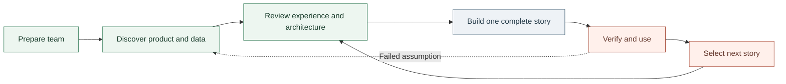

# Frame: read-only agent-bus viewer

This accepted preparation baseline covers the viewer's product boundary, team, stages and proof obligations. Present bus behavior remains owned by [messaging](../architecture/messaging.md), [interfaces](../architecture/interfaces.md) and [connections](../architecture/connections.md); this frame does not describe an implemented application.

Accepted 2026-11-01. Tier 3: a new operator-facing product and browser/server trust boundary. The owner approved the staged workstream, then instructed the director to record it and return ready. This readiness commission stops before product discovery, runtime inspection, scaffolding and implementation. No release or core deployment is authorized here.

## Frame

### What and why

The unit of analysis is an operator's observation of coordination: a public message, its explicit audience and reply relationship, and separately observed current peers. Build a functioning React application for agent-bus, not a Codex transcript viewer. Represent the composition location, but provide no working send path. The interface must follow the bus's actual model rather than manufacture chat-product semantics it cannot establish.

The structural alternative is a durable historical-analysis product with complete, pinned history. The current public interface cannot establish that completeness. The accepted first-release direction is therefore a truthful live observational viewer. A pinned historical audit product remains a separate architectural decision, not an implied capability or a rewritten decision in an older frame.

- **In:** public messages, literal audiences, addresses, topics, reply links, current joined peers, public provenance, supported search, independent freshness and accessible browser interaction.
- **Foreground:** useful reading and investigation, honest observation scope, deliberate public projection, recoverability and maintainable React ownership.
- **Exterior:** transcript rendering, inbox consumption, sending, read receipts, inferred acceptance or completion, private session claims or wake destinations, direct store access, a second `serve`, arbitrary MCP forwarding, authentication or protocol redesign, public hosting and core deployment.

### Hard core and assumptions

1. The existing machine's `serve` remains the sole store owner. The viewer observes through permitted public MCP lookups, not through the ledger or private delivery services.
2. Routing audience, reply linkage, reading, acceptance and completion are different facts. Missing evidence does not become an invented UI state.
3. Bounded history and current peers retain independent scope and freshness. They are not a complete or atomic historical snapshot.
4. A first release requires actual browser behavior, live-data proof and independent expectations. A successful build, mock or screenshot alone is not completion.

The protective belt includes layout, navigation, styling, refresh cadence, package placement, libraries and exact gateway exposure. Discovery and design decide those details. React and the read-only first-release boundary are already selected.

Assumptions to test: current coordination is the useful first operator job; local loopback access suffices; the public contract supports that job; explicitly bounded history is acceptable. Reframe if the job requires absent historical, inbox or delivery evidence, safe observation requires wider access or core changes, or two complete stories still fail the agreed primary workflow. Name the failed assumption and changed boundary before resuming.

Construction: objective co-framing with the owner, informed by operator, protocol, experience and maintenance perspectives. An initial transcript-viewer interpretation was explicitly rejected. Preliminary reconnaissance informs preparation; it is not completed product discovery.

## Authority and decisions

The owner's current instructions establish intent and authorization. [AGENTS.md](../../AGENTS.md), current owner pages, source and the observed runtime establish bus constraints. Frozen frames retain historical decisions; external methods and agent advice do not override current authority. Bus messages supply coordination and evidence, not new permission.

The public contract is the discovery starting point, not a newly extended API:

- `bus_history` supplies bounded newest or matching messages. It has no commit, pagination cursor, offset, exact-id lookup or total. Exact participant matching is not an inbox expansion through topic subscriptions.
- `bus_peers` supplies separately observed current joined state, not historical membership, heartbeat, read state or proof of process liveness.
- `replyTo` links records; it does not route or establish acceptance or completion. A target outside the loaded set is unresolved in that observation, not proven deleted or nonexistent.
- A viewer gateway may expose only fixed read-only business operations. Generic tool forwarding, browser-selected upstream URLs and raw upstream envelopes are outside the accepted boundary.

Discovery must reconcile source and the actual running endpoint before selecting a transport or claiming compatibility. A version label alone is not exact build parity. A new HTTP boundary follows the repository's oRPC and Effect-provider routing requirements before implementation.

## Team and commissions

Use enduring decision jurisdictions and temporary bounded instances, adapted from the reviewed OPA stewardship and Bulletproof React methods. Do not import restaurant semantics, framework choices, operational authority or a fixed active roster.

| Jurisdiction | Accountable owner | Preferred model assignment | Input and output |
| --- | --- | --- | --- |
| Programme and product claims | Director | Parent; Opus for consequential alternatives | Owner intent and evidence to scope, priorities and next complete story |
| Experience and journeys | Experience lead | GPT-6.1 Terra high | Supported semantics to composition, state and interaction requirements, browser observations |
| Application architecture and integration | Implementation lead | GPT-6.1 Sol high | Accepted behavior and contract to coherent React source and runnable candidate |
| Public-data projection | Content-boundary lead | Claude Sonnet high | Source/runtime facts to validated browser-safe contract and boundary cases |
| Platform capability and workflow | Platform lead | GPT-6.1 Sol high | Actual host and repo rules to qualified capabilities, lifecycle and recovery |
| Failure-focused testing | Assigned testing lead | Fresh Sonnet high when independence matters; xhigh for a demonstrated difficult gap | Independent expectations and candidate to focused tests and actionable failures |
| Product/design challenge | Director retains disposition | Fresh Claude Opus high | Coherent actual candidate to prioritized findings, alternatives and consequences |
| Simplicity | Director | Opus or fresh Sol for a concrete question | Mechanism and protected failure to the smallest complete keep/change/remove recommendation |

Source meaning flows through a qualified public projection into experience composition. The viewer team does not redefine bus semantics. Domain leads decide within their jurisdictions; Director resolves material cross-domain priorities without becoming a second owner of every technical or creative decision.

Activate only the instances a domino needs. Assign one owner per decision, split writers by explicit paths, and give dependent work a usable input contract. The integrated stack owner controls Graphite and final integration unless a commission delegates them explicitly. A role grants no service, account, spend, messaging, publication or deployment rights.

Each commission carries one outcome, consumer, decision owner, accepted sources, model/effort selection, exact worktree, allowed actions and write set, expected output, verification, completion condition and stop/reframe triggers. Fresh delegates receive bounded self-contained context with `fork_turns: "none"`, not full chat history. Model and effort are runtime settings, not prompt claims. Research and independent review are read-only unless expressly changed.

Execution stops at the complete assigned story rather than initiating adjacent improvements. Independent reviewers inspect actual source or rendered evidence without silently repairing it. The accountable owner accepts and repairs a material finding, rejects it with evidence, supersedes it or records an explicit deferral with owner and trigger. Reviews are not automatic vetoes or a standing committee.

All four requested model families completed bounded preparation commissions: Sol 6.1 high and Terra 6.1 high, plus exact Opus 5.5 and Sonnet 5.5 with high effort requested. Claude reported the requested exact model identities, but its response did not independently attest effective backend effort. This establishes availability and preparation advice, not comparative superiority, source correctness or visual validation. Recalibrate assignments on provider changes or repeated observed misses; disclose unavailability rather than silently substituting.

## Stages and complete stories

| Stage | One outcome | Completion boundary |
| --- | --- | --- |
| 0. Preparation | Researched team and accepted workstream | Record acceptance, refine objective/commissions, verify and commit readiness; return before discovery |
| 1. Product and data discovery | One primary operator job grounded in actual bus observations | Representative workflow, public/private contract, live compatibility, evidence limits and a testable journey |
| 2. Experience and architecture | Inspectable design and smallest complete implementation boundary | State/interaction map, visual candidate, projection, gateway policy, imports, dependency tuple and negative-test expectations; focused Opus challenge |
| 3. Observe safely | Real public history visible end to end in React | Live lookup through fixed allowlist, runtime validation, forbidden-call/projection tests, loading/empty/unavailable states and no cursor/send path |
| 4. Find and inspect | Supported narrowing and exact audience/reply inspection | Search/participant semantics, navigation, unresolved-parent/bounded-window cases, keyboard and mobile journey |
| 5. Stay current | Useful fresh observations while the operator reads | Independent freshness, races, partial failures, last-good data, scroll/focus preservation and honest current subscriptions |
| 6. Qualify first release | Working local product with operating boundaries | Relevant full checks and build, live smoke, browser proof, consequential findings dispositioned, run/recovery guidance and clean committed stack |
| 7. Rolling product loop | Next valuable demonstrated operator outcome | Observe, select one story, design, implement, verify, use and revise ordered unfinished outcomes |

Keep one active implementation story per integrated write boundary and a short ordered set of unfinished user outcomes. Parallelize independent evidence and non-overlapping work, not unsettled shared decisions. Maintain continuity in canonical source, this accepted baseline and Git; do not add a parallel status or claims system.

Director checks the designated programme chat at phase boundaries with compact snapshots and a retained cursor, reading deeper only for changes relevant to the product. No unattended scheduled monitor or background bus polling loop follows from this baseline.

The next prepared commission is discovery, not implementation. It begins after the readiness handoff and the owner's next instruction. Later reversible work continues within the accepted scope without repeated permission requests; material reframes and excluded operational actions return to the owner.

## Proof and release boundary

| Claim | Required proof | Excluded inference |
| --- | --- | --- |
| Observer cannot consume or send mail | Actual-call boundary tests reject non-allowlisted operations | Confidentiality of all public message text |
| Browser contract is deliberately public | Runtime projection, nested-extra-field fixtures and generic public failures | Query containment or per-address authentication |
| Gateway stays local | Bind, Host, Origin, method, input and fixed-upstream tests | Public hosting readiness |
| Observations are truthful | Independent ordering, exact participant, bounds, absent/cyclic reply and separate-freshness fixtures | Complete archive or historical membership |
| Refresh is usable | Race, timeout, partial failure, pause/resume, last-good and scroll/focus checks | Exactly-once delivery or inbox unread state |
| Experience works | Real interaction/keyboard checks, desktop/mobile states, long strings, zoom, reduced motion and rendered-candidate review | All future data or universal accessibility coverage |
| Product is runnable | Relevant tests/types/lint/docs, production build, actual live-data smoke and runnable URL | Public deployment |

Bulletproof React informs dependency direction, direct imports, state close to consumers and one browser-safe data boundary. It does not require a new auth, store, form, telemetry or directory framework. Actual installed APIs and repository conventions govern implementation.

Develop in the dedicated Graphite branch/worktree; leave the live primary checkout untouched. Stage only intended files, pass `bun run check` and app-specific checks, commit through Graphite and inspect the resulting stack. No app server is needed for readiness. Later browser verification may start a local viewer server, never another agent-bus `serve`. Publishing, merging, public hosting and core deployment remain separate actions under actual authorization.

First-release completion means its scoped workflow works and meaningful limits are explicit. The continuing product loop does not make an infinite backlog part of that completion test. An active goal records the accepted objective; it does not override the current readiness-only stop condition.

## Qualification

Preparation research, four-model advisory work and owner acceptance are established. Product discovery, architecture selection, application implementation, live viewer proof and release qualification have not started. This change records readiness only; it adds no runtime behavior or shipped UI guarantee.

Readiness verification: typecheck, lint, `check:docs` (43 Markdown files) and `git diff --check` passed. Independent readiness/prompt review reported no material findings. Two `bun run check` attempts failed at the unchanged disposable-Fluree history-search test's 5,000 ms timeout; each run then reported five further Fluree failures, with 253 tests passing, six failing and one unhandled error. The full check is not green. No runtime or harness repair is included in this documentation-only change.

The owner explicitly authorized committing only this approved plan and its index with that failure recorded. This is a documentation-only exception, not a waiver of later implementation or release verification.

## Moved into current docs

- [ ] Contract: promote implemented viewer/API behavior to its current owner and `interfaces.md` when applicable; no new contract is implemented at preparation.
- [ ] Rule: promote qualified viewer rules to the responsible architecture page; ownership is selected during design.
- [ ] Agent guidance: update the skill only if agents need new bus-use guidance; no change is established yet.
- [ ] Platform claim: promote newly verified version-sensitive behavior to its platform page and findings register; preliminary compatibility evidence is not a new guarantee.
- [ ] Procedure: write the viewer's run/recovery procedure after its actual start and failure paths are rehearsed.
