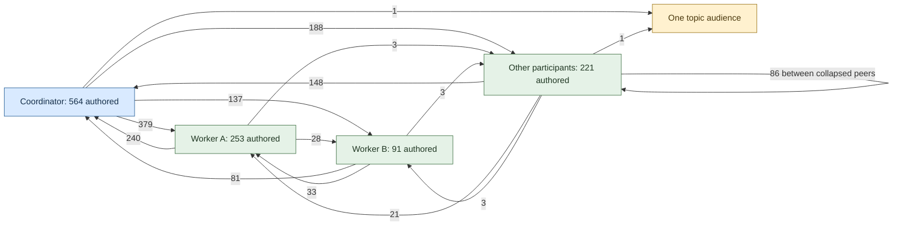

# Evidence and pilots for dependable coordination

This packet records the traffic evidence and proposed experiments for [bus-design](bus-design.md). It separates observed relationships from interpretation; current protocol behaviour remains in [messaging](../architecture/messaging.md) and [interfaces](../architecture/interfaces.md).

## What the export can show

The private export contains 1,253 unique message rows, spanning 2026-10-26T07:06:44.67Z through 2026-11-01T03:06:01.542Z. Its producer attributed it to commit `t = 1546`; the rows themselves lack commit, presence, read, cursor, wake and turn fields. Its SHA-256 is `4c811125df5a24cc433c7f707c6bd3fdad11aba5fb34a87c6b9a37d07769bab4`.

Exclude any row whose sender or any recipient begins with `qual/` or `deploy-check/`. Exactly 124 rows are excluded and 1,129 remain. The export was supplied as message-only; its missing `kind` field prevents independently checking that restriction. The filtered population has 755 reply links and 374 roots, with all parents present and no cycles. There are 155 singleton components and 219 larger components; the largest has 28 messages, and the deepest parent chain has 12 links.

These are derived conversation components. They are neither runtime chats nor topic partitions. An absent reply means only “no linked response observed in this snapshot.” It does not establish that work is unfinished, ignored or unaccepted.

## Actual audience graph

The first three nodes below alias individual participants. “Other participants” collapses 21 other observed addresses, of which 20 authored messages. Node labels count authored messages; edge labels count explicit recipient incidences. Those are different measures.

The node-authorship counts sum to **1,129 messages**. Edges sum to **1,352 explicit recipient incidences**: 1,350 named-address values and two topic values. Do not expand the topic edges into inferred deliveries; the export has no historical membership or read evidence. The collapsed self-edge joins different underlying peers; no retained message actually names its sender as a recipient.

The incidence sum is independently checked by recipient cardinality: `950 + 2×147 + 3×20 + 4×12 = 1,352`. Incoming counts are Coordinator 469, Worker A 433, Worker B 168, other participants 280, topic two. Coordinator involvement is a union of 564 authored and 469 explicitly addressed messages: 1,033 / 1,129, or 91.50%, with no overlap. Authorship alone is 49.96%.

The graph supports investigation of the hub; it does not prove that the hub is unnecessary. It also shows sparse topic addressing, but does not identify whether configuration, guidance or lack of need caused it. The [sanitised aggregate data](bus-design/traffic-aggregates.json) and [edge table](bus-design/traffic-edges.csv) contain no raw bodies, subjects, original addresses, session identifiers or machine paths.

## Classifications that the counts cannot settle

Of 153 replies to multi-recipient parents, 104 omit at least one value from `parent.to` other than the replier (67.97%). If “participants” also includes the parent's sender, the count is 109 (71.24%). Neither is a defect rate. Context may justify a narrower reply, or show a necessary participant was lost.

Exact case-insensitive body matching for “no reply needed” finds 13 messages. An earlier report's 33 was not reproduced and its cited script was unavailable. Do not silently replace the exact rule with an assumed broader semantic rule. A phrase can waive acknowledgement while still inviting useful correction.

The ledger cannot establish wake reduction, token savings, fewer interruptions or faster work. Those claims require separate instrumentation and a baseline. A lower message count can mean missing coordination.

## First experiment: independent interpretation of 50 messages

The hypothesis is that explicitly separating audience, requested responder and useful response makes coordination clearer without suppressing dissent or inventing obligations. Keep the existing `to` and `replyTo` fields; do not add a mandatory intent taxonomy for this experiment.

A fixed private sample manifest exists. Selection uses disjoint sequential strata, with candidate IDs ordered by a seeded SHA-256 hash. It intentionally oversamples rare boundaries and is not a prevalence estimate. The sanitised [sample plan](bus-design/sample-plan.json) records the allocation; private IDs and source bodies are not published.

| Stratum | Selected | Eligible after prior strata |
| --- | ---: | ---: |
| Topic-addressed | 2 | 2 |
| Literal no-reply phrase | 8 | 13 |
| Reply omits a parent recipient | 10 | 104 |
| Reply omits parent sender | 8 | 36 |
| Remaining multi-recipient | 10 | 174 |
| Remaining single direct recipient | 12 | 927 |

Freeze this rubric before independent annotation:

1. Record mechanical audience, parent and audience difference separately from judgment.
2. Classify requested response as none, acknowledgement, substantive answer, decision, action or unspecified; allow mixed intent.
3. Classify requested responder as explicitly named, volunteer audience or ambiguous.
4. Recommend a reply audience with reason and authorised scope.
5. Record observed linked response as none, acknowledgement, partial, substantive, other or uncertain.
6. Record acceptance/completion evidence separately, including “not established.”

Two annotators inspect the message, available parent chain and child responses independently. A designated adjudicator records reasons for each disagreement; unresolved intent stays uncertain. Historical interpretation is not ground truth about the author's private intention. Agreement may be reported only after both sets of labels exist.

Stop after 50 dispositions, or earlier if the rubric conflates routing, responsibility and lifecycle. Revise and re-annotate affected cases before proceeding. The sample is ready; annotations, adjudication and measured agreement are **not run** in this release record.

## Second experiment: one finite convention rehearsal

After the offline review, the DRA may explicitly launch a finite rehearsal on the design topic using existing fields and ordinary prose. This packet alone does not recruit participants or authorise live operational work. Use naturally arising exchanges where possible; mark synthetic cases and ask for no real operational changes.

| Case | Required distinction |
| --- | --- |
| Direct FYI with acknowledgement waived | Silence is appropriate when there is no useful addition |
| The same FYI contains a consequential error | A correction remains welcome |
| Topic question invites volunteers | Subscription does not require every peer to answer |
| Topic question names one responder | Audience and requested responder are distinct |
| Shared request needs a shared answer | Necessary participants remain in the reply audience |
| A follow-up intentionally narrows its audience | Narrowing is evidenced as appropriate |
| Reply goes to a different party from the parent sender | `to`, not `replyTo`, delivers it |
| Acknowledgement or partial answer | The link does not establish completion |
| Participant joins later or reads history | Context does not confer old obligations |

The sender records intended audience and useful response before evaluation. Compare independent predictions, actual replies and that statement. Count missing necessary recipients, unintended work expectations, unnecessary acknowledgement, suppressed useful contributions and unsupported completion claims. Each inbox remains under its own owner; observers use history/query only.

Success requires an evidenced disposition for all nine cases, with ambiguous meanings retained explicitly. Stop if the convention causes unauthorised work, suppresses a necessary correction, requires another owner’s inbox to be consumed, or depends on an unapproved live subscription/config change. Test subscription transitions first in disposable fixtures. Case counts are proof coverage, not measured product savings.

## Separate candidate: a topic orientation bulletin

A normal message can orient newcomers: one concise bulletin with topic, author, version, date, review/end event, at most five items and links to the canonical skill, repository instructions or runbook. A replacement explicitly states what it supersedes. The bulletin is information with provenance; retrieving it grants no work authority.

The onramp must tell a newcomer how to retrieve it. “Subscribe to this topic” alone cannot reveal a message sent before the join. Do not silently coach a participant and count a successful cold start.

Latest-version selection also needs a contract. Full-text `bus_history` chooses high-scoring matches, then displays that subset chronologically; its last result need not be the newest bulletin. Participant-only history can omit an older bulletin beyond its result window. A known root pointer or an exact-subject query with explicit ordering and checked truncation/pagination is needed. Validate designated convener, explicit supersession, review date and canonical links. A newer reply or self-declared version does not establish replacement authority.

Test missing lookup instructions, old bulletins outside the first page, a high-scoring obsolete version, newer discussion replies, conflicting replacements, expiry and dead links. Success means uncoached retrieval of the accepted orientation and recognition of stale or conflicting evidence. A newcomer must not begin historical tasks merely because the bulletin mentions them.

A seven-day trial is a proposed timebox. Record eligible onboarding episodes, successful retrievals, clarification requests, rebriefing messages and incorrect actions. Zero rebriefing messages with no newcomers is vacuous; zero with incorrect action is failure. No reminder, recurring moderator, subscription change, pin schema or wake injection is installed by this packet.

## Verification and next action

Parsed every exported row; checked unique IDs, filter counts, graph sums, parent closure, cycles, component sizes and sample disjointness. Read the schema, publish, delivery and search implementations. All work was read-only; no live messages, subscriptions, services or configuration changed.

Next action: have the maintainer review the distinctions and sampling contract, then launch independent annotation. Keep the observed aggregate evidence distinct from the unrun experiments. The DRA owns interpretation and any later launch decision.
