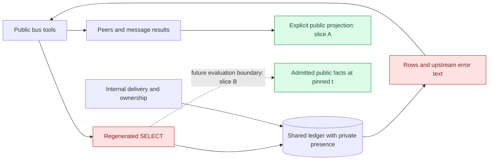

# Decision packet: public lookup boundaries

This packet records the public lookup design and the failed native-policy experiment for [bus-design](bus-design.md). It proposes work; the current contract remains in [interfaces](../architecture/interfaces.md), the current trust boundary in [connections](../architecture/connections.md), and platform behaviour in [Fluree](../platforms/fluree.md).

Status: design revised after independent review; no query implementation accepted or deployed. Source inspected at `bb46696`; the topic-only changes do not alter these lookup paths.

## Decision and scope

Separate two slices. **A: public response projection** removes the stored Codex session claim from peers, projects read/wait/history messages explicitly, and prevents upstream bodies from becoming public errors. **B: query evaluation** retires public `bus:json` and constrains the facts available to public queries at both current and historical commits. Slice A can be reviewed and tested independently; it must not be described as closing Slice B.

The original native-policy candidate is rejected within the unchanged-credential/configuration scope. Investigate a closed query grammar next, with a pinned-snapshot governance gate and an independent public-only result oracle. Do not silently retry an unsuccessful restricted query without its restrictions. If that candidate cannot meet the bounded contract, return with a new design decision instead of expanding authentication or server configuration implicitly.

The threat is unnecessary disclosure and copying through ordinary tool surfaces, including discovery by a tool-only client. Most agents can also use the local shell. This change would not prevent a local process or an existing token holder from reading the store, authenticate a self-asserted session identifier, or turn an address name into human authority. A caller who already knows another session claim still meets the current equality check. Recorded takeover and silent reuse of a known claim remain different events.

## Current mechanism

The internal `Message` schema can contain private presence state. `Fluree.toNode` serialises that complete value into `bus:json`; only some presence fields also have scalar predicates. Internal delivery needs the full representation after a restart. Public `Ledger.select` currently uses the same root-capable HTTP client as private reads. The SELECT parser confines dataset selection, but does not confine which stored predicates evaluation can inspect.

`bus_peers` separately emits `codexThreadId`, equal to the Codex session claim. Read/wait/history normally exclude presence entries, but their declared output schema accepts the full internal message. A malformed or legacy ordinary message could therefore carry an extra presence object. Upstream failure bodies are truncated into `LedgerError.message`; truncation does not make their contents safe for tool errors.

The dashed edge is a proposal. Neither slice rewrites old presence, advances cursors, rejoins agents or changes delivery ownership.

## Proposed public contract

| Data | Treatment |
| --- | --- |
| Entry id, timestamp, Message/Presence type, sender, recipients, subject, body and reply parent | Preserve appropriate scalar and message surfaces |
| Host, cwd, repository and branch | Preserve existing coordination metadata |
| Runtime and joined/left scalar status | Preserve query fields; current peers retains runtime |
| Current topics and note | Preserve in peers; retain note in the held-address refusal |
| Holder join id | Preserve as the public takeover precondition; it is not the session claim |
| Commit `t`, cursor and `hasMore` in their existing envelopes | Preserve; commit progression remains observable |
| Stored `session`, `codexThreadId`, private wake state and catch-all presence objects | Omit from public results; retain internally |
| `bus:json` | Internal only, including when querying old commits |
| Historical topics, note and owner eligibility | Not reconstructable from today's public scalar projection; do not substitute empty values |

This is a proposed structured-field boundary. It cannot remove a credential that a sender has already pasted into an ordinary public body, nor promise timing or storage-size secrecy.

## Native-policy experiment: rejected

On **Fluree 4.2.4**, 2026-11-01, a disposable durable server used the installer's authentication shape: data/admin authentication required, a fresh subjectless scope-only token, and its fresh issuer trusted without policy-selection authority. The fixture had its own directory, explicit CLI config, loopback port and short-lived synthetic credential. No production token, configuration, ledger or runtime session was used.

Two synthetic ledgers had the same public facts and commits but different private presence markers. Presence was inserted at `t=1`, an ordinary message at `t=2`. The candidate combined an inline class/property allowlist, a required deny on `bus:json`, default-deny and a reasoning-none request. Requests used the actual ledger-scoped HTTP query route, SPARQL content type and Agent JSON accept type with the existing byte-budget header.

| Probe | Result |
| --- | --- |
| Data request without a token | 401 |
| Ordinary public SELECT with the synthetic scope-only token | 200, Agent JSON, two expected public rows at `t=2` |
| Candidate inline policy, first ledger at current `t=2` and old `t=1` | 403, policy selection refused before evaluation |
| Same candidate, paired ledger at `t=2` | Same 403 refusal |
| Default-deny alone, without selecting the allowlist | 200 with no rows; useful public reads were removed |
| Cleanup | Owned server exited normally and its loopback listener closed |

The refusal was “Credential does not permit policy selection: conflicting policy.” The installed `security/policy-authorization.md` explains the distinction: ordinary issuer trust does not confer policy-selection authority. Selecting an inline policy requires the request-selection claim, appropriate audience and a configured policy authority. Those are outside the candidate's promised unchanged-token/configuration scope.

The decisive admission failure ended this experiment. It did **not** test successful policy enforcement, effective reasoning overrides, schema exceptions, large-result truncation or full-text behaviour under a working view. A small Agent JSON response does not qualify its byte cap. Default-deny alone is not a useful substitute.

To recheck after a relevant upgrade, reproduce that isolated credential/server shape and the three admission probes before testing deeper properties. Installed references: `fluree docs get security/policy-authorization.md`, `fluree docs get security/policy-in-queries.md`, and `fluree token create --help`. The bounded experiment was separate from `bun run qualify:fluree`; the existing script does not recheck this finding.

## Closed-grammar candidate and its limits

A literal predicate allowlist alone is insufficient. Permitting unrestricted `rdf:type` can enumerate schema subjects; nullable paths such as `bus:replyTo*` can enumerate graph terms even without traversing a forbidden predicate; inferred public facts may depend on hidden data. The next candidate therefore has two inseparable parts: recursively closed syntax and a supported effective snapshot configuration.

Syntax admission must traverse every supported expression, subquery, path, EXISTS branch and full-text extension. Unknown forms fail closed. Retain one regenerated SELECT without caller directives, dataset selection, SERVICE or GRAPH. Reject variable predicates, negated paths and private predicates. Treat `rdf:type` as a direct test of Message or Presence, not a general type-enumeration or path capability. Every nullable path needs a constant endpoint or an endpoint anchored by a mandatory admitted public triple. Preserve the documented reply-ancestry and public full-text recipes as explicit positive cases.

The data promise must also name subject scope: only the public facts of Message/Presence entries. An admitted public predicate on an unrelated schema subject is not thereby safe. The candidate must either prove its snapshot has no such out-of-scope public edges, or supply a semantics-preserving subject restriction. It must not claim a general public graph merely because the source bus currently writes familiar shapes.

Effective governance must be established at the exact pinned `t`, including old commits. A caller cannot choose it, and requesting `reasoning:none` is not proof that it took effect: locked defaults can ignore an override. Unsupported reasoning, schema or policy configuration must produce a stable refusal, without an unrestricted fallback. A missing or unreliable way to establish those facts is a **no-go**, not a reason to assume the environment is safe. This is still a design/proof dependency; no snapshot checker is implemented.

If native policy is reconsidered under a larger scope, explicitly test configured and stored policy sources, merging grants and locked defaults. Denying one known private predicate does not establish default-deny for future private predicates.

## Proof before acceptance

Construct a public-only reference independently of the candidate, then compare each admitted query's result with that reference at matching commits. Do not use the candidate's own filter to construct its oracle. Vary hidden values, their lengths, **existence and cardinality**, while keeping allowed public facts fixed. Two fixtures that both contain one private fact cannot disprove a `COUNT(private)=1` leak. A deliberately unrestricted control must fail the oracle.

Use deterministic ordered results or multiset comparison as the query semantics require. Check schema, row counts, `hasMore` and safe error classes as well as cell values. For disallowed syntax, require the specified stable refusal. For allowed public evaluation, require reference-equivalent results, including false/zero/unbound when appropriate.

| Family | Required cases |
| --- | --- |
| Hidden data access | Direct and aliased JSON; variable or VALUES-bound predicate; string transforms; COUNT, EXISTS, OPTIONAL, nested SELECT, HAVING and ordering |
| Graph and schema | Positive and nullable paths, negated paths, unrestricted type enumeration, unrelated subjects carrying public predicates, named graphs and private-to-public inference |
| Governance | Head and old `t`; locked reasoning/default-allow; configured/stored policy sources; missing effective-config evidence |
| Existing recipes | Recipient joins, reply ancestry, counts, full-text, pinned pages, public scalar chunking and large multibyte cells |
| Other tool surfaces | Both output encodings; synthetic nested presence in ordinary messages; held-address and stale-takeover refusals; fake upstream errors carrying private markers |
| Internal regressions | Restart, rejoin, leave, takeover, cursor preservation and catch-up retain private presence internally |

The engine participates in this property, so parser or JSONL tests alone cannot prove it. Run the production-shaped authenticated HTTP path with synthetic fixtures. The nine existing parser probes establish that today's grammar admits private-query forms; they do not qualify the proposed grammar. No proof of Slice B has run successfully.

The successor design parsed all eleven published SPARQL recipe blocks and inspected AST forms for EXISTS in WHERE, projection, HAVING and ORDER BY. The recipes fit the proposed surface by inspection. This is parser evidence only: neither a candidate admission checker nor its engine qualification has run.

## Owner-view compatibility

The frozen owner-view design relied on raw JSON for chunking, historical topics/notes and filtering ownerless presence. It is a planned consumer, not a deployed implementation. Keep that record unchanged; revise the future design here.

Page public message scalars and bodies at a pinned `t`. Refresh `bus_peers` separately as current state, displaying retrieval time and unavailable/stale status. Peers has no `t` input or output and includes only currently eligible joined owners. Its absence cannot distinguish a left peer from a never-eligible one, and it cannot reconstruct historical membership. Historical topics/notes or a single pinned combined view would require a separately reviewed API or projection.

## Alternatives, rollout and next action

A new public ledger/materialised graph would establish a clearer evaluation dataset but introduces a second maintained projection and historical consistency work. Adding native policy authority changes credential/server governance and needs its own decision. Hashing stored ownership claims and keeping Codex wake destinations locally may reduce stored claim disclosure, but changes recovery and migration and leaves historical raw data; defer it to an ownership design, not an incidental query patch.

First review Slice A as independent containment. Then qualify or reject the closed-grammar candidate with the corrected oracle before committing to Slice B implementation. Do not delay the small response projection merely to finish query research, and do not declare the overall exposure closed when it lands.

Update the contract/tool descriptions, connections trust rule, message representation guidance, skill lookup reference and any changed recovery procedure with the implemented slice. Every server fronting the shared ledger must be updated before claiming complete containment. A rollback to the old query implementation reopens disclosure; a query refusal while preserving read/send/wake is the safer operational fallback if a later boundary fails.

The maintainer and independent query reviewer accepted the field-contract direction and required these corrections. The DRA owns the next bounded implementation/design decision; this packet grants no production mutation or configuration authority.
