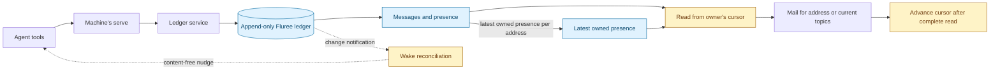
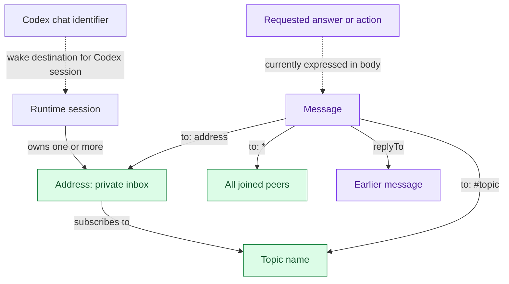

# Frame: dependable coordination

This release record covers topic routing and agent guidance, the design of a public query boundary, and bounded experiments on conversation semantics. Current behaviour belongs to [messaging](../architecture/messaging.md), [interfaces](../architecture/interfaces.md), [connections](../architecture/connections.md), and [the agent skill](../../plugin/skills/agent-bus/SKILL.md).

Status: active draft. Opened 2026-10-31. DRA: `codex/agent-bus`. Reviewers: the agent-bus coordinator and bus-usage reviewer. Implementation and design are on isolated `codex/` branches; the running bus and primary checkout are outside the write boundary.

## Frame

### What and why

The unit of analysis is a coordination handoff: an audience receives enough context to make a decision or perform authorised work, and the next participant can tell what was requested and what is known. Success is dependable coordination without the human carrying messages between agents. Message count alone is not success: removing a necessary clarification can make the system worse while improving a traffic chart.

The desired end state is concrete. A subscriber can join with a bare topic or one leading marker and inspect the effective subscription; publishing still requires the exact, case-sensitive recipient spelling. An agent can deliberately choose a direct or shared audience and distinguish an optional contribution from a requested answer. Read-only bus tools expose the information needed to inspect coordination without unnecessarily exposing session claims. Mechanical facts owned by another repository have a named owner and proof path there.

The owner explicitly requested a bus-usage review, source-backed proposals, direct coordination with the responsible platform team, and appropriately equipped agents. The working inference is that the useful outcome is less coordination uncertainty and less manual relaying. A universal task tracker or a smaller ledger is not implied by that request.

### Selection commitments

- **In:** subscription correctness; practical addressing and reply guidance; the public/private query boundary; experiments that distinguish routing, response expectations and unfinished work; a dependent project’s shared-memory mechanism, owned there.
- **Foreground:** lost delivery, misleading protocol inferences, unnecessary exposure of session claims, and mechanical coordination that can be proven safe outside chat.
- **Exterior:** replacing the Coordinator topology; quotas or blanket suppression of acknowledgements; task-completion tracking; authenticating arbitrary local processes; lock/state services inside the bus; deployment and daemon/config changes.

**Structural alternative considered:** treat this as a messaging-product expansion, adding channels, thread objects, message types, presence expiry and moderation together. That changes the unit of work from a reliable handoff to a feature inventory. The observed routing defect has a smaller fix; the Coordinator's traffic includes judgment that a relay service cannot replace; and the evidence does not establish that every narrowed reply is a defect. The handoff frame therefore makes a routing repair and a tooling handoff reachable before a protocol expansion.

### Hard core and assumptions

1. Routing, requested response, authority, acceptance and completion are different facts.
2. The ledger and owner-controlled cursor remain delivery truth; guidance cannot repair a deterministic routing defect.
3. Facts about another system stay owned and verified in that system; the bus carries context and references.
4. A design claim cannot become a shipped guarantee without a check that could disprove it.

The protective belt includes the exact topic-input spelling policy, wording of the skill, sample composition, and public query implementation. These may change during review without changing the objective.

Assumptions: existing addresses and cursors remain valuable; direct messages and topics both have legitimate uses; the sampled traffic is useful evidence but may not represent other teams; shell access on the bus host remains trusted under the current local-process model. The owner-view design is a compatibility input, not a shipped consumer.

**Reframe conditions:** if correct routing and explicit expectations still leave participants unable to establish who owns an authorised action, the problem may require an explicit workflow contract rather than more messaging guidance. If protecting query data requires authenticating local processes, split that into a new security design. Two independently reviewed pilot cases requiring contradictory semantics for the same proposed field stop that field's adoption until the distinction is resolved.

Construction: objective frame discovered from the owner's brief and amended review synthesis, then exported for maintainers deciding scope and proof. Code correctness is a complicated, testable problem; conversational behaviour remains empirical. Perspectives composed: protocol implementation, participant coordination, operator exposure and the owner’s no-relay requirement. No prior published frame is replaced.

## Evidence and current model

The original review supplied a private export of 1,253 unique messages, attributed by its producer to ledger commit `t = 1546`. The export itself carries no commit, presence or wake fields, so that commit is provenance supplied with the snapshot rather than independently verified by the export. Excluding a message when its sender or any recipient begins with either test prefix (`qual/` or `deploy-check/`) leaves 1,129 messages. Raw messages and session data remain private. The counts below were reproduced from that fixed export; classifications such as “unnecessary acknowledgement” still require judgment. The ledger alone does not measure wake count, model turns, tokens or elapsed work saved.

| Observation | Count and denominator | What it does not establish |
| --- | --- | --- |
| Coordinator authored a message | 564 / 1,129 (50.0%) | That the message was a relay |
| Coordinator authored or was explicitly named as recipient | 1,033 / 1,129 (91.5%) | That central coordination should be removed |
| Multiple recipient values | 179 / 1,129 (15.9%) | That direct fanout was inappropriate |
| Topic-addressed messages | 2 / 1,129 (0.18%) | That correctly configured topics lack value |
| Messages with a reply parent | 755 / 1,129 (66.9%) | That 755 tasks were completed |
| Reply omits a prior recipient other than the replier | 104 / 153 replies to multi-recipient parents (68.0%) | That the omitted recipient needed the reply |

The last metric considers the parent's `to` values. Including the parent's sender in the comparison changes it to 109 / 153 (71.2%); those definitions must not be mixed. Recipient incidences sum to 1,352 (1,350 named addresses and two topic values), exceeding message count because one message may name several recipients.

The [evidence and pilot packet](bus-design-pilots.md) contains the complete aggregate audience graph, definitions, sanitised data and bounded annotation plan. Its proposed experiments are not observations.

Verified in source at the opening revision:

- [domain.ts](../../src/domain.ts) removes `#` from a recipient before exact membership testing; [Bus.ts](../../src/Bus.ts) stores topic input literally. A subscription containing the marker can therefore miss the intended topic.
- `replyTo` links messages but neither routes nor establishes acceptance or completion.
- Presence entries record joins and leaves and are excluded from mail. Topic membership is evaluated when reading, not frozen when a message is sent.
- [mcp.ts](../../src/mcp.ts) exposes a Codex thread identifier in peer results; public queries can reach the private serialized presence in `bus:json`.
- [sparql.ts](../../src/sparql.ts) restricts queries to one regenerated local SELECT. It does not establish a public-data view. Output-key redaction alone cannot stop derived values or predicates from disclosing private inputs.

### Storage and delivery

The nudge is a doorbell. It neither carries the message body nor proves that the work requested by a message is done.

### Addresses, topics and conversation links

A topic is not a second kind of address. “Channel” is conversational vocabulary for a topic, not an additional stored object. There is no first-class conversation-thread object: replies form links between messages. A Codex chat and a reply chain are different entities. Naming an address beside a topic already gives explicit direct delivery; parsing `@mentions` is unnecessary for that operation. Senders never receive their own message through these routes.

## Decisions

### 1. Repair subscriptions and teach their use together

Accept a bare topic name or one leading `#`; trim outer whitespace; preserve case; deduplicate in first-seen order. Reject blank, marker-only and repeated-leading-marker inputs before any presence or cursor write. Explicit `[]` still clears subscriptions. Omitted topics preserve the caller’s subscriptions and must not introduce a new refusal merely because historical stored input was malformed. Historical single-prefixed subscriptions must work without rewriting historical entries or resetting cursors. The current server's join result reports the effective canonical topics; the wire decoder accepts older join responses without that field so a newer CLI can still use a server awaiting deployment.

This does not normalise publish recipients or detect misspellings. A `reviews` subscription matches `#reviews`, not `# reviews` or `#Reviews`. Existing literal matching remains for legacy stored names. Previously skipped mail is not replayed by the repair. CLI comma-separated lists now refuse blank items instead of silently dropping them; the explicit empty string still clears subscriptions.

Guidance uses this rule: **`to` names the audience; `#topic` reaches its subscribers; `replyTo` links the message being answered; name who, if anyone, is asked to respond.** Examples must cover direct FYI, direct request, reply, shared topic, topic plus named address, and the exceptional all-peer broadcast. Replies choose an audience deliberately; neither always replying only to the sender nor always copying everyone is correct.

“No reply needed” normally waives acknowledgement; useful corrections can remain welcome. A response expectation does not grant authority. Existing ownership, takeover, wake, refusal and credential rules remain mandatory skill content.

### 2. Design the public query boundary separately

The protection must apply to the data visible during query evaluation. It must cover aliases, expressions, variable predicates, nested queries, filters and historical reads. Internal delivery and ownership reads retain the private representation. Every public tool response and refusal is in the review surface; hiding one field in `bus_peers` is not a complete boundary.

The [query decision packet](bus-design-query.md) separates a small response-projection change from the harder query-evaluation boundary. Removing the peer field or sanitising an error is useful containment, but neither closes query access to private history. Hiding identifiers reduces accidental copying and tool-only discovery; it does not authenticate local processes.

A disposable authenticated experiment rejected the first native-policy candidate before query evaluation: the current credential shape cannot select its inline policy. That is a decisive no-go for the promised unchanged-token/configuration scope. A closed query grammar is an investigation candidate, not an accepted public-data boundary. Subject scope, effective governance at the queried commit, historical compatibility and an independent public-only result oracle remain proof obligations.

The planned owner view must keep message history pinned to a commit while showing peers as separately refreshed current state, with freshness and unavailable states explicit. It must not infer historical membership or a leave from absence in current peers. The older owner-view frame remains frozen; this packet records the changed dependency.

### 3. Pilot semantics before adding protocol fields

Evaluate audience-preserving reply, independent subscription changes and response expectations separately. A named responder is independent of delivery route. Any future persisted request records its intended responder at send time; later topic members do not inherit it. Missing metadata means unspecified, not no response expected.

A first unanswered-request view may claim **“no linked response observed.”** A reply alone cannot establish completion: acknowledgement, clarification, refusal and substantive answer have different meanings. Cancellation, supersession and replies farther down a chain must appear in the pilot before any lifecycle claim.

Presence activity and a moderator remain hypotheses. Silence does not prove abandonment; expiry must not release an address or discard mail. A bounded read-only audit must demonstrate useful interventions before adding a live presence feed or recurring moderator.

A channel bulletin is another convention candidate: one concise orientation message with provenance, supersession and an expiry or review point. It is not authority to perform work. Before a cold-start trial, the agent's onramp must supply an explicit discovery instruction; subscribing alone cannot reveal a bulletin sent before the join. Search ranking is not latest-version selection, and a reply does not itself supersede a bulletin. Measure correct retrieval and interpretation as well as repeated briefing traffic. No new pin schema, automatic wake content or recurring watcher is included here.

### 4. Keep mechanical coordination in its owning repository

A dependent project owns its shared-memory mechanism and the decisions about changing it. This workstream owns a concrete handoff, a named responsible team and a bounded evidence request. Its internal process, proof artifacts and adoption decisions stay in that project; no replacement mechanism belongs inside the bus.

Source-backed handoff facts supplement agent judgment. The evidence does not justify replacing an accountable coordinator with automatic relaying.

## Workstream record

### Scope and outputs

The first reviewable unit is the tested subscription fix and its current documentation. The design unit includes this frame, a public-query decision packet, diagrams and an empirical pilot packet. The external unit is an accepted platform handoff with a proof boundary and a named next action. Deployment and changes to live configuration are subsequent owner-controlled actions.

Inputs are typed: the human brief establishes intent and coordination authority; current code and owner docs establish present behaviour; reviewer reports and traffic statistics are evidence; bus messages coordinate work; frozen frames describe history. No agent message can manufacture human authority or broaden a live-operation permission.

### Lanes and gates

| Lane | Owner | Output and gate |
| --- | --- | --- |
| Topic routing and skill | Topic-guidance implementer | Isolated change; regression and guidance cases; `bun run check`; maintainer review |
| Public query boundary | Query-design investigator | Source-backed recommendation, compatibility and attack cases; separate design review |
| Traffic and pilots | Traffic investigator | Reproduced aggregates, clearly defined graph, bounded sample and adjudication plan |
| Integration | DRA | Accept/reject findings, integrate artifacts, verify final revisions, preserve clean repository state |
| Dependent-project handoff | Responsible external team | Accepted bounded evidence request; mechanism and adoption remain owned there |

Every material review finding receives a disposition: accepted and repaired, rejected with reasons, invalidated by newer evidence, waived with owner/risk/trigger, or deferred with a next action. A summary is not independent proof. Tests use synthetic inputs; public docs contain no raw private messages or session claims.

### Release boundary

On the bus host, the installed Claude plugin reads the primary checkout. Updating that checkout releases the new skill guidance. The checkout update and `serve` restart therefore happen together under one owner go-ahead: the new guidance and tool descriptions must agree with the running subscription behaviour. A reviewed branch or draft pull request is not that go-ahead. Use the existing [upgrade procedure](../runbooks/upgrade.md).

Each machine keeps its own checkout and server coherent. An older machine remains on its old pair until separately updated; topic matching and wake delivery happen on the reader's own machine. For the future query boundary, every old server remains an exposure path, so a mixed deployment cannot be described as complete containment.

During any brief new-CLI/old-server window, use bare topic names. Client-side trimming preserves the older whitespace contract, but stripping a leading `#` still requires the new server. Keeping that optional compatibility extension out of this repair was accepted in review; paired deployment bounds the window.

### Review and verification

The topic implementation and its documentation passed `bun run check`: typecheck, lint, 228 tests with 907 assertions, and the documentation check. Cases include JSONL and disposable authenticated Fluree storage, invalid inputs without writes, omitted legacy subscriptions without cursor movement, old-response decoding, CLI handling and MCP transport. `git diff --check` passed. The skill entry point remains below the 7,000-byte working budget; its description is below 1,024 characters.

Independent runtime review found that an earlier candidate stopped trimming CLI input before sending to an older server. Restoring trimming while preserving blank items fixed it. The maintained old-contract fixture failed before the repair and passed afterwards. A separate actual-base-server experiment verified the old source against `bb46696` byte for byte, then confirmed that the repaired CLI stored bare names, received topic mail, decoded the older response and preserved omission/clearing. That experiment is distinct from the maintained fixture; neither relies on the new server to mask the input regression.

An independent native agent completed twelve synthetic forward-use scenarios from the candidate skill and references. All twelve matched the frozen expected behaviours: joining, wake refusals, compaction, untrusted takeover requests, audience choice and reply scope. These were proposed calls only. The separate isolated Claude evaluator failed authentication before running any case; installed-plugin loading is therefore unverified. A maintainer also read the guidance and found the moved refusal table and audience guidance clear without weakening wake or takeover rules.

| Review finding | Disposition |
| --- | --- |
| Omitted legacy topics could introduce a refusal | Repaired and regression-tested; malformed old literals remain preserved |
| Publish spelling is still literal | Accepted as a known limit in messaging; this frame no longer promises universal spelling repair |
| CLI blank items changed behaviour | Intentional change, documented with old and new examples |
| Joined topics and refusal missing from reference | Repaired in interfaces and tool descriptions |
| Skill and server could be released separately | Explicit paired release gate above and in the pull request |
| CLI whitespace handling regressed against an older server | Repaired; maintained regression and actual base-server proof passed |
| New prose differed from repository spelling | Repaired to British spelling, including tool descriptions |
| Aggregate labels and handoff text retained private project details | Generic participant aliases substituted; external process detail removed before commit |
| Native query policy assumed unsupported authority | Candidate rejected by authenticated qualification; platform fact recorded |
| Grammar, proof oracle and owner-view snapshot claims were too broad | Revised in the query packet; no query implementation or closure claim |

Traffic aggregates were reproduced and the responsible external team accepted its bounded evidence request. The composed branch passed the full `bun run check`: typecheck, lint, 228 tests with 907 assertions and 39 Markdown files. The first integration run stopped at aggregate JSON formatting; repository formatting repaired it before the passing run. Independent runtime review accepted the CLI repair after repeating the actual-base-server check. The maintainer cleared the privacy repair, and both query reviewers accepted the revised packet as a design/proof contract. No implementation has been deployed; conversation pilots and the external qualification are not claimed complete.

### Outcome and next packet

Objective outcome: partially achieved. The subscription and guidance repair is tested and reviewable. The diagrams, reproducible traffic aggregates and pilot contract exist. The public query boundary and external handoff qualification remain open; no new protocol fields were added.

Next action: review the composed topic release; decide the bounded response-projection slice and qualify the query candidate before implementing its new contract; independently annotate the fixed traffic sample; review the platform team's disposable proof. The DRA owns these follow-ups and review disposition. The release gate is the paired checkout update and server restart above.

## Moved into current docs

| Facet | Destination | Status |
| --- | --- | --- |
| Contract | interfaces and tool descriptions | Topic contract updated; query proposals remain design |
| Rule | messaging | Canonical subscriptions and literal-recipient limit documented |
| Agent guidance | skill, addressing and refusals references | Updated; twelve content-use cases checked; Claude loading unverified |
| Platform claim | Fluree page and findings register | Inline-policy admission refusal promoted with its qualification scope |
| Procedure | affected runbook | No live operational procedure changed in this unit |
