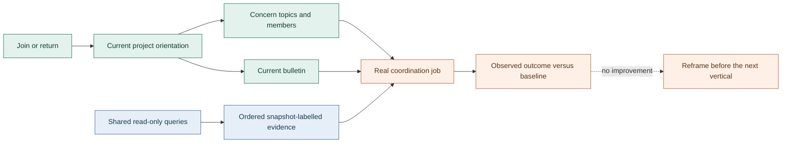

# Frame: coordination that teams use

This candidate frame covers the owner-directed product turnaround, its shared state model and real-team acceptance. [Projects](turnaround-projects.md), [topics](turnaround-topics.md) and [bulletins](turnaround-bulletin.md) are facets of one orientation vertical, not independent teams. Related frames cover [queries](turnaround-query.md), [activity](turnaround-activity.md) and [the viewer](turnaround-viewer.md). Current behaviour remains in [messaging](../architecture/messaging.md), [delivery](../architecture/delivery.md), [interfaces](../architecture/interfaces.md) and [viewer](../architecture/viewer.md).

Status: owner-accepted for implementation on 2026-11-01; deployment remains separately gated. Opened 2026-11-01. Joint DRAs: the Codex and Claude bus leads, with the accountable vertical split below. Mode: co-framing. Object: objective reframe. Operational correctness is testable; real-team behaviour requires observation.

## Diagnostic and construction

The preceding [bus-design frame](bus-design.md) prioritised a routing repair, guidance and bounded conventions. Those outputs shipped, but useful SPARQL was withdrawn and the new capabilities did not establish the desired real-team operating change. A skill announcement and a steward answering a documentation check cannot establish adoption. The owner has withdrawn the local-process query-containment premise and requested real product features and the full product loop.

The named move is **double-loop change**: completion now means an agreed real customer outcome improves, not that artifacts have accepted dispositions. The first query outcome is complete evidence retrieval without a human export; reduced coordination relay is a separate topic/adoption outcome. One does not establish the other. This is not a relabelling of the previous release checklist.

**Structural alternative:** restore queries and publish more examples while keeping projects and bulletins as conventions. That has lower schema cost and remains a serious comparison for projects. It cannot be the default for bulletins: the owner explicitly wants their retrieval and currentness owned by the server. A second alternative, building every suggested feature together, delays real feedback and can repeat announcement-only closure. Prefer one coherent model, delivered in customer-verifiable verticals.

## What and why

The unit is a real coordination job: a participant finds the right concern, recovers current context and evidence, contributes to the right audience, and can become inactive without disappearing. A team should not require its director or human owner to repeat a private briefing whenever work changes hands.

Select in useful read-only analysis, semantic audiences, project discovery, first-class orientation, continuity and the viewer. Foreground successful customer jobs and fewer manual relay steps. Deliberately exterior are adversarial local-process isolation, conventions presented as implemented features, synthetic pilots presented as adoption, a new task tracker, and new transport or sandbox infrastructure.

## Hard core and assumptions

1. The bus is local infrastructure for trusted actors; read-only queries must be useful. Address collision protection, read ownership and no transaction-through-query remain operational contracts, not a new authentication programme.
2. A project/concern model earns its place by making real discovery and audience choice easier. A catch-all project topic is not semantic topic adoption.
3. The server owns which bulletin is current. A newcomer or returning participant must not reconstruct that from ranked search or reply subjects.
4. Every vertical has one accountable owner and completes discovery, frame, build, qualification, deploy, real use, measurement and iteration. A green suite does not complete the last three.
5. Replacing a mechanism includes retiring its superseded code, duplicate execution paths, fallbacks and misleading current guidance. Preserve historical evidence, not dead runtime routes. Record any genuinely required transition path with its removal gate rather than leaving an indefinite fallback.

The protective belt includes exact API names, project identity/alias choices, saved-query packaging, bulletin scope and activity-state vocabulary. These are design decisions, not commitments manufactured by this frame.

Assumptions: the largest consumer will participate in a bounded real-use trial; its durable source instructions remain authoritative; ordinary direct mail remains useful; current addresses and unread state must survive migration. Role or workflow authority is not inferred from a message link.

## Shared state model

The Codex lead owns one orientation vertical and the shared relationship model. Its project, topic and bulletin frames are discovery facets, not permission for separate API designs or staffing. The orientation design settles the composed join/orient contract before activity builds on it.

| Relationship | Meaning and boundary |
| --- | --- |
| Address ownership | One runtime session owns the inbox; neither project association nor inactivity transfers it. |
| Project association | An explicit project/directory relationship, not inferred authorisation or a mandatory new table. |
| Concern topic | A discoverable audience within the accepted project model, not every project participant. |
| Subscription | Interest and shared delivery, distinct from membership, responsibility and activity. |
| Activity | Notification participation while retaining direct reachability; not evidence that a closed runtime can execute. |
| Bulletin scope | One server-designated current orientation per accepted scope, distinct from permanent instructions and authority to execute. |

One orientation operation composes project, concerns, members, current bulletin and the query-owned saved catalogue with usable examples. It labels pinned evidence versus live/current state and missing associations rather than silently combining them. The query vertical owns query definitions; orientation references that catalogue rather than cloning it. Exact names and storage remain design decisions.

## Orientation contract proposal

Dated 2026-11-01, for counterpart cross-review. This is a consumer-grounded contract proposal, not an implemented API, an adopted consumer policy or an agreed trial.

### Discovery result

The largest consumer confirms no eligible forthcoming orientation handoff, incoming participant, coordinator or bulletin maintainer yet (C4 below). Its agreement to a future query acceptance over the completed historical job remains separate; that acceptance has not yet been performed. This is not a new prerequisite for the query release or a reason to manufacture an onboarding job.

Its demonstrated grouping is one repository with explicitly identified checkout/worktree aliases. A broad development parent, consulted media or other systems, and removed transfer scratch do not establish membership. A directory linking concerns and their current summaries is the smaller candidate; no additional project-wide bulletin or blanket subscription has demonstrated value there.

### Narrowed relationships

Persist one stable directory identity, explicit aliases and registered concern links, without adding independent project lifecycle, authorisation roles or a second membership registry. This is server-owned state, not a naming convention. Concerns remain discoverable when their last subscriber leaves. Alias matching may return candidates and its selection basis; it never silently enrols an address. Resolve aliases at the orientation-state cut and report missing or removed aliases rather than silently dropping them. Machine-local alias values belong in the ledger and responses, not public documentation. Keep explicit association, subscription, responsibility and activity separate. Direct mail and reactivation remain reachable in every activity state.

A concern's current bulletin is explicitly designated, replaced by an identified successor, and retains its history. It links authoritative direction, source and delivery evidence rather than superseding those sources or authorising replay. Review-due means recheck requested; expired means currentness is unverified and requires reconciliation before reliance. Those are consumer design inputs, not maintenance commitments.

The Codex programme/orientation DRA owns bus-wide guidance publication for the current release and handover, using release-owned source and an explicit successor handoff rather than a perpetual dependency on one chat. Delivery to running and late sessions remains to be specified and qualified. This ownership establishes neither an orientation-trial commitment nor adoption proof; the lack of a consumer project-wide bulletin does not remove the programme's running-and-late-session guidance requirement.

### Composed result and currentness

One join/orient result returns the selected directory or unresolved candidates, registered concerns, explicitly associated members, separately labelled subscriptions/activity, current scoped bulletins and a reference to the query-owned catalogue. Its operation names, schemas, units, executable examples and catalogue revision come from that registry, not copied definitions or a second query gateway.

Label the investigation's pinned evidence cut, the current orientation-state cut, any subsequently observed head and the evaluation time used for review/expiry separately. A historical message cut does not make today's membership or bulletin designation historical; current enrichment is not fixed-cut evidence. Catalogue/code revision is not a ledger transaction.

Orient is read-only and consumes no inbox state. Join establishes its presence before reporting orientation. If that later read fails, report the committed join and orientation unavailability separately with an explicit retry route; do not disguise the successful join as a refusal. Preserve unread cursors. Replacing a bulletin must not lose or duplicate its ordinary update notification, and must not introduce two deliverable messages at one transaction while cursors still advance by transaction.

### Open validation

Confirm a real join/return job, its participant/coordinator and baseline, plus the actual bulletin maintainer and scope before counting adoption. A naturally occurring Agent Bus release handoff may be another customer, but an invented test role or coached author is not proof. Settle additive join/CLI decoding, ambiguous aliases, replacement conflicts/retries, mixed-cut labelling, expiry and missing state in maintained tests. An older or unavailable orientation capability is reported honestly, never replaced by ranked-message reconstruction. No orientation implementation begins ahead of the agreed query-first real-use outcome without a coordinated sequence change.

## First customer job and measures

Two representatives of the largest consumer supplied and consolidated one recent preview-delivery job, not two independent discoveries or nominal trials (C1-C3 below). It involved a source owner, submitter and publisher; blockers, candidate eligibility and actual publication were scattered through direct mail.

The first query outcome is to retrieve the complete ordered coordination evidence at an explicit fixed cut, including relevant messages without reply links, and reconstruct what was approved, what remained blocked, who could act, what actually completed and which holds were released. The executor runs the query once; the coordinator checks authority and handoff interpretation from the same returned material. An unbriefed-reader check is proposed, not a confirmed consumer commitment. Newcomer orientation, concern-topic onboarding and reactivation still need their own discovery and agreed real-use jobs.

The first query outcome is real task completion without a human export. Orientation proposes newcomer success without an individual briefing. For shared coordination, agree a fixed concern cohort, comparable observation windows, active concern-day denominator and exclusions before rollout. The mechanical primary proxy is distinct director-authored messages with an individual addressee in that cohort, counted once per message even with multiple recipients or a mixed direct/topic audience, per active concern-day. Saved queries expose the exact inputs and counts. They do not infer concern membership from paths or classify message intent.

The saved operation can compute observed-traffic days, not eligible concern-work days. It returns that diagnostic denominator and the direct-message numerator separately; unrelated cohort traffic or outside traffic to a concern can move the observed count. Do not silently substitute it for the agreed active concern-day denominator or count a falling ratio alone as adoption.

Direct-message volume is not semantic relay. Consumer-judged examples must establish whether actual rebriefing fell, while comparable workload, necessary-recipient coverage and unnecessary-interruption checks guard against a misleading reduction. Human coding is secondary, not the sole trigger or a new annotation programme. Topic share is diagnostic only. Report latency or time savings only if measured comparably.

The supplied traffic pull is a private message-only observation, not a pinned ledger proof or historical membership record. Its reported approximate topic share is not an accepted baseline until the cut, exclusions and denominator are reproduced. Do not count test traffic, the turnaround discussion itself, or an absence of newcomers as improvement.

## Ownership and gates

The Claude and Codex leads partner 1:1 with one accountable owner per vertical. Claude owns query, its viewer integration and activity; Codex owns orientation and its shared state model. Each owner integrates and runs its whole product loop; the other lead cross-reviews. Release decisions are joint, not subject to a separate general integration owner. Current official model documentation supports overlapping long-running coding/agentic capabilities, not a universal provider ranking. This split combines those capabilities with Claude's existing Effect/MCP/wake context and Codex's real-consumer intake and cross-host qualification context. The old prompt profile's model identity is not assumed to be the current runtime.

Query comes first: besides its own customer job, it supplies reproducible fixed-cut reads for later baselines. Cut the orientation/topic baseline through the deployed query contract before changing those workflows. Ad hoc history pulls are not the accepted measurement instrument. Query and its shared-definition viewer migration form the proposed first release unit; do not activate an interim viewer path merely to manufacture a baseline. The prior live viewer may truthfully be unavailable. This sequencing remains subject to the joint owner gate.

Frames precede new vertical teams. Each accepted vertical gets a dedicated concern topic, a bounded write surface, its consumer, a handoff contract and a failure route. Existing viewer corrections remain with their current owner and frame; do not create a competing implementation.

Bring the owner decision-ready checkpoints for this frame, deployment, and irreversible or external changes. Routine sequencing, review disposition and communication stay with the leads. Keep implementation in dedicated worktrees. A development clone whose trunk is not a live installation avoids activating source when Graphite updates its local trunk.

## Acceptance and operational follow-up

On 2026-11-01 the owner accepted the frame set, accountable split, query/shared-viewer/PR15 first release unit without an interim viewer deployment, and draft frame publication after acceptance with merge alongside that first release. This is implementation authority, not deployment approval.

The owner also rejected additional coordination directories and independent project clones: use the single canonical repository and the shared `DEV/worktrees` location for all projects, with agent/project/purpose names. This supersedes the independent-clone isolation option above. Preserve the exact deployed source while using Graphite; do not treat a submit dry run as permission to advance a live primary. If publication cannot preserve that boundary, resolve the specific repository-operation gate rather than creating another clone or bypassing Graphite.

The owner subsequently approved keeping each live checkout detached at its already-deployed commit, leaving `main` free for Graphite in that same repository. This changes checkout metadata, not source bytes or service state; reviewed activation remains separately gated. Longer term, the owner wants a versioned release artifact rather than source-checkout deployment. Retain Effect CLI and Bun, qualify executable and plugin/hook/viewer asset packaging together, and make activation/rollback independent of development branches. That packaging follow-up is not a prerequisite for restoring useful queries and orientation.

## Falsifier and lifecycle

If the first shipped vertical does not improve its agreed real-team measure against the pre-rollout baseline, reframe it before building the next. Count inability to discover the route, choose the audience, or proceed without repeated coaching as adoption findings, not exclusions for noncompliance. Deliberate use can qualify the mechanism but cannot erase unsuccessful real use. An observation window and threshold must be agreed with the consumer before rollout; missing eligible observations means unmeasured, not success.

Prior frames remain frozen. This dated proposal supersedes their completion criterion and records the owner's changed trust premise; it does not claim the current refusal is already removed. Mechanism and migration plans follow acceptance rather than being hidden inside the objective.

## Source register

These identifiers preserve the provenance of owner decisions and consumer offers without publishing their private project evidence. The leads retain the exact source paths, bounded extracts and acceptance oracle in the private turnaround intake.

- O1: direct human decision withdrawing adversarial local query containment.
- O2: direct human direction requiring the partnership, full product loop and frames before teams.
- O3: direct human decisions separating semantic concerns, a built-in bulletin and project discovery.
- O4: queued human command retaining direct contact and reactivation while inactive/done/idle agents stop project/topic notifications. This fixes an outcome, not an API shape.
- C1: executor's preview-delivery offer.
- C2: coordinator's offer.
- C3: consolidation and acceptance of one whole-job reconstruction, with the narrower interval only a control slice.
- C4: consolidated orientation discovery: no eligible upcoming job or accepted maintainer; explicit repository grouping, concern audience and review/expiry interpretation are design inputs, not adopted policy.

## Moved into current docs

- [ ] Contract: interfaces and tool descriptions reflect accepted, implemented APIs.
- [ ] Rules: architecture owners describe shipped behaviour and limits.
- [ ] Agent guidance: the skill supports the actual onboarding and activity paths.
- [ ] Platform claims: version-sensitive findings carry their observed basis.
- [ ] Procedure: deployment, recovery and real-team onboarding are verified.
