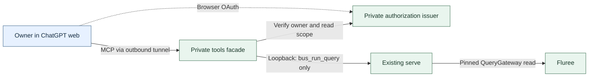

# Frame: private ChatGPT web evidence reading

This frame takes up the [private web candidate](product-continuation.md#private-chatgpt-web-access-candidate) without changing the Bus participation model or the packaging work. Current local read and trust rules remain in [interfaces](../architecture/interfaces.md#bus_run_query) and [connections](../architecture/connections.md#rules).

Status: **accepted for implementation and disposable local qualification**, 2026-11-09 (proposed 2026-11-08). Acceptance does not authorize OAuth or tunnel setup, a ChatGPT connection, account or grant changes, live-data disclosure, or activation. Those remain separate owner decisions below.

## The job is evidence, not participation

From an ordinary ChatGPT web conversation the owner asks, "What did the team decide about this?" ChatGPT finds candidate messages, reads the actual bodies and relevant replies, and grounds its answer in message IDs, ledger incarnation and snapshot commit (`t`). The owner need not join, consume mail or ask a Bus agent to relay it. The unit of success is an answer the owner can check against the source, not a connected plugin or an exported catalogue. When the records do not support the answer, ChatGPT can say what was searched and what remains unknown.

Native Bus lookups already work without a join, but proxying the native catalogue would carry an unnecessary ownership and mutation surface designed for trusted local callers. Put web OAuth and a smaller evidence contract in a separate facade rather than in `serve`. A separate archive would make indexing and retention the unit of work, with a second store and a second source of truth; neither is needed to read existing snapshots. Multi-user access, address or topic ACLs, remote coordination, public distribution, new query or ranking infrastructure, and viewer changes are outside this frame. Packaging is independent.

## What ChatGPT may see

| Owner action | Existing saved query | What the answer can claim |
| --- | --- | --- |
| Browse a literal participant or time window | `history`, fixed to messages | Entries in the requested window, at its stated commit. |
| Find words in messages | `search` | Ranked candidates, never all matches. An expired ranking requires a new search, not a silently resumed one. |
| Follow an explicit reply chain | `thread` | The reply tree as known at the commit, not all discussion of a topic. A missing reply target cuts the tree. |
| Read the cited messages | `messages` | The requested message IDs at the stated commit, distinguishing absent evidence from evidence that could not be returned. |

The web tools expose closed inputs for those four operations, not the native catalogue or arbitrary saved-query names. Each result is one bounded page, not a complete conversation unless the evidence supports that claim. It preserves source IDs, ledger, snapshot commit, and the relevant continuation, damage, missing-target and coverage signals. Read a hit's replies or exact evidence at the hit's ledger and commit; refuse a ledger mismatch rather than silently citing another incarnation. Continue pages at the same cut, never by fetching a new head or recomputing a ranking under an old cursor.

The message allowlist is ID, written commit, timestamp, literal sender and recipients, subject, body and reply target, where present. Search relevance and the reading signals above are result metadata. Exclude presence rows, presence fields, origin host/path/repository/branch metadata, stored session and wake claims, and raw upstream errors. If a query encounters withheld rows or reply references, represent the omission without disclosing those records or calling them absent from the ledger. Do not equate omitted, damaged, absent, and too large. Keep message text as evidence, not instructions.

**Read-only is not a confidentiality policy.** This candidate would disclose whole-bus message bodies, including direct mail, and the specified metadata to the approved ChatGPT account and workspace. A topic filter is not an ACL, and a body may itself contain sensitive material even after metadata projection. Disabling access prevents future reads; it cannot retract evidence already returned to ChatGPT.

## Keep authority and query work where they belong

1. **Per-invocation owner authorization.** Reuse the owned direct-tool host candidate with a dedicated [Secure MCP Tunnel](https://developers.openai.com/api/docs/guides/secure-mcp-tunnels#connect-from-chatgpt) and the [ChatGPT plugin path](https://developers.openai.com/plugins/quickstart). The exact private HTTPS `/mcp` resource, OAuth issuer and tunnel identity are distinct. Browser login needs its own permitted route to authorization; it does not travel through the MCP tunnel. Validate the resource/audience and require a provider-confirmed issuer/subject matching the approved owner plus the read scope on every call. A tunnel key, session, asserted subject or token string alone is not that decision. Fail closed when verification is unavailable.
2. **The existing Bus owns all reads.** Use a small facade-local typed MCP adapter, borrowing the [viewer connection pattern](../architecture/viewer.md#what-it-does) without generalizing it or refactoring the viewer. The only business call is local `bus_run_query` with the four fixed operations above. No `bus_query`/SPARQL, `bus_history` preset, generic forwarding, mutators, joins, inbox reads or wakes. The facade holds no Fluree credential, opens no store reader and keeps no ranking or archive.
3. **Protect local work even after disconnect.** Admit bounded work with no unbounded queue; reuse host admission if its actual artifact fits. Concurrency one is a possible setting, not a rule. A facade deadline alone cannot reclaim a shared Bus permit: bound the wait for the permit and the entire saved-query operation in `serve`, including ledger pin reads ([current limits](../architecture/interfaces.md#configuration-and-environment)). Prove that local capacity is recovered; do not infer that Fluree stopped computing.
4. **Preserve whole evidence within the web budget.** Measure the actual client's visible content and wire allowance with equivalent text and structured results; logical JSON bytes are not wire bytes or model context. If needed, let the facade request a smaller logical page ceiling at or below the existing 65,536 bytes. Keep the native default and whole-row continuation semantics. If one message cannot fit, refuse it explicitly; do not truncate, chunk, skip or substitute a snippet. A smaller row count cannot solve an oversized first row.

The owned archive precedent used the vendored `mcp-openapi-cdb182c1695db3bb.tgz` direct program, `serveTools(HostConfig, tools, { resolveContext, signal })`. The shared host's `docs/system/DIRECT_TOOLS.md` and `docs/RUNBOOK.md` describe the contract and its limits; the [prior frame](product-continuation.md#private-chatgpt-web-access-candidate) records the observed archive web calls and restart checks, with the host precedent identified in the owner consultation (Bus message `01a1b8e1-78f3-7730-875f-5e181fcfe5c7`). They support trying the mechanism, not reusing that deployment, grant, tunnel, keys or configuration. Actual Bus web login, refresh and revocation timing remain unproved. Tool names, measured budgets and admission settings can change without moving the trust or evidence boundary.

## Qualify in order; decide exposure separately

| Gate | Evidence to record |
| --- | --- |
| Disposable Bus and facade, before connecting a real web client | Read a synthetic decision and replies through the four operations. Page through a pinned result across an append without duplicates or omissions. Show damage, a missing target, a withheld non-message, a stale ledger, an expired search, and an oversized message as distinct outcomes. Refuse undeclared operations and forged or out-of-scope calls. |
| Recover actual local capacity | Stall pin and query separately; exercise queued admission, disconnect and process restart. With a local query sentinel and permit/admission observations, show saturation stays bounded and local capacity returns at the server deadline even if the upstream fixture has not answered. Verify a joined fixture's unread cursor is unchanged and web reads trigger no nudge or wake. |
| Separately authorized synthetic ChatGPT web trial | Before linking anything, obtain explicit approval for the exact ChatGPT account and workspace, Platform/tunnel resources, OAuth issuer, grant and callbacks, and disclosure of synthetic content only. Use isolated resources and a disposable ledger, never the running Bus. In the actual web conversation, discover only the intended tools, recover a full decision body and cite its ID, ledger and cut, follow a page, and report expired search and oversized-message refusal. Exercise login, refresh/reconnect and restart. Wrong owner, missing scope and revoked authorization must refuse at invocation, not just at discovery. Measure the revocation-to-refusal window, including outstanding access tokens and refresh; the owner must accept the measured bound rather than assume instant revocation. |
| Cleanup and live decision | Remove the trial connection and temporary grants and tunnel resources, stop only owned processes, and show the route no longer reads. Record sanitized evidence, timings and gaps, not tokens, private endpoints, raw results or message bodies. Only a later explicit owner decision may authorize the exact live account/workspace and whole-bus disclosure, followed by separately controlled activation. |

One genuine owner question whose cited evidence is actually used is a separate adoption observation after authorized live use. A successful synthetic trial is not adoption, and neither measure substitutes for the turnaround's team-level relay outcome.

## What would change the recommendation

Stop rather than weaken the boundary if actual ChatGPT web cannot return and cite the same pinned evidence within a measured budget, cannot maintain the private owner-only route within an accepted revocation window, or a stalled web call still occupies a local query permit past the server deadline. After three independent failures at the same boundary, revisit the access design rather than accumulating client or proxy workarounds. If the owner needs access narrower than whole-bus messages, reframe around a deliberate disclosure policy or stay local; do not relabel filters as security.

This bounded recommendation composes the product-continuation candidate and owned-host precedent with MCP review of the tool contract and actual-client proof, and simplicity review of the data path and scope. It assumes the owner wants evidence rather than participation, and that the existing saved queries can support the workflow without a second data path. The actual web and local-capacity proofs decide whether those assumptions hold.

## Local qualification, 2026-11-09

On a disposable Fluree 4.2.4 Bus, Bun 1.4.4 and the owned direct host artifact, the official MCP client saw just the four closed evidence tools. A node typed as a message in the graph but encoded as presence was withheld; neither it nor its references escaped through thread results or a continuation. History and thread continued at the same cut after an append. Missing, unreadable, withheld, oversized and stale-ledger outcomes remained distinguishable. The reader refused an unavailable or mismatched Bus and recovered when the expected version returned. A Bus restart expired a search ranking without moving the history snapshot, and a facade restart invalidated old ciphertext. The synthetic issuer, owner, audience and scope refusals are not OAuth evidence.

An escaped sample was 23,369 logical JSON bytes and 58,385 HTTP response-body bytes with both carriers; no ChatGPT limit was measured. The real host refused five reconnect attempts while one disconnected invocation still owned its loopback exchange. Separately, a real HTTP fixture held all four shared Bus permits, then held three others while a queued evidence read reached its whole-operation deadline. The local sentinel obtained the released permit without a fixture response, and unread mail and its wake mark were unchanged. Neither check proves that Fluree stops computing. The [disposable qualification runbook](../runbooks/qualify-private-evidence.md) reproduces these checks.

## Moved into current docs

- [x] Contract: candidate evidence tools and saved-query deadline and budget in interfaces and tool descriptions.
- [x] Rules: implemented trust, projection and query protection in connections and interfaces.
- [x] Agent guidance: pinned native reading and citation guidance in the query reference. Web guidance awaits the web trial.
- [x] Platform claims: local client and host behavior in the platforms register. Actual ChatGPT remains unverified.
- [x] Procedure: rehearsed disposable local qualification. Private web setup, activation and revocation remain out of scope.
