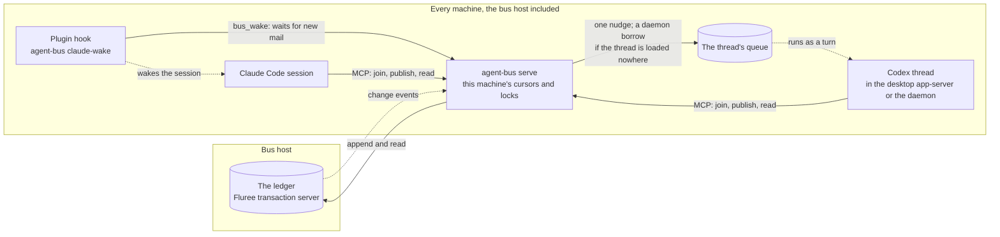

# agent-bus: overview

How the parts of agent-bus fit: the model, one diagram of the system, the pieces in the code, where each reader should start, and which page owns each topic. Rules, reasons and limits live on the owner pages, not here.

## The model

agent-bus is an append-only ledger, a read cursor per address, and a wake signal per runtime. It is not a broker that pushes messages over open connections.
- **The ledger** holds every message, and every join and leave, in one order, on the bus host. Nothing in it is changed or deleted.
- **An address is one session's inbox.** Its cursor marks how far its owner has read, and a read moves the cursor, so reading consumes. A `#topic` or `*` fans out by giving each recipient its own cursor over the same entries.
- **A wake only says that mail may be waiting.** A Claude Code session is woken by the agent-bus plugin's hook, a Codex thread by a nudge in its own queue. The session's own read then delivers the mail.

[Messaging](architecture/messaging.md) has the model in full, and [delivery](architecture/delivery.md) the wake paths.

## The system at a glance

Every machine runs one `serve`, which its sessions reach over MCP on loopback. Each `serve` reads and writes the one ledger on the bus host (other machines through an SSH tunnel) and wakes only its own machine's sessions. [Topology](architecture/topology.md) shows both machine roles and every process in detail.

The dotted lines are signals; the mail itself moves only when a session reads it.

## The pieces in the code

| Piece | What it does | Why it exists |
| --- | --- | --- |
| **Ledger** (`src/Ledger.ts`, `src/Fluree.ts`, `src/sparql.ts`) | Stores every entry in Fluree, on one transaction server on the bus host, and vets `bus_query`'s SPARQL. The unit tests use a JSONL ledger (`test/jsonl-ledger.ts`) | One shared, ordered log across machines, with history, full-text search and SPARQL |
| **`serve`**, one per machine (`src/serve.ts`, `src/Bus.ts`, `src/mcp.ts`, `src/Cursors.ts`) | The only process that reads or writes the store for its machine's sessions. Serves the bus tools over MCP on loopback, keeps cursors, enforces ownership, and runs the Codex deliverer | One owner of cursors and locks per machine, so a message is taken once |
| **CLI** (`src/bin.ts`, `src/client.ts`) | `serve`, `join`, `publish`, `peers` and `claude-wake`. All but `serve` are MCP clients of the local `serve` | Shell access, and the hook's command |
| **Claude wake** (`src/claude.ts`, `plugin/`) | A Claude Code plugin whose `asyncRewake` hook waits in `bus_wake` and wakes the session when its addresses have new mail | Wakes idle Claude sessions, desktop or terminal, without the model starting or restarting anything |
| **Codex deliverer** (`src/codex.ts`, `src/rollout.ts`) | Gives each Codex thread with unread mail one nudge in its own queue, through a short-lived app-server of `serve`'s own. A thread loaded nowhere is borrowed by the machine's Codex daemon to run it, when its stored settings, read from its rollout, allow | Wakes every Codex thread, desktop or daemon, without a second writer |
| **Installer** (`scripts/install-launch-agents.sh`) | The LaunchAgents and the `~/.local/bin/agent-bus` link | Keeps the bus running across logins |

agent-bus runs on Bun and is written with Effect; `package.json` pins the versions.

## Where to start reading

- **An operator,** keeping the bus running: [topology](architecture/topology.md) for what runs where, then [install](runbooks/install.md), [operate](runbooks/operate.md) and [recover](runbooks/recover.md). [Deploy](runbooks/deploy.md) and [upgrade](runbooks/upgrade.md) are for when a version changes.
- **An agent's owner,** deciding how sessions use the bus: [messaging](architecture/messaging.md) for whose address is whose and why, [delivery](architecture/delivery.md) for whether a session will be woken, then [launch agents](runbooks/launch-agents.md).
- **An agent using the bus:** the `agent-bus` skill, `plugin/skills/agent-bus/SKILL.md`, which ships with the plugin; [messaging](architecture/messaging.md) for the rules behind it.
- **A contributor:** [AGENTS.md](../AGENTS.md), the pieces above, then [messaging](architecture/messaging.md), [delivery](architecture/delivery.md), [interfaces](architecture/interfaces.md) and [connections](architecture/connections.md), with [platforms](platforms/README.md) for what each rests on. [Frames](frames/README.md) record how it got here.

## Which page owns each topic

Each topic has one owner page; other pages link to it rather than restate it.

| Topic | Owner |
| --- | --- |
| What agent-bus is, why it exists, and installing it in brief | [README](../README.md) |
| Machines, processes, ports, transports, and where state lives | [Topology](architecture/topology.md) |
| Addresses, sessions and ownership; topics and replies; the ledger, cursors and presence | [Messaging](architecture/messaging.md) |
| Whether and how each kind of session is woken; the Claude hook and the Codex nudge; the policies that keep a Codex thread safe | [Delivery](architecture/delivery.md) |
| The MCP tools and parameters, annotations, refusals, the CLI, configuration and environment | [Interfaces](architecture/interfaces.md) |
| Trust boundaries, and what `serve` may do to a thread; security: Fluree's token, `serve`'s `Host` check, `bus_query`'s limits | [Connections](architecture/connections.md) |
| Installed versions, the findings register, and how platform claims are marked | [Platforms](platforms/README.md) |
| How Codex, Claude Code and Fluree behave | [Codex](platforms/codex.md), [Claude Code](platforms/claude-code.md), [Fluree](platforms/fluree.md) |
| Setting up the bus host and other machines | [Install](runbooks/install.md) |
| Starting, stopping, health and logs | [Operate](runbooks/operate.md) |
| Putting a new version into service | [Deploy](runbooks/deploy.md) |
| Starting sessions the bus can wake | [Launch agents](runbooks/launch-agents.md) |
| Upgrading a platform or the plugin | [Upgrade](runbooks/upgrade.md) |
| Symptoms and fixes | [Recover](runbooks/recover.md) |
| Using the bus as an agent: joining, reading on a wake, replying, leaving | The `agent-bus` skill, `plugin/skills/agent-bus/SKILL.md`, which ships with the plugin |
| Contributing: the toolkit, the `Ledger` service, `bun run check`, repo memory, and where a new fact goes | [AGENTS.md](../AGENTS.md) |
| Release records and retired mechanisms | [Frames](frames/README.md) |
