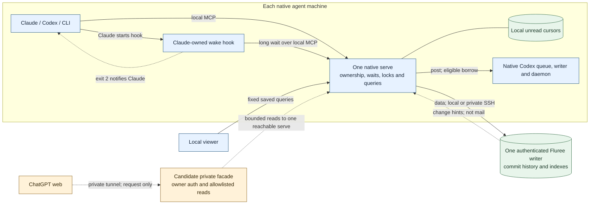

# Where Agent Bus should run

Decision-support research commissioned 2026-11-07, against source `84c94fb`. This is not a deployment decision or a description of shipped hosting support. The accepted [native packaging frame](../frames/product-continuation.md) is a separate implementation and qualification lane.

## Recommendation

**Keep delivery native and finish the accepted source-independent package. Do not containerize Agent Bus for the current workflow.** A container can make a Linux process reproducible; it cannot make an existing Mac thread or its owning writer available, and it is not needed to detach Agent Bus releases from a checkout. The current topology already separates a shared transaction store from delivery on each agent machine.

Private web access and storage placement are separate decisions:

- **Private web reading:** the [already-requested ChatGPT web lane](../frames/product-continuation.md#private-chatgpt-web-access-candidate) continues separately. Qualify owner access, intended disclosure and actual ChatGPT client behavior before activating the authenticated read-only facade and outbound tunnel on an existing host. The facade must not become a second store reader, an alternate query engine, or a remote native MCP proxy. It does not wake an agent.
- **Storage availability:** if a sleeping, logged-out, or unavailable *storage host* demonstrably interrupts work on a different, awake agent host, consider relocating the **one** Fluree transaction server to a private always-on host. First compare the operational cost with improving availability and recovery on the current storage host. On Linux, use a pinned native service by default; choose an image only if the operator's existing container practice makes ownership, updates and restore easier. Neither choice wakes a sleeping recipient.

The demonstrated problems point in different directions: packaging addresses the current checkout dependency; [the deploy record](../runbooks/deploy.md#before-you-start) records a tunnel reconnection to address latency. The independent operating review found a further tunnel interruption affecting a native participant, not evidence that the storage host had failed. The runbooks describe what a stale ledger restore does to a cursor but do not show a qualified ledger backup and restore. That recovery gap is worth addressing independently of container or host placement; backup custody was not audited.

## What has to stay with the agent

**Stored, observable, nudged and read are different outcomes.** A Fluree commit is stored. A pinned query can observe it, within its result limits. A wake signals eligible unread mail to a particular owner; a queue item is not proof a turn ran. Only the owner's successful consuming read acknowledges its messages. An observer does not acquire that authority.

The storage placement is adjustable. The native agent boundary and the distinction between an observation and a consuming read are not.

| Responsibility | Execution, state and authority today | Placement consequence |
| --- | --- | --- |
| Agent entry, ownership and unread position | Native plugin/CLI use local MCP. One `serve` per machine stamps join origin, checks the claimed session against ledger presence, serializes reads/delivery per address and keeps local cursor files by ledger incarnation. | Keep native `serve` and its private config, credential and cursor root. The host/session conventions are not network principal authentication or replica fencing. |
| Codex delivery | `serve` spawns the user's app-server for queue list/add/delete/read; it shares the native thread files, queue and writer locks. Eligible borrows use the native daemon's private Unix socket; the writer, not Bus, runs the queued turn. | Keep the native CLI, user home and daemon together. A different Linux app-server can own *different* threads, not replace the existing Mac desktop writer or its tools. |
| Claude delivery and compact recovery | Claude starts a native hook; it calls local MCP with that session ID and signals through `asyncRewake` exit 2. Waits and wake marks live in that `serve`; compact recovery reads holdings and supplies context, not ownership. | The hook remains native even if TCP requests can reach elsewhere. A suspended, ended or unarmed Claude session does not get a turn just because a service accepts its wait. |
| Commit history and indexes | One Fluree transaction server owns the ordered log, stored presence and commands, configuration, indexes and durable files. Other agent machines already reach it through SSH. Data/admin use a bearer token; the private event stream carries hints. | Keep one authoritative history and private path. Manage token and signing-key custody separately from release files or images. No peer, replica or writable local fallback is needed for relocation. |
| Query contract and traversal state | `QueryGateway` pins the cut; MCP bounds, projects and labels results. Each serving process has its own query pool and expiring held ranked selections. | Keep a ranked traversal on one upstream process. Expiry or restart requires a new search if a held ranking was lost; do not transparently rerank or call unchecked results complete. |
| Viewer and proposed facade | Viewer is a separate loopback process over fixed saved queries, with no store credential. The proposed facade would use approved public projections from existing Bus MCP, not host a new gateway or use the viewer as an auth layer. | Observation can move more easily than delivery. An independently hosted observer still needs a live, reachable upstream unless a different data path is expressly designed and qualified. |
| Releases and supervision | Today the launcher binds Bun to live source; launchd starts native jobs and hooks follow Claude. Packaging proposes a versioned, reversible cohort for `serve`, CLI, hooks, plugin and viewer. Store, secrets and cursors are separate. | Packaging addresses source coupling and rollback without introducing a VM. Neither a release pointer nor an image tag changes native plugin caches or already-running hooks atomically. |

**Read in source:** [origin, ownership, cursor and wake logic](../../src/Bus.ts), [native Codex delivery](../../src/codex.ts), [Claude hook](../../src/claude.ts), [compact recovery](../../src/compact.ts), [entrypoint and config](../../src/bin.ts), [file cursors](../../src/Cursors.ts), [HTTP bind and Host guard](../../src/serve.ts), [store integration](../../src/Fluree.ts), [MCP resource ownership](../../src/mcp.ts), [held selections](../../src/RankedSelections.ts), [viewer reader](../../viewer/server/reader.ts), and [LaunchAgent installer](../../scripts/install-launch-agents.sh). The corresponding [topology](../architecture/topology.md), [delivery](../architecture/delivery.md), [messaging](../architecture/messaging.md), [trust](../architecture/connections.md), and [viewer](../architecture/viewer.md) rules describe the operating contract.

**Important distinction:** `serve --host` only selects targets for the Codex deliverer. A join's `origin.host` and the Claude wake filter still use the serving process's actual hostname (matched on the lowercased first DNS label). A different container hostname would stop matching existing Mac-origin Claude joins and be recorded for new ones. Branch/repo enrichment also looks up the caller's path from that process. Changing a name or adding a TCP forward does not move the queue, provide the Git checkout, move a cursor or fence a second writer. A rejoin or takeover on another machine may select a different cursor or start at the decision head; it is not lossless handoff. Guarded presence writes do not fence an ordinary send or cursor read already in flight on another machine.

## Which arrangements buy anything

| Arrangement | What it could improve | What it costs or cannot do | Disposition |
| --- | --- | --- | --- |
| **Packaged native** on existing topology | Exact release identity, no active source dependency, explicit activation and code rollback; no new network or VM. | Still needs native installs and cache refresh, one live store, backups and a working private path. A release proof must include an actual hook and client, not just a healthy process. | **Do now** under the accepted packaging lane. Not yet delivered by this research. |
| **Local Docker on Mac**, whole Bus | Image build and dependency pinning. | Linux VM cannot run the Mac app-server binary or share the native kernel's private Unix sockets, launchd jobs or desktop ownership via TCP. Sharing user homes risks locks, queue and credential access; a native bridge would retain the native failure domain and add authority. | **Reject for current workflow.** Neither image build nor published port disproves the delivery failure. |
| **Local Docker on Mac**, Fluree or observer only | A vendor image pins a Linux Fluree build and userspace; volumes separate files from image churn. An observer has a smaller portable surface. | Adds Docker Desktop availability, disk and log management, explicit ports and volume backup/restore without surviving the Mac's sleep. An observer still depends on an upstream. | **No demonstrated advantage.** Revisit only for a maintenance improvement over the native service. |
| **Split: native delivery, private Linux Fluree** (native binary or container) | Decouples commits and query data from the Mac currently storing them. Other awake agent hosts may keep working if that Mac is off. | Adds a new host, private network dependency for *every* agent machine, data custody, credentials, patching, monitoring and tested recovery. Still one store, no offline local writes, and no web reads unless a `serve` stays reachable. The prior storage host loses its local path during network loss. | **Feasible in shape; defer.** Choose placement for the measured availability need before choosing runtime. |
| **All remote**, including central `serve` | New remote-owned work can run where its writer, worktree, tools and Bus are co-located. A laptop can be only the UI for a remote [Codex SSH project](../platforms/codex.md#across-machines-ssh-projects). | Existing native joins, local cursors, queue/daemon authority and hooks cannot be transparently moved or safely reached by exposing MCP. A remote project's tools need not match the native desktop's, and the path still needs a supported, ready agent. | **Reject as replacement.** If a new job must continue without the viewing laptop, first consider the existing native remote-project placement, not migration of the local thread. |

Compare Fluree OCI against an **exact native Fluree binary** under a service manager. Today the installer captures the executable path from `PATH` when rendering its [Fluree LaunchAgent](../runbooks/upgrade.md#after-upgrading-fluree), not a verified immutable target. Pinning that target does not require adding Fluree to the Bus release cohort or a container.

The strongest OCI candidate does not need a custom Bus image: Fluree documents its [non-root server image and volume](https://github.com/fluree/db/blob/v4.2.4/docs/operations/docker.md#whats-in-the-image), and the [registry tag](https://hub.docker.com/v2/repositories/fluree/server/tags/4.2.4) lists Linux arm64 and amd64. That is artifact availability, not a Bus compatibility test. A real candidate would pin the digest, retain private ports and authentication, verify effective index configuration, and manage its volume and backup separately. Image rollback is not storage rollback. Existing [disposable native checks](../runbooks/upgrade.md#after-upgrading-fluree) already exercise the relevant qualification path without an engine; a container would not replace the required native release rehearsal.

If the problem is logout, a login-independent **store** supervisor may be smaller than moving data. If it is loss of power, same-host startup improvements can only shorten recovery. A pre-login supervisor and auto-restart do not guarantee access to a locked FileVault volume. [Apple documents SSH unlock after restart](https://support.apple.com/guide/security/sec8447f5049/web) on supported Apple silicon systems with Remote Login and network access; that still requires an authorized unlock and was not tested here. Do not weaken encryption or move native delivery out of the agent's user session for either case.

### Why Docker Desktop is not a host integration

- **Version anchor:** one current Mac reports macOS 27.0 on arm64, Docker Desktop 4.55.0 in the app bundle and Docker CLI 29.1.3. [The matching release notes](https://docs.docker.com/desktop/release-notes/#4550) list Engine 29.1.3 for that bundle; this does not attest a running engine or another host's installed version/settings. The [Bus platform register](../platforms/README.md#installed-versions) records the previously qualified native versions. Bun's [platform distributions](https://bun.com/docs/installation) and the [Fluree release](https://github.com/fluree/db/releases/tag/v4.2.4) support evaluating a Linux build independently of the Mac launchers.
- **Network:** [Desktop runs the engine in a Linux VM](https://docs.docker.com/desktop/features/networking/). Ordinary port publishing forwards to the container's network, not to an arbitrary loopback socket inside it; publishing without a host address may listen on all interfaces. Desktop's [opt-in host mode](https://docs.docker.com/engine/network/drivers/host/#docker-desktop) is TCP/UDP, not Linux kernel namespace or Unix-socket sharing across macOS and the VM. A host-mode setting or explicit local forwarding may solve reachability only. Even a loopback-bound forwarded Bus endpoint still trusts callers as local; rewriting Host to make the check pass is not authentication. [Docker publishing](https://docs.docker.com/engine/network/port-publishing/) and [MCP transport security](https://modelcontextprotocol.io/specification/2025-06-18/basic/transports#security-warning) explain these distinct boundaries.
- **Files and identity:** [bind mounts](https://docs.docker.com/engine/storage/bind-mounts/) expose files through the VM sharing layer (on a remote engine, from the *engine* host, not the operator's Mac). [Container root](https://docs.docker.com/desktop/setup/install/mac-permission-requirements/#containers-running-as-root-within-the-linux-vm) does not become the Mac desktop user. Seeing a socket path, queue DB or worktree in a mount is not sharing socket endpoints, native app identity or qualified writer-lock semantics. Do not mount live homes or turn the Docker API into a native bridge.
- **Lifecycle and recovery:** [Desktop startup](https://docs.docker.com/desktop/settings-and-maintenance/settings/#general) is configurable at sign-in, and [restart policies](https://docs.docker.com/engine/containers/start-containers-automatically/) apply under a running engine. They do not give an asleep or powered-off Mac a running guest. Native [LaunchAgents are user-login scoped](https://developer.apple.com/library/archive/documentation/MacOSX/Conceptual/BPSystemStartup/Chapters/CreatingLaunchdJobs.html); the baseline is not always-on either. A [named volume](https://docs.docker.com/engine/storage/volumes/) outlives a container but is not a backup and is not included in the image ([Desktop recovery](https://docs.docker.com/desktop/settings-and-maintenance/backup-and-restore/)). Linux Engine can be boot-supervised [by systemd](https://docs.docker.com/engine/install/linux-postinstall/#configure-docker-to-start-on-boot-with-systemd), as can a native Fluree service; any container user, volume permissions, engine privileges and shutdown behavior must be qualified on that exact host. Podman does not change the missing Mac agent authority and needs no separate trial.

On a **Linux Engine host**, host mode can share that Linux host's network namespace, not the desktop Mac's. Network sharing alone still does not supply the right user, queue, files, daemon or agent process. A same-kernel Linux integration could be more feasible, but would qualify a Linux-owned workload, not replace the Mac's session or avoid the proof of native delivery.

A **new Linux agent machine** need not host Fluree. It can keep its own native `serve`, private route to the existing store and a distinct stable hostname. It would need a Linux supervisor instead of the LaunchAgent installer, a matching native CLI selected by `--codex`, and real queue, writer, borrow and hook qualification for the workflows it serves.

### What survives loss of a machine or connection

| Loss | What is still possible | What does not follow |
| --- | --- | --- |
| One recipient Mac sleeps or disconnects, store and another agent host reachable | Another connected owner can commit mail addressed to the sleeping session. A reachable observer can see the commit. On return, the recipient's normal authorized path can read retained unread mail if state and ownership survive. | Nobody can infer its hook is armed, the Codex writer ran, or mail was read. Bus `active` is wake policy, not liveness. Closing Claude is not the same as a live idle hook; after ten minutes of failed calls, the hook stops and needs a native arming event. |
| Current storage host unavailable | Other native agents can still do work outside Bus. Previously committed history is durable subject to the actual store and backups. | No connected central-store substitute, no new accepted offline mail, no fresh Bus query or cursor delivery. A backup is not an active second writer. |
| All existing agent hosts unavailable, relocated store still reachable | The store and its committed history can remain available on the storage host. | The proposed web path is connector/facade, then a live `serve`, then Fluree. Hosting only the store cannot make that path work. An always-on Bus endpoint serving queries would be a separate qualified choice, not authority to grant the facade store credentials. |
| Remote observer or tunnel unavailable; native services and store healthy | Local agents continue messaging and waking. | A healthy tunnel control plane cannot answer without the connector, facade and reachable upstream; a web read is not out-of-band delivery. |

The [Secure MCP Tunnel](https://developers.openai.com/api/docs/guides/secure-mcp-tunnels#what-is-an-mcp-tunnel) provides an outbound request path to an already reachable server. It doesn't authorize the owner or tunnel the browser's OAuth login, and it does not require container hosting. Reuse the proposed existing adapter only after checking actual ChatGPT discovery, visible bounded results, auth/revocation, refusal of tools outside the read allowlist, and no cursor change. Authorize whole-bus public projections explicitly: the word *public* here describes a tool projection, not a permission to disclose it, and projection is not secret filtering. Use bounded admission and deadlines ahead of the shared query pool, with a stable upstream for continued ranked traversal. Do not proxy raw `serve` or grant the facade a Fluree credential.

## What would change the decision

1. **Availability or lower maintenance, not buildability.** Show that the storage host, rather than the recipient's host, session state or private link, is blocking useful work. Identify which hosts and job must work during which outage. Independently, a maintained Fluree image on an already-operated engine can earn its place by simplifying upgrades or tested restores. Compare the same pinned Fluree release, protection and restore outcome. Native is the simpler default here, not demonstrated runtime superiority.
2. **Exact-history handoff, not healthy endpoints.** Fence writes to the old server and verify the new store at the same ledger incarnation **and exact frozen head commit** before any native `serve` connects; startup can create a missing ledger. A shared name, first commit and numeric `t` still allow a diverging suffix and skipped or duplicate mail. Leave native cursors in place; expose one authoritative writable endpoint. A rehearsal must verify the preserved prefix, guarded changes, index and pinned/ranked reads, plus consumed/unread sentinels. Check authenticated data access and the tokenless event stream *inside* the private path (or deliberate polling-only degradation), including reconnect. Do not retry ambiguous mutation requests transparently: a lost response may hide a committed publish. Before new writes, abort can return to the unchanged old store; after them, rollback must retain the new commits. [Current recovery](../runbooks/recover.md) distinguishes an older head from a different incarnation. Exact-version Fluree [configuration](https://github.com/fluree/db/blob/v4.2.4/docs/operations/configuration.md), [backup](https://github.com/fluree/db/blob/v4.2.4/docs/operations/storage.md#backup-and-recovery) and [event](https://github.com/fluree/db/blob/v4.2.4/docs/operations/query-peers.md) docs support the components, not the migration's guarantees.
3. **New remote work or a supported native boundary.** A new job that must continue while its viewing laptop is off can start on an already-awake native host if its needed tools and permission profile work there. That does not move the current thread or imply desktop-tool parity. Moving `serve` away from an existing native writer is a different proposition: a supported bridge would need to preserve identity, settlement, interruption and exclusive owner authority, then demonstrate a real native wake and correlated read. Private IPC, replacement writers, broad mounts and privilege workarounds do not count. See the [Codex app-server guide](https://learn.chatgpt.com/docs/app-server), [qualified Codex boundaries](../platforms/codex.md), and [Claude hook contract](https://code.claude.com/docs/en/hooks#command-hook-fields); a documented general API is not evidence of parity with the installed native integrations.

**Probe decision:** no runtime hosting probe. A listener, mapped directory or image can pass without addressing the deciding fault. Even a successful `.flpack` round trip would choose a backup method, not a host. If an actual placement requirement emerges, involve the testing-design steward before a bounded synthetic-data rehearsal and name the oracle and cleanup first.

**Smallest next story:** qualify the accepted, relocated native release with rollback and real-client verification. The already-requested private web-reading lane proceeds separately, with access, disclosure and actual-client qualification before activation. If a separate operations follow-up is commissioned, prefer a native backup/restore rehearsal at a known head and diagnosis of the existing private path over adding a host. None requires Docker.

For that recovery story, Fluree documents a quiesced file backup and [full-history `.flpack` restore](https://github.com/fluree/db/blob/v4.2.4/docs/operations/pack-archive-restore.md) that imports the original content-addressed commit chain. Neither has been qualified here as a Bus restore; verify the same ledger name, first commit and exact head before interpreting any existing cursor.

## Charter and evidence record

- **Question and scope.** Compare the native packaged baseline, Mac Docker, private Linux hosting and split/all-remote placement by outcomes: install, upgrade, rollback, availability, recovery, access and support. Keep native workflows, ownership, unread position, durable history and honest queries intact. No production changes, public ingress, purchasing, container-engine setup, orchestration, replacement writers, private IPC, multi-tenant redesign or packaging scope changes.
- **Phases and ownership.** Codex owns source tracing, the common artifact and synthesis. A separately commissioned native Claude partner owns the independent operating map, candidate comparison and challenge. Compare before probing; a probe needs a decision-reversing question and testing-design review. Obtain a focused independent Codex architecture challenge before final synthesis. Only evidence that changes the recommendation extends research; neither peer nor an image build authorizes activation.
- **Evidence strength.** The table and code links are source-read on the named revision. Installed app/CLI versions were inspected read-only on one Mac. Platform pages link prior version-pinned live and disposable evidence, not new observations made here. Vendor guarantees are linked at the claim; candidate consequences are inferences. Exact network settings, Linux host placement, recovery workload, comparative latency/uptime, client qualification and user adoption were not measured. No engine was started, no native homes or ledger mounted, and no live configuration changed for this report.
- **Review:** Codex traced implementation; native Claude independently checked operations, compared candidates, and challenged the native default with a second reviewer. The state-machine steward added the exact-head and one-writer gates. Independent Codex and Claude challenges sharpened the native remote-project option, the requirement for a reachable `serve` to observe the store, and the maintenance-only case for an existing container host. The operating review sharpened the backup and tunnel gaps, without evidence of a storage-host failure. The proposed archive probe was deferred to recovery work because its result would not reverse this decision.
